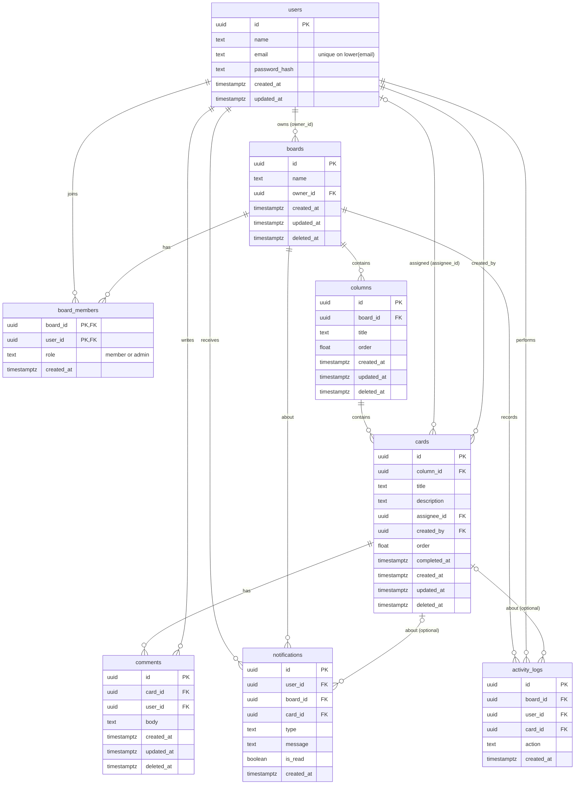

# Design Document: RevoTask Database Layer

## Overview

This document designs the PostgreSQL schema, SQLAlchemy models, migrations, connection handling, seed command and reference queries for RevoTask. Eight tables are defined: `users`, `boards`, `board_members`, `columns`, `cards`, `comments`, `notifications` and `activity_logs`.

The backend spec (blueprints with `routes.py`, `service.py`, `schema.py`) imports these models from `app/models/`. Routes, request validation and UI stay out of scope. The guidelines file `/guidelines/database.md` is written later and must match this document.

### Key design decisions

| # | Decision | Rationale |
|---|----------|-----------|
| D1 | Every rule that a requirement says the Database must reject is a PostgreSQL constraint (NOT NULL, CHECK, FK, UNIQUE), not only a Python validator. | Requirements 1 to 8 describe database-level rejection. Raw SQL and future services get the same protection. |
| D2 | Text limits are `TEXT` columns plus `CHECK (char_length(...) BETWEEN a AND b)`. | One uniform error type (SQLSTATE 23514) for both empty and too-long values. `VARCHAR(n)` cannot reject the empty string. |
| D3 | `order` is `db.Float` (PostgreSQL `double precision`) with `CHECK ("order" > 0 AND "order" < 'Infinity')`. | Meets the "greater than zero" rule. In PostgreSQL `NaN` sorts above `Infinity`, so the upper bound also rejects `NaN` and `Infinity`. |
| D4 | `updated_at` is maintained by a `BEFORE UPDATE` trigger, not only by SQLAlchemy. | Requirements 1.6, 4.4 and 5.7 say the Database sets it, so raw SQL updates must also bump it. The trigger also pins `created_at`. |
| D5 | UUID primary keys use both a Python default (`uuid.uuid4`) and a server default (`gen_random_uuid()`). | Objects get ids before flush; raw inserts still get ids from the Database (Req 1.5). `gen_random_uuid()` is built in from PostgreSQL 13. |
| D6 | Case-insensitive email uniqueness uses a unique functional index on `lower(email)`. | No extension needed (unlike `citext`). Works on Railway without privileges. |
| D7 | Role is `TEXT` with a CHECK, not a native PostgreSQL ENUM. | Adding a role later is a plain constraint change, not an `ALTER TYPE`. |
| D8 | Mixins are split: `TimestampMixin`, `SoftDeleteMixin`, `CreatedAtMixin`, `UUIDPrimaryKeyMixin`. | The requirements give `deleted_at` only to `boards`, `columns`, `cards` and `comments`, and only `created_at` to `board_members`, `notifications` and `activity_logs`. One all-in-one mixin would add columns the requirements do not define. |
| D9 | FK delete rules follow ownership. Children owned by a parent use `CASCADE`. Authorship and ownership references use `RESTRICT`. Optional references use `SET NULL`. | Satisfies Req 4.7, 8.3 to 8.5 and 8.7. Full table in [Foreign keys](#foreign-keys). |
| D10 | Reference queries live in `app/models/queries.py` and are tested here. Backend services call them. | Requirement 7 is about what the Schema allows to be computed, so the queries are part of the verified deliverable. |
| D11 | Migrations run as a Railway pre-deploy/release command (`flask db upgrade`), never implicitly at app start. | Avoids concurrent migration runs from multiple app instances. |

### Research findings

- **Railway connection.** Railway provides `DATABASE_URL` for its PostgreSQL service, and it uses the private network host by default. Running migrations from a local machine needs the public proxy URL ([Railway help thread](https://help.railway.app/questions/help-with-connecting-to-db-c425ee31)). Railway's PostgreSQL template serves TLS on both private and public hostnames ([Railway PostgreSQL template](https://railway.com/deploy/postgresql)). Railway injects `RAILWAY_PROJECT_ID` and other `RAILWAY_*` variables into every service ([Railway variables reference](https://docs.railway.com/reference/variables)), so the code detects Railway with `RAILWAY_PROJECT_ID` or `RAILWAY_ENVIRONMENT_NAME`.
- **Functional index and Alembic.** Alembic autogenerate has a history of mishandling expression-based indexes such as `lower(col)`, and older SQLAlchemy versions skipped reflecting them ([Alembic issue #676](https://github.com/sqlalchemy/alembic/issues/676), [alembic-utils-extended notes](https://pypi.org/project/alembic-utils-extended/)). Mitigation: pin SQLAlchemy 2.x with a current Alembic, hand-review the first migration, and add a "zero diff" test for Requirement 10.5 (see [Testing Strategy](#testing-strategy)). Fallback if a spurious diff appears: skip that one index in an `include_object` hook and keep it in the hand-written migration.
- **Not detected by autogenerate.** Alembic does not detect CHECK constraint changes or triggers. Those parts of the initial migration are written by hand, and later constraint changes must be too.

*Content was rephrased for compliance with licensing restrictions.*

## Architecture


### Directory layout

```
app/
  __init__.py          create_app()
  extensions.py        db (with naming convention), migrate
  db_config.py         DATABASE_URL handling, engine options, verify_connection
  seed.py              `flask seed` command
  models/
    __init__.py        imports every model (so Alembic sees all tables)
    mixins.py          UUIDPrimaryKeyMixin, TimestampMixin, SoftDeleteMixin, CreatedAtMixin
    user.py            User
    board.py           Board, BoardMember
    column.py          BoardColumn  (table "columns")
    card.py            Card
    comment.py         Comment
    notification.py    Notification
    activity_log.py    ActivityLog
    queries.py         reference queries (Requirement 7)
migrations/            Flask-Migrate / Alembic
tests/database/        pytest + Hypothesis
```

The class for the `columns` table is named `BoardColumn` to avoid confusion with `db.Column`.

## Components and Interfaces

### 1. Extensions (`app/extensions.py`)

```python
from flask_sqlalchemy import SQLAlchemy
from flask_migrate import Migrate
from sqlalchemy import MetaData

NAMING_CONVENTION = {
    "ix": "ix_%(column_0_label)s",
    "uq": "uq_%(table_name)s_%(column_0_name)s",
    "ck": "ck_%(table_name)s_%(constraint_name)s",
    "fk": "fk_%(table_name)s_%(column_0_name)s_%(referred_table_name)s",
    "pk": "pk_%(table_name)s",
}
db = SQLAlchemy(metadata=MetaData(naming_convention=NAMING_CONVENTION))
migrate = Migrate()
```

A naming convention gives every constraint a stable name, so Alembic can drop and alter them and error messages identify the failing constraint.

### 2. Configuration and connection (`app/db_config.py`) (Requirement 11)

```python
import os, time
from sqlalchemy import text
from sqlalchemy.exc import OperationalError

CONNECT_TIMEOUT_S = 10
MAX_CONNECT_ATTEMPTS = 3

class DatabaseConfigError(RuntimeError): ...
class DatabaseUnreachableError(RuntimeError): ...

def normalize_database_url(raw: str | None) -> str:
    """Req 11.2, 11.3, 11.5. Reads nothing but its argument."""
    if raw is None or not raw.strip():
        raise DatabaseConfigError("DATABASE_URL is not set or is empty")
    if raw.startswith("postgres://"):
        return "postgresql://" + raw[len("postgres://"):]   # only the scheme changes
    return raw

def running_on_railway(env=os.environ) -> bool:
    return bool(env.get("RAILWAY_PROJECT_ID") or env.get("RAILWAY_ENVIRONMENT_NAME"))

def engine_options(env=os.environ) -> dict:
    """Req 11.4, 11.6. connect_timeout bounds each attempt to 10 s (libpq)."""
    connect_args = {"connect_timeout": CONNECT_TIMEOUT_S}
    if running_on_railway(env) or env.get("DB_REQUIRE_SSL") == "1":
        connect_args["sslmode"] = "require"
    return {"pool_pre_ping": True, "connect_args": connect_args}

def verify_connection(engine, *, attempts=MAX_CONNECT_ATTEMPTS, delay=1.0, sleep=time.sleep):
    """Req 11.6, 11.7. Up to `attempts` tries; error text never contains the password."""
    for n in range(1, attempts + 1):
        try:
            with engine.connect() as conn:
                conn.execute(text("SELECT 1"))
            return
        except OperationalError:
            if n < attempts:
                sleep(delay)
    safe_url = engine.url.render_as_string(hide_password=True)
    raise DatabaseUnreachableError(
        f"Database unreachable after {attempts} attempts: {safe_url}"
    ) from None   # drop the driver exception chain
```

`DB_REQUIRE_SSL=1` lets a developer force SSL when running `flask db upgrade` from a laptop against Railway's public proxy URL, where `RAILWAY_*` variables are absent.

### 3. App factory wiring (`app/__init__.py`)

```python
def create_app(verify_db: bool = True) -> Flask:
    app = Flask(__name__)
    uri = normalize_database_url(os.environ.get("DATABASE_URL"))   # raises BEFORE any engine exists
    app.config.update(
        SQLALCHEMY_DATABASE_URI=uri,
        SQLALCHEMY_ENGINE_OPTIONS=engine_options(),
        SQLALCHEMY_TRACK_MODIFICATIONS=False,
    )
    db.init_app(app)                       # Flask-SQLAlchemy creates engines here
    migrate.init_app(
        app, db,
        compare_type=True,
        render_as_batch=False,             # batch mode is for SQLite only
        transaction_per_migration=True,    # Req 10.6: failed revision does not undo earlier ones
        process_revision_directives=skip_empty_revision,   # Req 10.5
    )
    from app import models  # noqa: F401   (register tables)
    from app.seed import seed_command
    app.cli.add_command(seed_command)
    if verify_db:
        with app.app_context():
            verify_connection(db.engine)
    return app
```

`skip_empty_revision` is the standard Alembic hook that clears `script.upgrade_ops` when there are no operations, so `flask db migrate` writes no file when models match the database.

### 4. Mixins

Code in [Data Models](#shared-mixins-appmodelsmixinspy).

### 5. Migration strategy (Requirement 10, 9.9)

1. **Single linear history.** `flask db init` once. Each change is one `flask db migrate -m "..."` followed by a manual review. CI runs `flask db heads` and fails unless exactly one head exists (Req 10.1).
2. **Initial revision `0001_initial_schema`.** Generated by autogenerate, then edited by hand to add:
   - the `set_updated_at()` function and five triggers (users, boards, columns, cards, comments),
   - all CHECK constraints and the `lower(email)` unique index, if autogenerate omits or misrenders them,
   - index creation through a helper that names the failing index (Req 9.9):
     ```python
     def _create_index(name, table, cols, **kw):
         try:
             op.create_index(name, table, cols, **kw)
         except Exception as exc:
             raise RuntimeError(f"Failed to create index {name}") from exc
     ```
3. **Transactional DDL.** PostgreSQL runs DDL in transactions, and `transaction_per_migration=True` wraps each revision in its own transaction. A failing revision rolls back completely, earlier revisions stay applied, and the command exits non-zero with Alembic's message naming the revision (Req 10.6, 9.9).
4. **Downgrade.** Each revision implements `downgrade()`. The initial one drops triggers, the function, indexes and tables in reverse dependency order (Req 10.4).
5. **Idempotent upgrade.** Alembic skips revisions already applied, so a second `flask db upgrade` is a no-op with exit status 0 (Req 10.3).
6. **Drift check.** `flask db check` (Flask-Migrate 4) exits non-zero if the models differ from the latest revision. CI runs it after `flask db upgrade` on an empty database (Req 10.2, 10.5).
7. **Deploy.** Railway pre-deploy command: `flask db upgrade`. Do not call `upgrade()` from `create_app`.
8. **Later constraint or trigger changes** are written by hand, because autogenerate does not see them.

### 6. Seed command (`app/seed.py`) (Requirement 12)

`flask seed [--force]`. Behavior:

- Refuses to run on Railway unless `--force` is passed, because the seed users have a known development password.
- Uses **deterministic UUIDs**: `uuid.uuid5(SEED_NAMESPACE, "<kind>:<natural key>")`. Re-running generates the same ids.
- Inserts with `postgresql.insert(...).on_conflict_do_nothing()`, so repeat runs add nothing (Req 12.2).
- Runs in one transaction. On any exception it rolls back, prints `Seeding failed: <cause>` and exits with status 1 (Req 12.4). On success it prints `Seeding finished.` and exits 0 (Req 12.3).
- Password for both users comes from `SEED_PASSWORD` (default `revotask-dev`), hashed with `werkzeug.security.generate_password_hash`.

| Entity | Rows |
|--------|------|
| users | `alice@revotask.test` (Alice), `bob@revotask.test` (Bob) |
| boards | "RevoTask Demo", owner Alice |
| board_members | Alice `admin`, Bob `member` |
| columns | "To Do" `order=1.0`, "In Progress" `2.0`, "Done" `3.0` |
| cards | To Do: 2 cards (`1.0`, `2.0`); In Progress: 2 cards (`1.0`, `2.0`); Done: 1 card (`1.0`). Assignees alternate between Alice and Bob; `created_by` is Alice. |

```python
@click.command("seed")
@click.option("--force", is_flag=True)
@with_appcontext
def seed_command(force):
    if running_on_railway() and not force:
        raise click.ClickException("Refusing to seed a Railway database without --force")
    try:
        _insert_all()          # all inserts use ON CONFLICT DO NOTHING
        db.session.commit()
    except Exception as exc:
        db.session.rollback()
        raise click.ClickException(f"Seeding failed: {exc}")   # exit status 1
    click.echo("Seeding finished.")
```

If a non-seed user already owns one of the seed emails, the insert is skipped and the membership insert fails its foreign key. The run then rolls back and reports the cause. This only happens on a database that is not empty.

### 7. Reference queries (`app/models/queries.py`) (Requirement 7, 9.8)

All queries use the SQLAlchemy 2.0 `select()` style. A card is "live" when `cards.deleted_at IS NULL`. Queries also hide cards whose column or board is soft-deleted, since soft-deleting a parent must hide its contents. That extra filter does not change results when parents are not deleted.

```python
from datetime import datetime, time, timedelta, timezone
from sqlalchemy import select, func, and_, or_
from app.extensions import db
from app.models import User, Board, BoardMember, BoardColumn, Card, ActivityLog, Notification

UTC = timezone.utc

def week_bounds_utc(now: datetime) -> tuple[datetime, datetime]:
    """Monday 00:00 UTC (inclusive) and next Monday 00:00 UTC (exclusive)."""
    now = now.astimezone(UTC)
    monday = now.date() - timedelta(days=now.weekday())
    start = datetime.combine(monday, time.min, tzinfo=UTC)
    return start, start + timedelta(days=7)

# 7.2  Cards per column; empty columns return 0 (outer join, deleted_at test in ON clause)
def card_counts_per_column(board_id):
    return db.session.execute(
        select(BoardColumn.id, BoardColumn.title, func.count(Card.id).label("card_count"))
        .outerjoin(Card, and_(Card.column_id == BoardColumn.id, Card.deleted_at.is_(None)))
        .where(BoardColumn.board_id == board_id, BoardColumn.deleted_at.is_(None))
        .group_by(BoardColumn.id, BoardColumn.title, BoardColumn.order)
        .order_by(BoardColumn.order)
    ).all()

# 7.3  Completed this week
def completed_this_week(board_id, now=None):
    start, end = week_bounds_utc(now or datetime.now(UTC))
    return db.session.scalar(
        select(func.count(Card.id))
        .join(BoardColumn, Card.column_id == BoardColumn.id)
        .where(BoardColumn.board_id == board_id,
               Card.deleted_at.is_(None),
               Card.completed_at >= start, Card.completed_at < end)
    )

# 7.4  Member activity: members with 0 logs appear, ex-members appear only if they have logs
def member_activity(board_id):
    member_ids = select(BoardMember.user_id).where(BoardMember.board_id == board_id)
    actor_ids = select(ActivityLog.user_id).where(ActivityLog.board_id == board_id)
    return db.session.execute(
        select(User.id, User.name, func.count(ActivityLog.id).label("actions"))
        .outerjoin(ActivityLog, and_(ActivityLog.user_id == User.id,
                                     ActivityLog.board_id == board_id))
        .where(or_(User.id.in_(member_ids), User.id.in_(actor_ids)))
        .group_by(User.id, User.name)
    ).all()

# 7.5  "Assigned to me", grouped by board name in Python with itertools.groupby
def my_tasks(user_id):
    return db.session.execute(
        select(Board.id, Board.name, Card)
        .join(BoardColumn, BoardColumn.board_id == Board.id)
        .join(Card, Card.column_id == BoardColumn.id)
        .where(Card.assignee_id == user_id, Card.deleted_at.is_(None),
               BoardColumn.deleted_at.is_(None), Board.deleted_at.is_(None))
        .order_by(Board.name, BoardColumn.order, Card.order)
    ).all()

# 7.6  Case-insensitive substring search, title OR description; term is 1..200 chars
def search_cards(term: str, user_id=None):
    if not 1 <= len(term) <= 200:
        raise ValueError("search term must be 1 to 200 characters")
    stmt = (
        select(Card)
        .join(BoardColumn, Card.column_id == BoardColumn.id)
        .join(Board, BoardColumn.board_id == Board.id)
        .where(Card.deleted_at.is_(None), BoardColumn.deleted_at.is_(None),
               Board.deleted_at.is_(None),
               or_(Card.title.icontains(term, autoescape=True),          # ILIKE, % and _ escaped
                   Card.description.icontains(term, autoescape=True)))
    )
    if user_id is not None:   # optional scope: only boards the user belongs to
        stmt = stmt.join(BoardMember, and_(BoardMember.board_id == Board.id,
                                            BoardMember.user_id == user_id))
    return db.session.scalars(stmt).all()

# 6.3  Notification page: served by ix_notifications_user_id_created_at (backward scan)
def notifications_page(user_id, limit=20, offset=0):
    assert 1 <= limit <= 100 and 0 <= offset <= 1_000_000
    return db.session.scalars(
        select(Notification).where(Notification.user_id == user_id)
        .order_by(Notification.created_at.desc()).limit(limit).offset(offset)
    ).all()

# 9.8  Board load: three indexed queries, no N+1
def load_board(board_id):
    board = db.session.get(Board, board_id)
    columns = db.session.scalars(
        select(BoardColumn).where(BoardColumn.board_id == board_id,
                                  BoardColumn.deleted_at.is_(None))
        .order_by(BoardColumn.order)).all()
    cards = db.session.scalars(
        select(Card).where(Card.column_id.in_([c.id for c in columns]),
                           Card.deleted_at.is_(None))
        .order_by(Card.column_id, Card.order)).all()
    return board, columns, cards
```

Notes:
- `icontains(..., autoescape=True)` escapes `%`, `_` and the escape character, so a search for `50%` matches the literal text. Substring search with a leading wildcard cannot use a B-tree index. At the 5,000 cards per board scale in Requirement 9.8, a scan is acceptable. `pg_trgm` is a later option and is not part of this spec.
- When many cards share a position, ties are broken by the database's order. Services may add `Card.id` as a tie-breaker. Float positions between neighbours run out of precision after about 50 repeated halvings. Rebalancing (renumbering to 1.0, 2.0, ...) belongs to the backend spec.

### 8. Backend contract

The backend spec consumes this layer through these rules:

- Import models only from `app.models`; use `db.session` from `app.extensions`.
- Creating a board must, in one transaction, insert the `boards` row and the creator's `board_members` row with role `admin` (Req 2.5).
- Soft delete uses `SoftDeleteMixin.soft_delete()`. Reads filter with `Model.deleted_at.is_(None)`.
- Catch `sqlalchemy.exc.IntegrityError` and map `err.orig.pgcode` as listed in [Error Handling](#error-handling).
- Normalize emails to lower case before insert if the API wants to store them that way. The database does not require it.

## Data Models

### ER diagram



### Foreign keys

| Column | References | ON DELETE | Reason |
|--------|-----------|-----------|--------|
| `boards.owner_id` | `users.id` | RESTRICT | A board must keep an owner. Deleting such a user is rejected (Req 8.7). |
| `board_members.board_id` | `boards.id` | CASCADE | Req 8.3 |
| `board_members.user_id` | `users.id` | CASCADE | Membership has no meaning without the user. |
| `columns.board_id` | `boards.id` | CASCADE | Req 8.3 |
| `cards.column_id` | `columns.id` | CASCADE | Req 8.4 |
| `cards.assignee_id` | `users.id` | SET NULL | Req 4.7 |
| `cards.created_by` | `users.id` | RESTRICT | Authorship is kept (Req 2.6, 4.1: NOT NULL). Deleting an author is rejected. |
| `comments.card_id` | `cards.id` | CASCADE | Req 8.5 |
| `comments.user_id` | `users.id` | RESTRICT | Authorship is kept. |
| `notifications.user_id` | `users.id` | CASCADE | A notification is addressed to the user and has no value without them. |
| `notifications.board_id` | `boards.id` | CASCADE | Req 8.3 |
| `notifications.card_id` | `cards.id` | SET NULL | Keep the message when a card is hard-deleted. |
| `activity_logs.board_id` | `boards.id` | CASCADE | Req 8.3 |
| `activity_logs.user_id` | `users.id` | RESTRICT | History keeps its actor. |
| `activity_logs.card_id` | `cards.id` | SET NULL | Keep history when a card is hard-deleted. |

Consequence of D9: a user who authored cards, comments or activity, or who owns a board, cannot be hard-deleted until that content is reassigned or removed. A future account-deletion spec decides how (for example, anonymization). `cards.assignee_id` and memberships never block a user delete. This is a deliberate trade-off. The alternative, making `created_by` nullable, contradicts Req 4.1.

### Shared mixins (`app/models/mixins.py`)

```python
import uuid
from datetime import datetime, timezone
from sqlalchemy.dialects.postgresql import UUID
from app.extensions import db

def _tstz(**kw):
    return db.Column(db.DateTime(timezone=True), **kw)

class UUIDPrimaryKeyMixin:
    id = db.Column(UUID(as_uuid=True), primary_key=True,
                   default=uuid.uuid4, server_default=db.text("gen_random_uuid()"))

class CreatedAtMixin:
    created_at = _tstz(nullable=False, server_default=db.func.now())

class TimestampMixin(CreatedAtMixin):
    # Maintained by trigger set_updated_at(); FetchedValue makes the ORM re-read it.
    updated_at = _tstz(nullable=False, server_default=db.func.now(),
                       server_onupdate=db.FetchedValue())

class SoftDeleteMixin:
    deleted_at = _tstz(nullable=True)

    def soft_delete(self) -> None:
        self.deleted_at = datetime.now(timezone.utc)

    def restore(self) -> None:
        self.deleted_at = None

    @property
    def is_deleted(self) -> bool:
        return self.deleted_at is not None
```

Which tables use which mixins:

| Table | UUID PK | `created_at` | `updated_at` | `deleted_at` |
|-------|:------:|:-----------:|:-----------:|:-----------:|
| users | yes | yes | yes | no |
| boards | yes | yes | yes | yes |
| board_members | composite PK | yes | no | no |
| columns | yes | yes | yes | yes |
| cards | yes | yes | yes | yes |
| comments | yes | yes | yes | yes |
| notifications | yes | yes | no | no |
| activity_logs | yes | yes | no | no |

The `UUID(as_uuid=True)` type is `sqlalchemy.dialects.postgresql.UUID`. A `User` has no `deleted_at` because Requirement 1 defines none and Requirement 4.7 treats user removal as a hard delete.

### Models

```python
# app/models/user.py
class User(UUIDPrimaryKeyMixin, TimestampMixin, db.Model):
    __tablename__ = "users"
    name = db.Column(db.Text, nullable=False)
    email = db.Column(db.Text, nullable=False)
    password_hash = db.Column(db.Text, nullable=False)       # salted hash only (Req 1.3)

    __table_args__ = (
        db.CheckConstraint("char_length(name) BETWEEN 1 AND 255", name="name_length"),
        db.CheckConstraint("char_length(email) BETWEEN 3 AND 254", name="email_length"),
        db.Index("uq_users_email_lower", db.func.lower(email), unique=True),   # Req 1.2, D6
    )
```

```python
# app/models/board.py
class Board(UUIDPrimaryKeyMixin, TimestampMixin, SoftDeleteMixin, db.Model):
    __tablename__ = "boards"
    name = db.Column(db.Text, nullable=False)
    owner_id = db.Column(UUID(as_uuid=True),
                         db.ForeignKey("users.id", ondelete="RESTRICT"), nullable=False)

    owner = db.relationship("User")
    members = db.relationship("BoardMember", back_populates="board", passive_deletes=True)
    columns = db.relationship("BoardColumn", back_populates="board", passive_deletes=True,
                              order_by="BoardColumn.order")

    __table_args__ = (
        db.CheckConstraint("char_length(name) BETWEEN 1 AND 255", name="name_length"),
    )


class BoardMember(CreatedAtMixin, db.Model):
    __tablename__ = "board_members"
    board_id = db.Column(UUID(as_uuid=True),
                         db.ForeignKey("boards.id", ondelete="CASCADE"), primary_key=True)
    user_id = db.Column(UUID(as_uuid=True),
                        db.ForeignKey("users.id", ondelete="CASCADE"), primary_key=True)
    role = db.Column(db.Text, nullable=False)

    board = db.relationship("Board", back_populates="members")
    user = db.relationship("User")

    __table_args__ = (
        db.CheckConstraint("role IN ('member', 'admin')", name="role_valid"),   # Req 2.4
        db.Index("ix_board_members_user_id", "user_id"),                         # Req 9.5
    )
```

The composite primary key on (`board_id`, `user_id`) is also the unique constraint required by Req 2.3 and gives the SQLSTATE 23505 error of Req 2.8.

```python
# app/models/column.py
class BoardColumn(UUIDPrimaryKeyMixin, TimestampMixin, SoftDeleteMixin, db.Model):
    __tablename__ = "columns"
    board_id = db.Column(UUID(as_uuid=True),
                         db.ForeignKey("boards.id", ondelete="CASCADE"), nullable=False)
    title = db.Column(db.Text, nullable=False)
    order = db.Column(db.Float, nullable=False)

    board = db.relationship("Board", back_populates="columns")
    cards = db.relationship("Card", back_populates="column", passive_deletes=True,
                            order_by="Card.order")

    __table_args__ = (
        db.CheckConstraint("char_length(title) BETWEEN 1 AND 255", name="title_length"),
        db.CheckConstraint('"order" > 0 AND "order" < \'Infinity\'', name="order_positive"),
        db.Index("ix_columns_board_id_order", "board_id", "order"),              # Req 9.3
    )
```

```python
# app/models/card.py
class Card(UUIDPrimaryKeyMixin, TimestampMixin, SoftDeleteMixin, db.Model):
    __tablename__ = "cards"
    column_id = db.Column(UUID(as_uuid=True),
                          db.ForeignKey("columns.id", ondelete="CASCADE"), nullable=False)
    title = db.Column(db.Text, nullable=False)
    description = db.Column(db.Text, nullable=True)
    assignee_id = db.Column(UUID(as_uuid=True),
                            db.ForeignKey("users.id", ondelete="SET NULL"), nullable=True)
    created_by = db.Column(UUID(as_uuid=True),
                           db.ForeignKey("users.id", ondelete="RESTRICT"), nullable=False)
    order = db.Column(db.Float, nullable=False)
    completed_at = db.Column(db.DateTime(timezone=True), nullable=True)

    column = db.relationship("BoardColumn", back_populates="cards")
    assignee = db.relationship("User", foreign_keys=[assignee_id])
    creator = db.relationship("User", foreign_keys=[created_by])
    comments = db.relationship("Comment", back_populates="card", passive_deletes=True)

    __table_args__ = (
        db.CheckConstraint("char_length(title) BETWEEN 1 AND 255", name="title_length"),
        db.CheckConstraint("description IS NULL OR char_length(description) <= 10000",
                           name="description_length"),
        db.CheckConstraint('"order" > 0 AND "order" < \'Infinity\'', name="order_positive"),
        db.Index("ix_cards_column_id_order", "column_id", "order"),              # Req 9.1
        db.Index("ix_cards_assignee_id", "assignee_id"),                         # Req 9.2
        db.Index("ix_cards_completed_at", "completed_at"),                       # Req 9.7
    )
```

```python
# app/models/comment.py
class Comment(UUIDPrimaryKeyMixin, TimestampMixin, SoftDeleteMixin, db.Model):
    __tablename__ = "comments"
    card_id = db.Column(UUID(as_uuid=True),
                        db.ForeignKey("cards.id", ondelete="CASCADE"), nullable=False)
    user_id = db.Column(UUID(as_uuid=True),
                        db.ForeignKey("users.id", ondelete="RESTRICT"), nullable=False)
    body = db.Column(db.Text, nullable=False)

    card = db.relationship("Card", back_populates="comments")
    author = db.relationship("User")

    __table_args__ = (
        db.CheckConstraint(r"body ~ '\S' AND char_length(body) <= 5000",         # Req 5.5
                           name="body_valid"),
        db.CheckConstraint("updated_at >= created_at", name="updated_after_created"),  # Req 5.7
        db.Index("ix_comments_card_id", "card_id"),                              # Req 9.4
    )
```

`body ~ '\S'` requires at least one non-whitespace character. It rejects the empty string and strings of only spaces, tabs or newlines.

```python
# app/models/notification.py
class Notification(UUIDPrimaryKeyMixin, CreatedAtMixin, db.Model):
    __tablename__ = "notifications"
    user_id = db.Column(UUID(as_uuid=True),
                        db.ForeignKey("users.id", ondelete="CASCADE"), nullable=False)
    board_id = db.Column(UUID(as_uuid=True),
                         db.ForeignKey("boards.id", ondelete="CASCADE"), nullable=False)
    card_id = db.Column(UUID(as_uuid=True),
                        db.ForeignKey("cards.id", ondelete="SET NULL"), nullable=True)
    type = db.Column(db.Text, nullable=False)
    message = db.Column(db.Text, nullable=False)
    is_read = db.Column(db.Boolean, nullable=False, default=False, server_default=db.false())

    __table_args__ = (
        db.CheckConstraint("char_length(type) BETWEEN 1 AND 50", name="type_length"),
        db.CheckConstraint("char_length(message) BETWEEN 1 AND 500", name="message_length"),
        db.Index("ix_notifications_user_id_created_at", "user_id", "created_at"),   # Req 6.3
    )
```

```python
# app/models/activity_log.py
class ActivityLog(UUIDPrimaryKeyMixin, CreatedAtMixin, db.Model):
    __tablename__ = "activity_logs"
    board_id = db.Column(UUID(as_uuid=True),
                         db.ForeignKey("boards.id", ondelete="CASCADE"), nullable=False)
    user_id = db.Column(UUID(as_uuid=True),
                        db.ForeignKey("users.id", ondelete="RESTRICT"), nullable=False)
    card_id = db.Column(UUID(as_uuid=True),
                        db.ForeignKey("cards.id", ondelete="SET NULL"), nullable=True)
    action = db.Column(db.Text, nullable=False)

    __table_args__ = (
        db.CheckConstraint("char_length(action) BETWEEN 1 AND 100", name="action_length"),
        db.Index("ix_activity_logs_board_id_created_at", "board_id", "created_at"),  # Req 9.6
    )
```

```python
# app/models/__init__.py
from .user import User
from .board import Board, BoardMember
from .column import BoardColumn
from .card import Card
from .comment import Comment
from .notification import Notification
from .activity_log import ActivityLog
```

### Index summary (Requirement 9)

| Index | Table | Keys | Serves |
|-------|-------|------|--------|
| `ix_cards_column_id_order` | cards | (`column_id`, `order`) | 9.1, cards of a column in order |
| `ix_cards_assignee_id` | cards | `assignee_id` | 9.2, my-tasks |
| `ix_columns_board_id_order` | columns | (`board_id`, `order`) | 9.3, columns of a board in order |
| `ix_comments_card_id` | comments | `card_id` | 9.4 |
| `ix_board_members_user_id` | board_members | `user_id` | 9.5, boards of a user |
| `ix_activity_logs_board_id_created_at` | activity_logs | (`board_id`, `created_at`) | 9.6 |
| `ix_cards_completed_at` | cards | `completed_at` | 9.7, weekly completion |
| `ix_notifications_user_id_created_at` | notifications | (`user_id`, `created_at`) | 6.3, backward scan gives `created_at DESC` |
| `uq_users_email_lower` | users | `lower(email)` unique | 1.2 |

Not indexed on purpose: `boards.owner_id`, `cards.created_by`, `comments.user_id` and `activity_logs.user_id`. They are scanned only when a user is hard-deleted (an infrequent operation), and the requirements do not ask for them.

### Database-side `updated_at` trigger (hand-written in migration `0001`)

```sql
CREATE FUNCTION set_updated_at() RETURNS trigger AS $$
BEGIN
    NEW.created_at := OLD.created_at;                          -- Req 1.6: created_at never changes
    NEW.updated_at := GREATEST(now(), OLD.updated_at);         -- Req 4.4: never moves backwards
    RETURN NEW;
END;
$$ LANGUAGE plpgsql;

-- repeated for users, boards, columns, cards, comments
CREATE TRIGGER trg_cards_set_updated_at BEFORE UPDATE ON cards
    FOR EACH ROW EXECUTE FUNCTION set_updated_at();
```

`now()` is the transaction start time. Within one transaction an insert followed by an update therefore leaves `updated_at` equal to `created_at`, which satisfies the "greater than or equal" rules in Requirements 4.4 and 5.7.

## Correctness Properties

*A property is a characteristic or behavior that should hold true across all valid executions of a system-essentially, a formal statement about what the system should do. Properties serve as the bridge between human-readable specifications and machine-verifiable correctness guarantees.*

Database properties run against a real PostgreSQL instance, because the behavior under test is the constraints, triggers and foreign keys themselves. Each generated example runs inside a transaction that is rolled back.

### Property 1: Email uniqueness is case-insensitive

*For any* valid email address and *for any* re-casing of its characters, inserting a second user with the re-cased email after the first is stored SHALL fail with a unique violation (SQLSTATE 23505), and the set of `users` rows SHALL be unchanged by the failed statement.

**Validates: Requirements 1.2, 1.4**

### Property 2: Bounded text fields accept exactly their length range

*For any* bounded text field in the registry (`users.name` 1-255, `users.email` 3-254, `boards.name` 1-255, `columns.title` 1-255, `cards.title` 1-255, `cards.description` 0-10,000 or NULL, `comments.body` at most 5,000, `notifications.type` 1-50, `notifications.message` 1-500, `activity_logs.action` 1-100) and *for any* string, or NULL for a NOT NULL field, the insert SHALL succeed if and only if the value is not NULL (unless nullable) and its length is within the range. A rejected statement SHALL raise a constraint violation and leave the table unchanged.

**Validates: Requirements 1.7, 2.9, 3.2, 3.5, 4.1, 5.5, 6.2, 7.1**

### Property 3: Comment bodies must contain a non-whitespace character

*For any* string made only of whitespace characters (including the empty string, tabs and newlines), inserting or updating `comments.body` to it SHALL be rejected, and *for any* string of at most 5,000 characters containing at least one non-whitespace character, it SHALL be accepted.

**Validates: Requirements 5.5**

### Property 4: Order values must be positive and finite

*For any* float `x` (including zero, negatives, `NaN` and infinities) stored as `order` in `columns` or `cards`, the statement SHALL succeed if and only if `0 < x < Infinity`. A rejected statement SHALL raise a check-constraint violation (23514) and leave existing rows unchanged.

**Validates: Requirements 3.3, 4.3**

### Property 5: Membership roles are restricted to the allowed set

*For any* string `r` used as `board_members.role`, an insert or update SHALL succeed if and only if `r` is `member` or `admin`; otherwise it SHALL raise a check-constraint violation and leave existing rows unchanged.

**Validates: Requirements 2.4, 2.7**

### Property 6: A user has at most one membership per board

*For any* board, user and pair of roles, inserting the (`board_id`, `user_id`) pair a second time SHALL fail with a unique violation (23505) and the existing membership row SHALL be unchanged.

**Validates: Requirements 2.3, 2.8**

### Property 7: Orphan foreign keys are rejected atomically

*For any* foreign key declared in the schema metadata and *for any* random UUID that matches no parent row, inserting (or updating to) a row that uses it SHALL fail with a foreign-key violation (23503), and the table SHALL contain no part of the failed statement. Nullable foreign keys SHALL accept NULL.

**Validates: Requirements 3.4, 4.9, 5.6, 6.5, 7.7, 8.2**

### Property 8: Inserts without defaults get generated values

*For any* valid row of any table inserted by raw SQL without `id`, `created_at`, `updated_at`, `deleted_at`, or `is_read`, the stored row SHALL have a UUID `id` (except `board_members`), `created_at` and `updated_at` equal to the database time within the transaction, `deleted_at` NULL, and `is_read` false.

**Validates: Requirements 1.5, 3.6, 6.1, 7.1**

### Property 9: Updates advance `updated_at` and never change `created_at`

*For any* stored row in `users`, `boards`, `columns`, `cards` or `comments` and *for any* valid update to it (including an update that tries to set `created_at` or move `updated_at` backwards), the new `created_at` SHALL equal the old one and the new `updated_at` SHALL be greater than or equal to the old `updated_at`. For comments, `updated_at` SHALL also be at least `created_at`.

**Validates: Requirements 1.6, 4.4, 5.7**

### Property 10: Soft delete and timestamps keep the row intact

*For any* card or comment, soft-deleting it at *any* timezone-aware instant `t` SHALL keep the row, SHALL store `deleted_at` equal to `t` as an instant, and SHALL change no column other than `deleted_at` and `updated_at`. *For any* timezone-aware instant `t`, storing it in `cards.completed_at` and reading it back SHALL return the same instant in UTC.

**Validates: Requirements 4.5, 4.8, 5.4**

### Property 11: Hard delete cascades to all dependents

*For any* generated graph of boards, columns, cards, comments, members, notifications and activity logs, hard-deleting a board SHALL remove all of its `board_members`, `columns`, `activity_logs` and `notifications` rows; hard-deleting a column SHALL remove all of its cards; hard-deleting a card SHALL remove all of its comments. After each delete there SHALL be zero rows referencing the deleted id, and unrelated rows SHALL be unchanged.

**Validates: Requirements 8.3, 8.4, 8.5**

### Property 12: Deleting a referenced parent without a cascade rule is rejected

*For any* user who owns a board, created a card, wrote a comment or has an activity log, hard-deleting that user SHALL fail with a foreign-key violation (23503), and both the user row and every referencing row SHALL be unchanged.

**Validates: Requirements 8.7**

### Property 13: Removing a user unassigns their cards but keeps them

*For any* set of cards assigned to a user (some of them soft-deleted) whose creators are other users, hard-deleting that user SHALL set `assignee_id` to NULL on every one of those cards and SHALL leave the number of card rows unchanged.

**Validates: Requirements 4.7**

### Property 14: Removing a member keeps their authored content

*For any* board with members who authored cards and comments, deleting one user's `board_members` row for that board SHALL delete exactly that row and SHALL leave every card and comment, including `created_by` and `user_id` values, unchanged.

**Validates: Requirements 2.6**

### Property 15: Marking a notification read changes only `is_read`

*For any* notification, setting `is_read` to true SHALL keep the row and leave every other column value unchanged.

**Validates: Requirements 6.4**

### Property 16: Notification pages match the reference slice

*For any* set of notifications across users, *for any* user (including one with none), and *for any* limit in 1-100 and offset in 0-1,000,000, `notifications_page` SHALL return only that user's rows, in `created_at` descending order, starting after the offset, with at most `limit` rows, equal to the same slice computed in Python. A user with no notifications SHALL get zero rows without error.

**Validates: Requirements 6.3, 6.6**

### Property 17: Card counts per column match the data

*For any* board with generated columns and cards (including soft-deleted cards and empty columns), `card_counts_per_column` SHALL return one row per non-deleted column, and each count SHALL equal the number of non-deleted cards in that column, with 0 for empty columns.

**Validates: Requirements 7.2**

### Property 18: Weekly completion counts respect the week boundaries

*For any* "now" instant and *for any* cards with `completed_at` values (including instants exactly at, one microsecond before, and one microsecond after the week boundaries), `completed_this_week` SHALL count exactly the non-deleted cards of the board whose `completed_at` is at or after Monday 00:00 UTC of the current week and strictly before Monday 00:00 UTC of the next week.

**Validates: Requirements 7.3**

### Property 19: Member activity counts match the logs

*For any* board with generated members and activity logs, `member_activity` SHALL report for each user the number of that board's logs they performed, SHALL include every member with count 0 when they have no logs, and SHALL NOT include a non-member who has no logs on that board.

**Validates: Requirements 7.4**

### Property 20: My-tasks returns exactly the user's live assigned cards

*For any* set of boards and cards, `my_tasks(user)` SHALL return exactly the non-deleted cards assigned to that user, each paired with the name of its board, so that grouping by board name partitions the result.

**Validates: Requirements 7.5**

### Property 21: Search is a case-insensitive substring match on title or description

*For any* generated cards and *for any* search term of 1-200 characters (including `%`, `_` and mixed case), `search_cards` SHALL return exactly the non-deleted cards whose title or description contains the term when compared case-insensitively as a literal substring.

**Validates: Requirements 7.6**

### Property 22: Only the leading `postgres://` scheme is rewritten

*For any* URL string beginning with `postgres://`, `normalize_database_url` SHALL return `postgresql://` followed by the unchanged remainder. *For any* other non-blank URL it SHALL return the input unchanged.

**Validates: Requirements 11.3**

### Property 23: Blank `DATABASE_URL` is rejected before an engine exists

*For any* `DATABASE_URL` that is unset, empty or whitespace-only, `create_app` SHALL raise an error whose message contains `DATABASE_URL`, and no SQLAlchemy engine SHALL have been created.

**Validates: Requirements 11.5**

### Property 24: Connection attempts are bounded at three

*For any* number `k` of consecutive connection failures from 0 to 2 followed by success, `verify_connection` SHALL return after exactly `k + 1` attempts. *For any* sequence of failures of length 3 or more, it SHALL raise `DatabaseUnreachableError` after exactly 3 attempts. The engine options SHALL carry `connect_timeout=10`.

**Validates: Requirements 11.6, 11.7**

### Property 25: Unreachable-database errors never contain the password

*For any* database URL with a password, when all connection attempts fail, the message of the raised error SHALL NOT contain the password.

**Validates: Requirements 11.7**

### Property 26: Seeding is idempotent

*For any* number of runs `n >= 1` of the seed command against an empty database, the rows of `users`, `boards`, `board_members`, `columns` and `cards` SHALL be identical (same ids, same counts) to those after the first run.

**Validates: Requirements 12.2**

## Error Handling

### Database errors

The backend catches `sqlalchemy.exc.IntegrityError` and reads `err.orig.pgcode` and `err.orig.diag.constraint_name`. Named constraints let the backend map an error to a field without parsing messages.

| SQLSTATE | Meaning | Example constraint | Typical backend response |
|----------|---------|-------------------|--------------------------|
| 23505 | unique violation | `uq_users_email_lower`, `pk_board_members` | 409 Conflict |
| 23514 | check violation | `ck_cards_order_positive`, `ck_comments_body_valid`, `ck_board_members_role_valid` | 422 Unprocessable |
| 23502 | not-null violation | any NOT NULL column | 422 |
| 23503 | FK violation (orphan insert or restricted delete) | `fk_cards_column_id_columns`, `fk_cards_created_by_users` | 404 for orphan, 409 for restricted delete |

Every failed statement is atomic. The session must call `db.session.rollback()` before further use. Services that probe a constraint on purpose use `begin_nested()` (a savepoint) so the outer transaction survives.

### Configuration and connection errors

| Situation | Behavior | Requirement |
|-----------|----------|-------------|
| `DATABASE_URL` missing, empty or blank | `DatabaseConfigError("DATABASE_URL is not set or is empty")` before `db.init_app`; no engine; app does not start | 11.5 |
| Connection attempt hangs | libpq aborts after `connect_timeout=10` s, then retry | 11.6 |
| 3 attempts fail | `DatabaseUnreachableError` naming the URL with the password hidden; chained driver error suppressed | 11.7 |
| Local run against Railway private host | Fails as unreachable. Use the public URL and `DB_REQUIRE_SSL=1`. | 11.4 |

### Migration errors

| Situation | Behavior | Requirement |
|-----------|----------|-------------|
| Revision fails inside `flask db upgrade` | That revision's transaction rolls back; earlier revisions stay applied; command exits non-zero; Alembic's message names the revision | 10.6 |
| Index creation fails | `RuntimeError("Failed to create index <name>")` chained to the driver error; whole revision rolls back | 9.9 |
| Models differ from latest revision | `flask db check` exits non-zero in CI | 10.5 |
| More than one head | CI check on `flask db heads` fails | 10.1 |

### Seed errors

Any exception rolls back the single seed transaction and exits with status 1 and `Seeding failed: <cause>`. Running on Railway without `--force` exits with status 1 before touching the database.

## Testing Strategy

PBT applies to this feature: the constraints, triggers, cascades, queries and configuration functions have clear input/output behavior over large input spaces. Pure schema-shape facts, migrations, performance and the CLI are covered by example, smoke and integration tests instead.

### Tools

- `pytest`, `Hypothesis` (property-based testing library; not implemented from scratch), a locally installed PostgreSQL 18. The `conftest.py` fixtures use `TEST_DATABASE_URL` if set, otherwise start a throwaway PostgreSQL 18 cluster (`initdb` + `pg_ctl` in a temp directory) and remove it at session end. CI may use a PostgreSQL 18 service container. Tests do not use SQLite, because CHECK regex, triggers, `gen_random_uuid()` and functional indexes are PostgreSQL behavior.
- The test database is built by running `flask db upgrade` once per session, so every test also exercises the real migrations.
- Each Hypothesis example runs in its own transaction and is rolled back at the end. Statements that are expected to fail run inside `begin_nested()`.
- Strategies: `st.text()` with whitespace and non-BMP characters, `st.floats(allow_nan=True, allow_infinity=True)`, `st.uuids()`, `st.datetimes(timezones=st.timezones())`, and composite strategies for board graphs.

### Property tests

- Every property in [Correctness Properties](#correctness-properties) is implemented as **one** Hypothesis test with `@settings(max_examples=100, deadline=None)` or higher.
- Each test carries a comment tag in this format: `# Feature: database, Property N: <property title>`.
- Property 7 iterates `db.metadata.tables` and their `ForeignKey` objects, so a new foreign key is covered automatically.
- Property 2 reads from a single registry of `(table, column, min, max, nullable)` entries. The same registry is used to assert the CHECK constraints exist in the reflected schema.
- Properties 22 to 25 are pure-Python tests. Property 24 and 25 use a fake engine whose `connect()` raises a scripted `OperationalError`, and an injected `sleep`. Property 23 patches `Flask-SQLAlchemy.init_app` to assert it is never called.

### Unit, smoke and integration tests (example-based)

| Area | Tests | Requirements |
|------|-------|--------------|
| Schema shape | Reflect the migrated DB. Assert tables, columns, types (`order` is `double precision` NOT NULL), NOT NULL flags, no `password` column, UUID PKs, composite PK on `board_members` | 1.1, 1.3, 2.1, 2.2, 3.1, 4.1, 4.2, 5.1 to 5.3, 6.1, 7.1, 8.1, 8.6, 11.1 |
| NOT NULL | Parametrized insert with each required column NULL | 3.2, 5.2 |
| Board creation | Board plus admin membership in one transaction | 2.5 |
| Unassigned card | Insert card with NULL assignee | 4.6 |
| Indexes | Reflect indexes; assert names, columns, leading key | 9.1 to 9.7 |
| Index use | `EXPLAIN` on the cards-by-column and columns-by-board queries over seeded data shows an index scan and no `Sort` node; notifications page uses `ix_notifications_user_id_created_at` | 9.1, 9.3, 6.3 |
| Performance | Seed 50 columns and 5,000 cards. Run the three `load_board` queries 100 times and assert p95 at most 200 ms each | 9.8 |
| Migration chain | `flask db heads` has one head; every revision has one parent | 10.1 |
| Upgrade/downgrade | Empty DB `upgrade` equals models (exit 0, current = head); second `upgrade` no-op and rows unchanged; `downgrade -1` returns to the previous revision; `flask db check` reports no changes | 10.2 to 10.5 |
| Migration failure | Add a temporary failing revision; assert non-zero exit, message with revision id, DB at previous revision. Force an index failure; assert the message names the index and no tables were created by that revision | 10.6, 9.9 |
| Zero-diff guard for `lower(email)` | `compare_metadata` returns an empty diff. If it does not, use the `include_object` fallback in [Research findings](#research-findings) | 10.5 |
| Config | `engine_options` with and without `RAILWAY_PROJECT_ID`; source scan finds no connection strings | 11.2, 11.4 |
| Seed | Empty DB: 2 users, 1 board, memberships `admin`+`member`, 3 columns with orders 1.0/2.0/3.0, 5 cards over 3 columns. `CliRunner` exit code 0 and message. Injected failure: exit code 1, all tables empty. Railway guard without `--force` | 12.1, 12.3, 12.4 |

### Coverage rule

Every acceptance criterion maps to at least one test in the traceability table below. A criterion marked "SMOKE" or "INTEGRATION" is not turned into a property because its behavior does not vary with input or depends on tooling outside this code.

## Requirements Traceability

| Requirement | Design elements | Verified by |
|-------------|-----------------|-------------|
| 1.1, 1.3 | `User` model; `password_hash` only | Schema shape |
| 1.2, 1.4 | `uq_users_email_lower` (D6) | Property 1 |
| 1.5 | `UUIDPrimaryKeyMixin`, `TimestampMixin` server defaults (D5) | Property 8 |
| 1.6 | `set_updated_at()` trigger (D4) | Property 9 |
| 1.7 | `name_length`, `email_length` checks, NOT NULL | Property 2 |
| 2.1, 2.2 | `Board`, `BoardMember` | Schema shape |
| 2.3, 2.8 | Composite PK on `board_members` | Property 6 |
| 2.4, 2.7 | `ck_board_members_role_valid` (D7) | Property 5 |
| 2.5 | Backend contract: board and admin member in one transaction | Board creation example |
| 2.6 | `board_members` FKs delete only the membership; `created_by` and `comments.user_id` untouched | Property 14 |
| 2.9 | `ck_boards_name_length` | Property 2 |
| 3.1, 3.2 | `BoardColumn`, `order = db.Column(db.Float, nullable=False)` | Schema shape, NOT NULL, Property 2 |
| 3.3 | `ck_columns_order_positive` (D3) | Property 4 |
| 3.4 | `columns.board_id` FK | Property 7 |
| 3.5 | `ck_columns_title_length` | Property 2 |
| 3.6 | Mixin server defaults, `deleted_at` nullable | Property 8 |
| 4.1, 4.2 | `Card` model, `order` Float | Schema shape, Property 2 |
| 4.3 | `ck_cards_order_positive` | Property 4 |
| 4.4 | Trigger | Property 9 |
| 4.5 | `SoftDeleteMixin.soft_delete()` plus trigger | Property 10 |
| 4.6 | `assignee_id` nullable | Unassigned card example |
| 4.7 | `cards.assignee_id` ON DELETE SET NULL | Property 13 |
| 4.8 | `completed_at` `timestamptz` | Property 10 |
| 4.9 | Card FKs | Property 7 |
| 5.1 to 5.3 | `Comment` model | Schema shape, NOT NULL |
| 5.4 | `SoftDeleteMixin` | Property 10 |
| 5.5 | `ck_comments_body_valid` | Properties 2, 3 |
| 5.6 | Comment FKs | Property 7 |
| 5.7 | Trigger plus `ck_comments_updated_after_created` | Property 9 |
| 6.1, 6.2 | `Notification` model, length checks | Schema shape, Properties 2, 8 |
| 6.3, 6.6 | `ix_notifications_user_id_created_at`, `notifications_page` | Properties 16, EXPLAIN example |
| 6.4 | Plain boolean column; no triggers on `notifications` | Property 15 |
| 6.5 | Checks, NOT NULL and FKs | Properties 2, 7 |
| 7.1 | `ActivityLog` model, `ck_activity_logs_action_length` | Schema shape, Property 2 |
| 7.2 | `card_counts_per_column` | Property 17 |
| 7.3 | `completed_this_week`, `week_bounds_utc` | Property 18 |
| 7.4 | `member_activity` | Property 19 |
| 7.5 | `my_tasks` | Property 20 |
| 7.6 | `search_cards` | Property 21 |
| 7.7 | `activity_logs` FKs | Property 7 |
| 8.1, 8.6 | Every `*_id` has an FK; UUID PKs; composite PK | Schema shape |
| 8.2 | FK constraints (all rows of the FK table) | Property 7 |
| 8.3 to 8.5 | `ON DELETE CASCADE` rules | Property 11 |
| 8.7 | `ON DELETE RESTRICT` rules (D9) | Property 12 |
| 9.1 to 9.7 | Index summary table | Index reflection, EXPLAIN example |
| 9.8 | Indexes plus `load_board` | Performance test |
| 9.9 | `_create_index` helper, transactional DDL | Migration failure test |
| 10.1 | Linear history, one head | Migration chain test |
| 10.2 to 10.4 | Migration strategy items 3 to 5 | Upgrade/downgrade tests |
| 10.5 | `skip_empty_revision`, `flask db check` | Zero-diff guard |
| 10.6 | `transaction_per_migration=True` | Migration failure test |
| 11.1, 11.2 | PostgreSQL only; config reads `os.environ` | Config tests |
| 11.3 | `normalize_database_url` | Property 22 |
| 11.4 | `engine_options` | Config example |
| 11.5 | `DatabaseConfigError` before `init_app` | Property 23 |
| 11.6, 11.7 | `verify_connection`, `connect_timeout` | Properties 24, 25 |
| 12.1, 12.3, 12.4 | `flask seed` | Seed examples |
| 12.2 | Deterministic UUIDs plus `ON CONFLICT DO NOTHING` | Property 26 |

## Open Points for Review

1. **User deletion is blocked for authors and owners** (D9). Requirement 4.7 only says assignments are cleared. If account deletion must always succeed, the requirements need a rule for authored cards, comments and logs (anonymize or reassign), and `created_by` would become nullable.
2. **Extra soft-delete filtering in queries.** The reference queries also hide cards under soft-deleted columns or boards. Requirements 7.2 to 7.6 only name `cards.deleted_at`. Say so if you want the literal behavior.
3. **`DB_REQUIRE_SSL` and `RAILWAY_*` detection** are my choices for "where deployed on Railway". They are not defined in the requirements.
