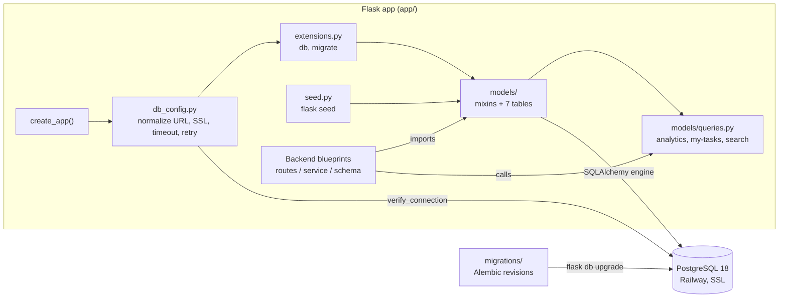
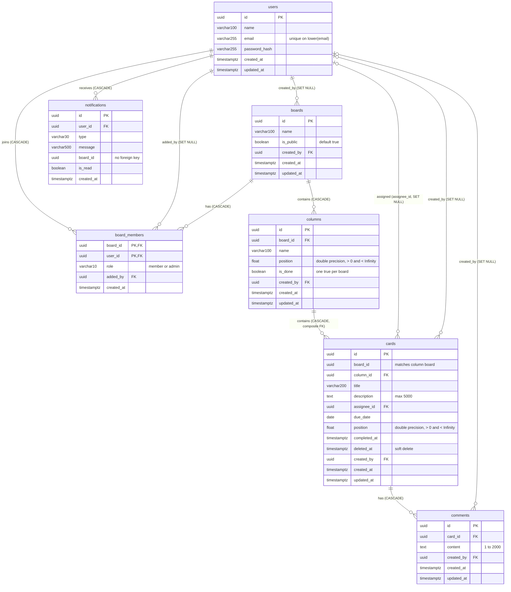

# Design Document: RevoTask Database Layer

Version: V4

## Overview

This document designs the PostgreSQL schema, SQLAlchemy models, migrations, seed command and reference queries for RevoTask in V4. V4 aligns the design with `.kiro/steering/database.md`, which is the source of truth. Where V3 disagreed with the steering file, the steering file wins. The V3 design is preserved in `history/design-V3.md`, and V3 decisions are marked in the decision table below.

The schema has seven tables: `users`, `boards`, `board_members`, `columns`, `cards`, `comments` and `notifications`. The `activity_logs` table from V3 is removed. Member activity is computed from joins over `cards` and `comments`.

The backend spec imports these models from `app/models/`. Routes, request validation and UI stay out of scope. The backend rules that V4 affects are listed in `CHANGELOG.md` (V4 Impact). This design does not edit the backend spec.

### Key design decisions

Status values: **Active** (kept as in V3), **Amended** (kept, with a V4 change), **Superseded** (replaced by a V4 decision), **Removed** (no longer in the schema), **New** (added in V4).

| # | Decision | Status | Rationale and V3 reference |
|---|----------|--------|----------------------------|
| D1 | Every rule that the Database must reject is a PostgreSQL constraint (NOT NULL, CHECK, FK, UNIQUE, partial unique index), not only a Python validator. | Active | Requirements 1 to 8 require database-level rejection. Raw SQL and future services get the same protection. |
| D2 | Text limits come from DB-SCH-01. `name`, `email`, `title`, `type`, `message`, `role` and `password_hash` are `VARCHAR(n)`. Only `description` and `content` are `TEXT` with a CHECK backstop (DB-SCH-02). | Amended | V3 used `TEXT` plus CHECK everywhere (V3 D2). The steering table defines VARCHAR lengths for most columns. |
| D3 | The position check is `CHECK ("position" > 0 AND "position" < 'Infinity')` on `columns` and `cards`. It rejects zero, negatives, `NaN` and `+Infinity`. | Amended | V3 D3 had this bound. The V4 draft dropped it to follow DB-ORD-01 literally. OD-4 is resolved from the baseline, which keeps the bound. This is a deviation from DB-ORD-01, which lists only `position > 0`. |
| D4 | `updated_at` is maintained by a `BEFORE UPDATE` trigger on the five mutable tables (`users`, `boards`, `columns`, `cards`, `comments`). The trigger also pins `created_at`. | Amended | V3 D4 covered the same tables but also covered boards, which V4 keeps. Steering DB-CNV-04 requires `updated_at` on these five tables. |
| D5 | UUID primary keys use both a Python default (`uuid.uuid4`) and a server default (`gen_random_uuid()`). | Active | Objects get ids before flush, and raw inserts still get ids (Requirement 1, criterion 5). |
| D6 | Case-insensitive email uniqueness uses a unique index on `lower(email)` named `uq_users_email_lower`. | Active | No extension needed. Works on Railway without privileges. |
| D7 | Role is `VARCHAR(10)` with the check `ck_board_members_role`, not a native ENUM. | Amended | V3 used `TEXT` (V3 D7). DB-SCH-01 specifies `VARCHAR(10)`. |
| D8 | Mixins split by capability: `UUIDPrimaryKeyMixin`, `CreatedAtMixin`, `TimestampMixin` (created and updated) and `SoftDeleteMixin` (cards only). `restore()` is removed. | Superseded | V3 applied `SoftDeleteMixin` to boards and columns. DB-CNV-05 and DB-SOFT-01 allow soft delete on cards only. DB-SOFT-01 says nothing restores a card through the application. |
| D9 | Ownership and authorship references (`created_by`, `added_by`, `assignee_id`) use `ON DELETE SET NULL`. Children owned by a parent use `CASCADE`. | Superseded | V3 used `RESTRICT` for `created_by`, `owner_id`, `comments.user_id` and `activity_logs.user_id` (V3 D9). DB-OWN-01 and DB-CAS-01 require `SET NULL`, so deleting a user never fails. |
| D10 | Reference queries live in `app/models/queries.py` and are tested here. Backend services call them. | Amended | Same approach as V3. Queries are updated for the V4 schema (see Reference queries). |
| D11 | Migrations run as a Railway pre-deploy or release command (`flask db upgrade`), never implicitly at app start. | Active | Avoids concurrent migration runs from several app instances. |
| D12 | The schema is DB-SCH-01 verbatim. This spec does not add tables or columns that the steering file does not list. | New | DB-SCH-01 says to change the schema only by updating the steering section first. |
| D13 | The `activity_logs` table is removed. Member activity is three counts computed from `cards.created_by`, `comments.created_by` and `cards.assignee_id`. | New | The steering schema has no activity table. This is a breaking change (Requirement 7, criterion 1). |
| D14 | `notifications.board_id` is a plain UUID with no foreign key. Deleting a board keeps its notifications. | New | DB-NTF-01 and DB-CAS-01. Notification text must outlive the item it describes. |
| D15 | `cards.board_id` is NOT NULL and is kept equal to the column's board by the composite FK `(column_id, board_id)` to `columns (id, board_id)`. No separate foreign key on `cards.board_id`. | New | DB-SCH-03. DB-CAS-01 lists no foreign key for `cards.board_id` alone. |
| D16 | The Position column is named `position` in the database and exposed as `order` in the models and the API. | New | DB-ORD-01. V3 named the column `order`, which is a reserved SQL word. |
| D17 | The seed command refuses to run when `FLASK_ENV=production` unless `--force` is passed. Railway detection stays only in the connection code (Requirement 11, criterion 4). | New | DB-SEED-01. V3 refused on Railway (V3 Components 6). |
| D18 | The index set is exactly the rows of DB-IDX-01, plus the non-unique position indexes (DB-ORD-02) and the completed partial index (DB-DON-02). V3 indexes that the steering does not list are removed. | Superseded | The V3 index summary is replaced by the Index summary in this design. |
| D19 | The V4 change is a new revision `0002_v4_schema` on `main`, on top of the applied V3 revision `0001_initial_schema`. `0001` is not edited or replaced. | New | DB-MIG-01 forbids editing an applied migration. `0001` is applied in `revotask_db` (OD-7, resolved from the baseline). Changed from the V4 draft, which planned a new `0001` on a branch. |
| D20 | Cards are soft-deleted. Comments, columns and boards are hard-deleted. | New | DB-CNV-05, DB-SOFT-01. V3 soft-deleted comments, columns and boards. |
| D21 | All V4 work is committed directly on `main`. No feature branch is created. | New | OD-8, resolved by the user. The project uses only `main`. Replaces the V4 draft step that created a `database-v4` branch (task 0.2). |

### Research findings

- **Railway connection.** Railway provides `DATABASE_URL` for its PostgreSQL service and uses the private network host by default. Running migrations from a local machine needs the public proxy URL ([Railway help thread](https://help.railway.app/questions/help-with-connecting-to-db-c425ee31)). Railway's PostgreSQL template serves TLS on both private and public hostnames ([Railway PostgreSQL template](https://railway.com/deploy/postgresql)). Railway injects `RAILWAY_*` variables into every service ([Railway variables reference](https://docs.railway.com/reference/variables)). The connection code uses them to decide on `sslmode=require` (Requirement 11).
- **Functional index and Alembic.** Alembic autogenerate has a history of mishandling expression indexes such as `lower(col)` and partial indexes ([Alembic issue #676](https://github.com/sqlalchemy/alembic/issues/676)). Mitigation: review each autogenerated revision by hand (DB-MIG-01) and keep a zero-diff test (Requirement 10, criterion 5).
- **Not detected by autogenerate.** Alembic does not detect CHECK constraint changes, partial index predicates, server defaults or triggers. Those parts of each revision are written by hand.

*Content was rephrased for compliance with licensing restrictions.*

## Architecture



### Directory layout

```
app/
  __init__.py          create_app()
  extensions.py        db (with naming convention), migrate
  db_config.py         DATABASE_URL handling, engine options, verify_connection
  seed.py              `flask seed` command
  models/
    __init__.py        imports every model (so Alembic sees all tables)
    mixins.py          UUIDPrimaryKeyMixin, CreatedAtMixin, TimestampMixin, SoftDeleteMixin
    user.py            User
    board.py           Board, BoardMember
    column.py          BoardColumn  (table "columns")
    card.py            Card
    comment.py         Comment
    notification.py    Notification
    queries.py         reference queries (Requirement 7)
migrations/            Flask-Migrate / Alembic
tests/database/        pytest + Hypothesis
```

The class for the `columns` table is named `BoardColumn` to avoid confusion with `db.Column`. `activity_log.py` is removed in V4.

## Components and Interfaces

### 1. Extensions (`app/extensions.py`) and configuration (`app/db_config.py`)

Unchanged from V3 (`history/design-V3.md`, Components 1 and 2). Requirement 11 is unchanged. The naming convention stays the same:

```python
NAMING_CONVENTION = {
    "ix": "ix_%(column_0_label)s",
    "uq": "uq_%(table_name)s_%(column_0_name)s",
    "ck": "ck_%(table_name)s_%(constraint_name)s",
    "fk": "fk_%(table_name)s_%(column_0_name)s_%(referred_table_name)s",
    "pk": "pk_%(table_name)s",
}
```

Every explicit name in this design (for example `uq_columns_board_id_done` or `ck_cards_position`) is set in the model, so the generated name matches the steering examples.

### 2. App factory (`app/__init__.py`)

Unchanged from V3 except for the seed command registration. `create_app()` normalizes `DATABASE_URL` before `db.init_app`, configures Alembic (`compare_type=True`, `render_as_batch=False`, `transaction_per_migration=True`, `process_revision_directives=skip_empty_revision`), and never calls `upgrade()`.

### 3. Migration strategy (Requirement 10, Requirement 9, criterion 9)

1. **Single linear history.** One head, one parent per revision (Requirement 10, criterion 1). CI runs `flask db heads` and fails unless exactly one head exists.
2. **Revision `0002_v4_schema`** (decision D19). `0001_initial_schema` is applied in the local database `revotask_db`, so it is not edited (DB-MIG-01). `0002` converts the V3 schema to V4 with ALTER statements, not CREATE TABLE. Autogenerate compares the models with the V3 schema, and the draft is then reviewed and edited by hand (DB-MIG-01) to add:
   - every CHECK constraint listed in the Data Models section, with the names shown there,
   - every partial index predicate (`postgresql_where`), including `is_done`, `is_public`, `NOT is_read` and `deleted_at IS NULL`,
   - server defaults: `gen_random_uuid()` for each `id`, `true` for `boards.is_public`, `false` for `columns.is_done` and `notifications.is_read`,
   - the composite foreign key on `cards` and the `UNIQUE (id, board_id)` on `columns`,
   - the `set_updated_at()` function and the five triggers,
   - the V3-to-V4 changes listed under Breaking changes in `CHANGELOG.md` V4: drop `activity_logs`, `boards.owner_id`, `boards.deleted_at`, `columns.deleted_at` and `comments.deleted_at`; rename `order` to `position`, `columns.title` to `name`, `comments.body` to `content` and `comments.user_id` to `created_by`; add `cards.board_id` as nullable, backfill it from `columns.board_id`, then set it NOT NULL (DB-MIG-03); and move the foreign keys to the DB-CAS-01 table (for example `RESTRICT` to `SET NULL`),
   - index creation through a helper that names the failing index (Requirement 9, criterion 9):
     ```python
     def _create_index(name, table, cols, **kw):
         try:
             op.create_index(name, table, cols, **kw)
         except Exception as exc:
             raise RuntimeError(f"Failed to create index {name}") from exc
     ```
3. **Transactional DDL.** `transaction_per_migration=True` wraps each revision in its own transaction. A failing revision rolls back completely, earlier revisions stay applied, and the command exits non-zero naming the revision (Requirement 10, criterion 6).
4. **Downgrade.** `downgrade()` of `0002` reverses each step and restores the V3 schema that `0001` creates, so `downgrade -1` returns to `0001_initial_schema` (DB-MIG-02). Rows in `activity_logs` cannot be restored, so the downgrade recreates that table empty.
5. **Idempotent upgrade.** A second `flask db upgrade` is a no-op (Requirement 10, criterion 3).
6. **Drift check.** `flask db check` exits non-zero if the models differ from the latest revision. CI runs it after `flask db upgrade` on an empty database.
7. **Data migrations are separate** (DB-MIG-03). The initial revision has no data step. Later data changes add a nullable column, backfill, then set NOT NULL in separate revisions.
8. **Later constraint, index or trigger changes** are written by hand.

### 4. Seed command (`app/seed.py`) (Requirement 12)

`flask seed [--force]`. Behavior:

- Refuses to run when `FLASK_ENV` is `production` unless `--force` is passed (Requirement 12, criterion 5).
- Uses **deterministic UUIDs**: `uuid.uuid5(SEED_NAMESPACE, "<kind>:<natural key>")`, so every run produces the same ids.
- Uses fixed timestamps (for example `completed_at` of the Done card) so that the first and later runs write identical values.
- Inserts with `postgresql.insert(...).on_conflict_do_nothing()`, so repeat runs add nothing (Requirement 12, criterion 2).
- Runs in one transaction. On any exception it rolls back, prints `Seeding failed: <cause>` and exits with status 1 (Requirement 12, criterion 4). On success it prints `Seeding finished.` and exits 0 (Requirement 12, criterion 3).
- Hashes the demo password from `SEED_PASSWORD` (default `revotask-dev`) with `werkzeug.security.generate_password_hash`. The default is a documented demo value (Requirement 12, criterion 6).

| Entity | Rows |
|--------|------|
| users | `alice@revotask.test` (Alice, Admin), `bob@revotask.test` (Bob, Member), `carol@revotask.test` (Carol, Guest-only, no `board_members` row). Alice and Bob are from the baseline seed. Carol is required by DB-SEED-01 (OD-2). |
| boards | "RevoTask Demo" (`is_public` true, created by Alice); "Private Sandbox" (`is_public` false, created by Alice) |
| board_members | Demo: Alice `admin`, Bob `member`. Sandbox: Alice `admin`. |
| columns | Demo: "To Do" 1.0, "In Progress" 2.0, "Done" 3.0 with `is_done` true. Sandbox: "Backlog" 1.0. |
| cards | Demo: To Do 2 cards (1.0, 2.0), In Progress 2 cards (1.0, 2.0), Done 1 card (1.0). Assignees alternate between Alice and Bob. `created_by` is Alice. The Done card has a fixed `completed_at`. Sandbox: 1 card in "Backlog". |
| comments | 2 comments on two cards of "To Do" (one by Bob, one by Alice). |

```python
@click.command("seed")
@click.option("--force", is_flag=True)
@with_appcontext
def seed_command(force):
    if os.environ.get("FLASK_ENV") == "production" and not force:
        raise click.ClickException("Refusing to seed in production without --force")
    try:
        _insert_all()          # all inserts use ON CONFLICT DO NOTHING
        db.session.commit()
    except Exception as exc:
        db.session.rollback()
        raise click.ClickException(f"Seeding failed: {exc}")   # exit status 1
    click.echo("Seeding finished.")
```

If a non-seed user already owns one of the seed emails, the user insert is skipped and the dependent inserts fail their foreign keys. The run then rolls back and reports the cause. This only happens on a non-empty database.

### 5. Reference queries (`app/models/queries.py`) (Requirements 6, 7, 9, criterion 8)

All queries use the SQLAlchemy 2.x `select()` style, except `Card.active()`, which returns a Flask-SQLAlchemy query so that services can write `Card.active().filter_by(...)` (DB-SOFT-02). The helper applies `deleted_at IS NULL`. Every live-card query uses it.

```python
from datetime import datetime, time, timedelta, timezone
from sqlalchemy import select, func, and_
from app.extensions import db
from app.models import User, Board, BoardMember, BoardColumn, Card, Comment, Notification

UTC = timezone.utc

def week_bounds_utc(now: datetime) -> tuple[datetime, datetime]:
    """Monday 00:00 UTC (inclusive) and next Monday 00:00 UTC (exclusive)."""
    now = now.astimezone(UTC)
    monday = now.date() - timedelta(days=now.weekday())
    start = datetime.combine(monday, time.min, tzinfo=UTC)
    return start, start + timedelta(days=7)

# Req 7.2  Cards per column; empty columns return 0 (outer join, deleted_at test in ON clause)
def card_counts_per_column(board_id):
    return db.session.execute(
        select(BoardColumn.id, BoardColumn.name, func.count(Card.id).label("card_count"))
        .outerjoin(Card, and_(Card.column_id == BoardColumn.id, Card.deleted_at.is_(None)))
        .where(BoardColumn.board_id == board_id)
        .group_by(BoardColumn.id, BoardColumn.name, BoardColumn.order)
        .order_by(BoardColumn.order)
    ).all()

# Req 7.3  Completed this week; uses ix_cards_board_id_completed_at (DB-DON-02)
def completed_this_week(board_id, now=None):
    start, end = week_bounds_utc(now or datetime.now(UTC))
    return db.session.scalar(
        select(func.count(Card.id))
        .where(Card.board_id == board_id,
               Card.deleted_at.is_(None),
               Card.completed_at >= start, Card.completed_at < end)
    )

# Req 7.4  Member activity: one row per current member, three counts, zeros included
def member_activity(board_id):
    created = (select(Card.created_by.label("user_id"), func.count().label("n"))
               .where(Card.board_id == board_id, Card.deleted_at.is_(None),
                      Card.created_by.is_not(None))
               .group_by(Card.created_by).subquery())
    commented = (select(Comment.created_by.label("user_id"), func.count().label("n"))
                 .join(Card, Card.id == Comment.card_id)
                 .where(Card.board_id == board_id, Card.deleted_at.is_(None),
                        Comment.created_by.is_not(None))
                 .group_by(Comment.created_by).subquery())
    assigned = (select(Card.assignee_id.label("user_id"), func.count().label("n"))
                .where(Card.board_id == board_id, Card.deleted_at.is_(None),
                       Card.assignee_id.is_not(None))
                .group_by(Card.assignee_id).subquery())
    return db.session.execute(
        select(User.id, User.name,
               func.coalesce(created.c.n, 0).label("cards_created"),
               func.coalesce(commented.c.n, 0).label("comments_added"),
               func.coalesce(assigned.c.n, 0).label("cards_assigned"))
        .join(BoardMember, and_(BoardMember.user_id == User.id,
                                BoardMember.board_id == board_id))
        .outerjoin(created, created.c.user_id == User.id)
        .outerjoin(commented, commented.c.user_id == User.id)
        .outerjoin(assigned, assigned.c.user_id == User.id)
        .order_by(User.name)
    ).all()

# Req 7.5  "Assigned to me", grouped by board name in Python with itertools.groupby
def my_tasks(user_id):
    return db.session.execute(
        select(Board.id, Board.name, Card)
        .join(Card, Card.board_id == Board.id)
        .join(BoardColumn, BoardColumn.id == Card.column_id)
        .where(Card.assignee_id == user_id, Card.deleted_at.is_(None))
        .order_by(Board.name, BoardColumn.order, Card.order)
    ).all()

# Req 7.6  Case-insensitive substring search, title OR description; term is 1..200 chars
def search_cards(term: str, user_id=None):
    if not 1 <= len(term) <= 200:
        raise ValueError("search term must be 1 to 200 characters")
    stmt = (
        select(Card)
        .where(Card.deleted_at.is_(None),
               or_(Card.title.icontains(term, autoescape=True),
                   Card.description.icontains(term, autoescape=True)))
    )
    if user_id is not None:   # optional scope: only boards the user belongs to
        stmt = stmt.join(BoardMember, and_(BoardMember.board_id == Card.board_id,
                                            BoardMember.user_id == user_id))
    return db.session.scalars(stmt).all()

# Req 6.3  Notification page: served by ix_notifications_user_id_created_at (created_at DESC)
def notifications_page(user_id, limit=20, offset=0):
    assert 1 <= limit <= 100 and 0 <= offset <= 1_000_000
    return db.session.scalars(
        select(Notification).where(Notification.user_id == user_id)
        .order_by(Notification.created_at.desc()).limit(limit).offset(offset)
    ).all()

# Req 9.8  Board load: three indexed queries, no N+1
def load_board(board_id):
    board = db.session.get(Board, board_id)
    columns = db.session.scalars(
        select(BoardColumn).where(BoardColumn.board_id == board_id)
        .order_by(BoardColumn.order)).all()
    cards = db.session.scalars(
        Card.active().filter(Card.column_id.in_([c.id for c in columns]))
        .order_by(Card.column_id, Card.order)).all()
    return board, columns, cards
```

Notes:
- `or_` is imported from `sqlalchemy` in the implementation. It is omitted above for brevity.
- Columns are hard-deleted, so no query filters on a column's deletion state. A card in a live column cannot be under a deleted column.
- `member_activity` returns current members only. A User whose membership was removed keeps the cards and comments they created, but they are not listed.
- `icontains(..., autoescape=True)` escapes `%`, `_` and the escape character. A leading-wildcard search cannot use a B-tree index. At the scale of Requirement 9, criterion 8 a scan is acceptable.
- Ties in `position` are broken by the database order. Services may add `Card.id` as a tie-breaker. Rebalancing belongs to the backend spec (`backend.md` BE-ORD-02).

### 6. Backend contract

- Import models only from `app.models`, and use `db.session` from `app.extensions`.
- Creating a board inserts the `boards` row and the creator's `board_members` row (role `admin`) in one transaction (Requirement 2, criterion 5).
- Setting the Position of a card or column uses the attribute `order`. The database column is `position`.
- Soft delete of a card calls `Card.soft_delete()`. Live reads use `Card.active()`.
- Columns and boards are hard-deleted with `session.delete()` or a DELETE statement. The database cascades (DB-CAS-02).
- Column names: the Column model attribute is `name`. The API field `title` for a column is kept as an alias, mapped to `columns.name` (OD-5).
- Before a demotion or removal of an Admin, lock the board's admin rows (Requirement 2, criterion 14).
- Catch `sqlalchemy.exc.IntegrityError` and read `err.orig.pgcode` and `err.orig.diag.constraint_name`.

## Data Models

### ER diagram



`notifications.board_id` has no relationship line because it has no foreign key (DB-NTF-01).

### Foreign keys (DB-CAS-01, exact)

| Foreign key | On delete | Reason |
|---|---|---|
| `board_members.board_id` → `boards` | CASCADE | Membership has no meaning without its board. |
| `board_members.user_id` → `users` | CASCADE | Membership has no meaning without its user. |
| `columns.board_id` → `boards` | CASCADE | Columns belong to a board. |
| `cards (column_id, board_id)` → `columns (id, board_id)` | CASCADE | Cards belong to a column, and `board_id` must match it (DB-SCH-03). |
| `comments.card_id` → `cards` | CASCADE | Comments belong to a card. |
| `notifications.user_id` → `users` | CASCADE | A notification is addressed to a user. |
| `boards.created_by`, `board_members.added_by`, `columns.created_by`, `cards.created_by`, `comments.created_by`, `cards.assignee_id` → `users` | SET NULL | Deleting a user must not destroy shared work (DB-OWN-01). |
| `notifications.board_id` | no foreign key | Notification text outlives its board (DB-NTF-01). |

There is no foreign key from `cards.board_id` to `boards`, and none from `notifications.board_id`. A board delete reaches cards through `columns`.

Consequence: a user can always be hard-deleted. Their boards, columns, cards and comments stay, with `created_by` set to NULL. The backend treats a NULL `created_by` as foreign work that only Admins can delete.

### Shared mixins (`app/models/mixins.py`)

```python
import uuid
from datetime import datetime, timezone
from sqlalchemy.dialects.postgresql import UUID
from app.extensions import db

class UUIDPrimaryKeyMixin:
    id = db.Column(UUID(as_uuid=True), primary_key=True,
                   default=uuid.uuid4, server_default=db.text("gen_random_uuid()"))

class CreatedAtMixin:
    created_at = db.Column(db.DateTime(timezone=True), nullable=False,
                           server_default=db.func.now())

class TimestampMixin(CreatedAtMixin):
    # Maintained by the trigger set_updated_at(); FetchedValue makes the ORM re-read it.
    updated_at = db.Column(db.DateTime(timezone=True), nullable=False,
                           server_default=db.func.now(), server_onupdate=db.FetchedValue())

class SoftDeleteMixin:
    """Used by Card only (DB-CNV-05, DB-SOFT-01)."""
    deleted_at = db.Column(db.DateTime(timezone=True), nullable=True)

    def soft_delete(self) -> None:
        self.deleted_at = datetime.now(timezone.utc)
```

Mixin use by table:

| Table | UUID PK | `created_at` | `updated_at` | `deleted_at` |
|-------|:------:|:-----------:|:-----------:|:-----------:|
| users | yes | yes | yes | no |
| boards | yes | yes | yes | no |
| board_members | composite PK | yes | no | no |
| columns | yes | yes | yes | no |
| cards | yes | yes | yes | yes |
| comments | yes | yes | yes | no |
| notifications | yes | yes | no | no |

### Models

```python
# app/models/user.py
class User(UUIDPrimaryKeyMixin, TimestampMixin, db.Model):
    __tablename__ = "users"
    name = db.Column(db.String(100), nullable=False)
    email = db.Column(db.String(255), nullable=False)
    password_hash = db.Column(db.String(255), nullable=False)      # salted hash only (Req 1.3)

    __table_args__ = (
        db.CheckConstraint("char_length(name) >= 1", name="name_length"),                    # ck_users_name_length (OD-3)
        db.CheckConstraint("char_length(email) BETWEEN 3 AND 254", name="email_length"),     # ck_users_email_length (OD-3)
        db.CheckConstraint("char_length(password_hash) >= 1", name="password_hash_length"),  # ck_users_password_hash_length (OD-3)
        db.Index("uq_users_email_lower", db.func.lower(email), unique=True),   # Req 1.2, D6
    )
```

```python
# app/models/board.py
class Board(UUIDPrimaryKeyMixin, TimestampMixin, db.Model):
    __tablename__ = "boards"
    name = db.Column(db.String(100), nullable=False)
    is_public = db.Column(db.Boolean, nullable=False, default=True,
                          server_default=db.true())                 # DB-VIS-01
    created_by = db.Column(UUID(as_uuid=True),
                           db.ForeignKey("users.id", ondelete="SET NULL"), nullable=True)

    creator = db.relationship("User", foreign_keys=[created_by])
    members = db.relationship("BoardMember", back_populates="board",
                              cascade="all, delete-orphan", passive_deletes=True)
    columns = db.relationship("BoardColumn", back_populates="board",
                              cascade="all, delete-orphan", passive_deletes=True,
                              order_by="BoardColumn.order")

    __table_args__ = (
        db.CheckConstraint("char_length(name) >= 1", name="name_length"),                    # ck_boards_name_length (OD-3)
        db.Index("ix_boards_created_at_public", db.text("created_at DESC"),
                 postgresql_where=db.text("is_public")),                 # DB-IDX-01
    )


class BoardMember(CreatedAtMixin, db.Model):
    __tablename__ = "board_members"
    board_id = db.Column(UUID(as_uuid=True),
                         db.ForeignKey("boards.id", ondelete="CASCADE"), primary_key=True)
    user_id = db.Column(UUID(as_uuid=True),
                        db.ForeignKey("users.id", ondelete="CASCADE"), primary_key=True)
    role = db.Column(db.String(10), nullable=False)
    added_by = db.Column(UUID(as_uuid=True),
                         db.ForeignKey("users.id", ondelete="SET NULL"), nullable=True)

    board = db.relationship("Board", back_populates="members")
    user = db.relationship("User", foreign_keys=[user_id])

    __table_args__ = (
        db.CheckConstraint("role IN ('member', 'admin')", name="role"),        # ck_board_members_role
        db.Index("ix_board_members_user_id", "user_id"),                       # DB-IDX-01
    )
```

The composite primary key on (`board_id`, `user_id`) is the uniqueness rule (`pk_board_members`, Requirement 2, criterion 8). `board_members` has no UUID `id` (DB-CNV-03).

```python
# app/models/column.py
class BoardColumn(UUIDPrimaryKeyMixin, TimestampMixin, db.Model):
    __tablename__ = "columns"
    board_id = db.Column(UUID(as_uuid=True),
                         db.ForeignKey("boards.id", ondelete="CASCADE"), nullable=False)
    name = db.Column(db.String(100), nullable=False)
    order = db.Column("position", db.Float(53), nullable=False)       # DB-ORD-01
    is_done = db.Column(db.Boolean, nullable=False, default=False,
                        server_default=db.false())
    created_by = db.Column(UUID(as_uuid=True),
                           db.ForeignKey("users.id", ondelete="SET NULL"), nullable=True)

    board = db.relationship("Board", back_populates="columns")
    cards = db.relationship("Card", back_populates="column",
                            cascade="all, delete-orphan", passive_deletes=True,
                            order_by="Card.order")

    __table_args__ = (
        db.UniqueConstraint("id", "board_id", name="uq_columns_id_board_id"),   # target of cards FK
        db.CheckConstraint("char_length(name) >= 1", name="name_length"),        # ck_columns_name_length (OD-3)
        db.CheckConstraint('"position" > 0 AND "position" < \'Infinity\'', name="position"),  # ck_columns_position (OD-4)
        db.Index("uq_columns_board_id_done", "board_id", unique=True,
                 postgresql_where=db.text("is_done")),                          # DB-DON-01
        db.Index("ix_columns_board_id_position", "board_id", "position"),       # DB-IDX-01, DB-ORD-02
    )
```

Index declarations in code refer to the database column name `position`. The steering names are used for every index.

```python
# app/models/card.py
class Card(UUIDPrimaryKeyMixin, TimestampMixin, SoftDeleteMixin, db.Model):
    __tablename__ = "cards"
    board_id = db.Column(UUID(as_uuid=True), nullable=False)          # matches the column's board (DB-SCH-03)
    column_id = db.Column(UUID(as_uuid=True), nullable=False)
    title = db.Column(db.String(200), nullable=False)
    description = db.Column(db.Text, nullable=True)
    assignee_id = db.Column(UUID(as_uuid=True),
                            db.ForeignKey("users.id", ondelete="SET NULL"), nullable=True)
    due_date = db.Column(db.Date, nullable=True)
    order = db.Column("position", db.Float(53), nullable=False)       # DB-ORD-01
    completed_at = db.Column(db.DateTime(timezone=True), nullable=True)
    created_by = db.Column(UUID(as_uuid=True),
                           db.ForeignKey("users.id", ondelete="SET NULL"), nullable=True)

    column = db.relationship("BoardColumn", back_populates="cards")
    comments = db.relationship("Comment", back_populates="card",
                               cascade="all, delete-orphan", passive_deletes=True)

    __table_args__ = (
        db.ForeignKeyConstraint(["column_id", "board_id"],
                                ["columns.id", "columns.board_id"],
                                ondelete="CASCADE"),                             # fk_cards_column_id_columns
        db.CheckConstraint('"position" > 0 AND "position" < \'Infinity\'', name="position"),  # ck_cards_position (OD-4)
        db.CheckConstraint("char_length(title) >= 1", name="title_length"),     # ck_cards_title_length (OD-3)
        db.CheckConstraint("description IS NULL OR char_length(description) <= 5000",
                           name="description_length"),                           # ck_cards_description_length
        db.Index("ix_cards_column_id_position", "column_id", "position",
                 postgresql_where=db.text("deleted_at IS NULL")),                 # DB-IDX-01, DB-ORD-02
        db.Index("ix_cards_assignee_id", "assignee_id",
                 postgresql_where=db.text("assignee_id IS NOT NULL AND deleted_at IS NULL")),
        db.Index("ix_cards_board_id_created_by", "board_id", "created_by",
                 postgresql_where=db.text("deleted_at IS NULL")),
        db.Index("ix_cards_board_id_completed_at", "board_id", "completed_at",
                 postgresql_where=db.text("completed_at IS NOT NULL AND deleted_at IS NULL")),  # DB-DON-02
    )

    @classmethod
    def active(cls):
        """DB-SOFT-02. Every live-card query starts here."""
        return cls.query.filter(cls.deleted_at.is_(None))
```

The title maximum is enforced by the type `VARCHAR(200)` (DB-SCH-01). The one-character minimum is enforced by `ck_cards_title_length` (OD-3, reinstated from the baseline). Requirement 4, criterion 12 is met by both.

```python
# app/models/comment.py
class Comment(UUIDPrimaryKeyMixin, TimestampMixin, db.Model):
    __tablename__ = "comments"
    card_id = db.Column(UUID(as_uuid=True),
                        db.ForeignKey("cards.id", ondelete="CASCADE"), nullable=False)
    content = db.Column(db.Text, nullable=False)
    created_by = db.Column(UUID(as_uuid=True),
                           db.ForeignKey("users.id", ondelete="SET NULL"), nullable=True)

    card = db.relationship("Card", back_populates="comments")
    author = db.relationship("User", foreign_keys=[created_by])

    __table_args__ = (
        db.CheckConstraint("char_length(content) BETWEEN 1 AND 2000",
                           name="content_length"),                         # ck_comments_content_length
        db.CheckConstraint("updated_at >= created_at", name="updated_after_created"),
        db.Index("ix_comments_card_id_created_at", "card_id", "created_at"),
        db.Index("ix_comments_created_by", "created_by"),
    )
```

Whitespace-only content passes this check, because the length is 1 or more. The backend rejects it (Requirement 5, criterion 5).

```python
# app/models/notification.py
class Notification(UUIDPrimaryKeyMixin, CreatedAtMixin, db.Model):
    __tablename__ = "notifications"
    user_id = db.Column(UUID(as_uuid=True),
                        db.ForeignKey("users.id", ondelete="CASCADE"), nullable=False)
    type = db.Column(db.String(30), nullable=False)
    message = db.Column(db.String(500), nullable=False)
    board_id = db.Column(UUID(as_uuid=True), nullable=True)            # no FK (DB-NTF-01)
    is_read = db.Column(db.Boolean, nullable=False, default=False, server_default=db.false())

    user = db.relationship("User", foreign_keys=[user_id])

    __table_args__ = (
        db.CheckConstraint("type IN ('card_assigned', 'card_moved', 'comment_added', 'member_added')",
                           name="type"),                                   # ck_notifications_type, OD-1
        db.Index("ix_notifications_user_id_created_at", "user_id", db.text("created_at DESC")),
        db.Index("ix_notifications_user_id_unread", "user_id",
                 postgresql_where=db.text("NOT is_read")),
    )
```

```python
# app/models/__init__.py
from .user import User
from .board import Board, BoardMember
from .column import BoardColumn
from .card import Card
from .comment import Comment
from .notification import Notification
```

### Table definitions (DB-SCH-01)

| Table | Column | Type | Null | Constraint or default |
|---|---|---|---|---|
| users | id | UUID | no | PK, `gen_random_uuid()` |
| users | name | VARCHAR(100) | no | `ck_users_name_length`: 1 or more characters (OD-3) |
| users | email | VARCHAR(255) | no | unique on `lower(email)` (`uq_users_email_lower`); `ck_users_email_length`: 3 to 254 characters (OD-3) |
| users | password_hash | VARCHAR(255) | no | `ck_users_password_hash_length`: 1 or more characters (OD-3) |
| users | created_at, updated_at | TIMESTAMPTZ | no | `now()`; `updated_at` by trigger |
| boards | id | UUID | no | PK |
| boards | name | VARCHAR(100) | no | `ck_boards_name_length`: 1 or more characters (OD-3) |
| boards | is_public | BOOLEAN | no | default `true` |
| boards | created_by | UUID | yes | FK users, SET NULL |
| boards | created_at, updated_at | TIMESTAMPTZ | no | |
| board_members | board_id, user_id | UUID | no | composite PK; FKs CASCADE |
| board_members | role | VARCHAR(10) | no | `ck_board_members_role` in (member, admin) |
| board_members | added_by | UUID | yes | FK users, SET NULL |
| board_members | created_at | TIMESTAMPTZ | no | |
| columns | id | UUID | no | PK; `UNIQUE (id, board_id)` |
| columns | board_id | UUID | no | FK boards, CASCADE |
| columns | name | VARCHAR(100) | no | `ck_columns_name_length`: 1 or more characters (OD-3) |
| columns | position | DOUBLE PRECISION | no | `ck_columns_position`: `position > 0 AND position < 'Infinity'` (OD-4) |
| columns | is_done | BOOLEAN | no | default `false`; `uq_columns_board_id_done` |
| columns | created_by | UUID | yes | FK users, SET NULL |
| columns | created_at, updated_at | TIMESTAMPTZ | no | |
| cards | id | UUID | no | PK |
| cards | board_id | UUID | no | composite FK with column_id |
| cards | column_id | UUID | no | composite FK to columns, CASCADE |
| cards | title | VARCHAR(200) | no | `ck_cards_title_length`: 1 or more characters (OD-3) |
| cards | description | TEXT | yes | `ck_cards_description_length` (<= 5000) |
| cards | assignee_id | UUID | yes | FK users, SET NULL |
| cards | due_date | DATE | yes | |
| cards | position | DOUBLE PRECISION | no | `ck_cards_position`: `position > 0 AND position < 'Infinity'` (OD-4) |
| cards | completed_at | TIMESTAMPTZ | yes | |
| cards | deleted_at | TIMESTAMPTZ | yes | soft delete |
| cards | created_by | UUID | yes | FK users, SET NULL |
| cards | created_at, updated_at | TIMESTAMPTZ | no | |
| comments | id | UUID | no | PK |
| comments | card_id | UUID | no | FK cards, CASCADE |
| comments | content | TEXT | no | `ck_comments_content_length` (1 to 2000) |
| comments | created_by | UUID | yes | FK users, SET NULL |
| comments | created_at, updated_at | TIMESTAMPTZ | no | `ck_comments_updated_after_created` |
| notifications | id | UUID | no | PK |
| notifications | user_id | UUID | no | FK users, CASCADE |
| notifications | type | VARCHAR(30) | no | `ck_notifications_type` (OD-1) |
| notifications | message | VARCHAR(500) | no | |
| notifications | board_id | UUID | yes | no FK |
| notifications | is_read | BOOLEAN | no | default `false` |
| notifications | created_at | TIMESTAMPTZ | no | |

### Index summary (DB-IDX-01, DB-ORD-02, DB-DON-02)

| # | Index | Table | Keys and predicate | Serves | Requirement 9 criterion |
|---|-------|-------|--------------------|--------|------------------------|
| 1 | `uq_users_email_lower` | users | unique `lower(email)` | register, login, add member by email | 10 |
| 2 | `ix_board_members_user_id` | board_members | `user_id` | `GET /api/boards?scope=mine`, `GET /api/cards?assignee=me` | 11 |
| 3 | `ix_boards_created_at_public` | boards | `created_at DESC` WHERE `is_public` | `GET /api/boards?scope=public` | 12 |
| 4 | `ix_columns_board_id_position` | columns | `board_id`, `position` (non-unique) | `GET /api/boards/<id>` | 13 |
| 5 | `uq_columns_board_id_done` | columns | unique `board_id` WHERE `is_done` | DB-DON-01 | 14 |
| 6 | `ix_cards_column_id_position` | cards | `column_id`, `position` WHERE `deleted_at IS NULL` (non-unique) | board view, position moves | 15 |
| 7 | `ix_cards_assignee_id` | cards | `assignee_id` WHERE `assignee_id IS NOT NULL AND deleted_at IS NULL` | `GET /api/cards?assignee=me` | 16 |
| 8 | `ix_cards_board_id_created_by` | cards | `board_id`, `created_by` WHERE `deleted_at IS NULL` | `cards_created` in analytics | 17 |
| 9 | `ix_cards_board_id_completed_at` | cards | `board_id`, `completed_at` WHERE `completed_at IS NOT NULL AND deleted_at IS NULL` | DB-DON-02, weekly completion | 18 |
| 10 | `ix_comments_card_id_created_at` | comments | `card_id`, `created_at` | `GET /api/cards/<id>/comments` | 19 |
| 11 | `ix_comments_created_by` | comments | `created_by` | `comments_added` in analytics | 20 |
| 12 | `ix_notifications_user_id_created_at` | notifications | `user_id`, `created_at DESC` | DB-NTF-02, paginated list | 21 |
| 13 | `ix_notifications_user_id_unread` | notifications | `user_id` WHERE NOT `is_read` | DB-NTF-02, unread count | 22 |

DB-ORD-02 is met by indexes 4 and 6, which are non-unique. Index 5 is the only unique index on a table other than `users`, `board_members` and the primary keys. The primary keys and unique constraints (`pk_board_members`, `uq_columns_id_board_id`) are not counted. Removed from V3: `ix_cards_completed_at` (not partial), `ix_comments_card_id` (replaced by 10), `ix_activity_logs_board_id_created_at` (table removed), `ix_cards_column_id_order` and `ix_columns_board_id_order` (renamed to `position`).

### Database-side `updated_at` trigger (hand-written in migration `0002`)

```sql
CREATE FUNCTION set_updated_at() RETURNS trigger AS $$
BEGIN
    NEW.created_at := OLD.created_at;                          -- Req 1.6: created_at never changes
    NEW.updated_at := GREATEST(now(), OLD.updated_at);         -- Req 4.4: never moves backwards
    RETURN NEW;
END;
$$ LANGUAGE plpgsql;

-- repeated for users, boards, columns, cards, comments (not board_members or notifications)
CREATE TRIGGER trg_cards_set_updated_at BEFORE UPDATE ON cards
    FOR EACH ROW EXECUTE FUNCTION set_updated_at();
```

`now()` is the transaction start time. An insert followed by an update in one transaction leaves `updated_at` equal to `created_at`, which satisfies the "greater than or equal" rules.

## Correctness Properties

Database properties run against a real PostgreSQL 18 instance, because the behavior under test is the constraints, triggers and foreign keys. Each generated example runs inside a transaction that is rolled back. V3 property numbers 1 to 26 are kept where the property still applies. V3 properties whose statement changed are marked **(changed)**. Properties 27 to 29 are new.

### Property 1: Email uniqueness is case-insensitive
*For any* valid email and *for any* re-casing of it, inserting a second user with the re-cased email SHALL fail with a unique violation (SQLSTATE 23505), and the `users` rows SHALL be unchanged.
**Validates: Requirements 1.2, 1.4, 13.2**

### Property 2: Bounded text fields accept exactly their limit (changed)
*For any* field in the registry (`users.name` 1 to 100, `users.email` 3 to 254, `users.password_hash` 1 to 255, `boards.name` 1 to 100, `columns.name` 1 to 100, `cards.title` 1 to 200, `cards.description` up to 5000 or NULL, `notifications.type` up to 30, `notifications.message` up to 500) and *for any* string, the insert SHALL succeed if and only if the value is not NULL (unless the column is nullable) and its length is within the registry range (minimums from OD-3, baseline). The registry is the single source of these limits.
**Validates: Requirements 1.7, 2.9, 3.5, 4.12, 4.13, 5.5, 6.2**

### Property 3: Comment content has length 1 to 2,000 (changed)
*For any* string of length 0 or more than 2,000, inserting or updating `comments.content` to it SHALL fail with a check violation (`ck_comments_content_length`). *For any* string of length 1 to 2,000, including whitespace-only strings, it SHALL succeed.
**Validates: Requirements 5.5, 13.12**

### Property 4: Position is positive and finite (changed)
*For any* float `x` stored as `position` in `columns` or `cards`, the statement SHALL succeed if and only if `x > 0` and `x < 'Infinity'` in PostgreSQL ordering (OD-4, baseline bound). Zero, negatives, `-Infinity`, `+Infinity` and `NaN` SHALL be rejected by `ck_columns_position` or `ck_cards_position`. Because PostgreSQL orders `NaN` above every number, the `< 'Infinity'` bound is what rejects it.
**Validates: Requirements 3.3, 4.3, 13.4**

### Property 5: Membership roles are restricted to the allowed set
*For any* string `r` used as `board_members.role`, the statement SHALL succeed if and only if `r` is `member` or `admin`.
**Validates: Requirements 2.4, 2.7, 13.5**

### Property 6: A user has at most one membership per board
*For any* board and user, inserting the (`board_id`, `user_id`) pair a second time SHALL fail with `pk_board_members` (23505), and the existing row SHALL be unchanged.
**Validates: Requirements 2.3, 2.8, 13.7**

### Property 7: Orphan foreign keys are rejected atomically
*For any* foreign key in `db.metadata` and *for any* random UUID that matches no parent row, inserting or updating a row to use it SHALL fail with a foreign-key violation (23503) and leave no part of the statement in the table. NULL SHALL be accepted by nullable foreign keys. The test skips `notifications.board_id` because it has no foreign key.
**Validates: Requirements 3.4, 4.9, 5.6, 8.2**

### Property 8: Inserts without defaults get generated values (changed)
*For any* valid row inserted by raw SQL without `id`, `created_at`, `updated_at`, `deleted_at`, `is_read`, `is_public` or `is_done`, the stored row SHALL have a UUID `id` (except `board_members`), timestamps equal to the transaction time, `deleted_at` NULL, `is_read` false, `is_public` true, and `is_done` false.
**Validates: Requirements 1.5, 2.10, 3.6, 3.8, 6.1**

### Property 9: Updates advance `updated_at` and never change `created_at`
*For any* stored row in `users`, `boards`, `columns`, `cards` or `comments` and *for any* valid update (including one that sets `created_at` or moves `updated_at` backwards), the new `created_at` SHALL equal the old one and the new `updated_at` SHALL be greater than or equal to the old one. For comments, `updated_at` SHALL be at least `created_at`.
**Validates: Requirements 1.6, 4.4, 5.7**

### Property 10: Soft delete keeps the card intact; timestamps round-trip (changed)
*For any* card, soft-deleting it at *any* timezone-aware instant `t` SHALL keep the row, store `deleted_at` equal to `t`, and change no column other than `deleted_at` and `updated_at`. *For any* instant `t`, storing it in `cards.completed_at` and reading it back SHALL return the same instant in UTC. Comments and columns are not soft-deleted in V4.
**Validates: Requirements 4.5, 4.8, 5.4**

### Property 11: Hard delete cascades to all dependents (changed)
*For any* generated graph of boards, columns, cards, comments and members, hard-deleting a board SHALL remove its `board_members`, `columns`, `cards` (including soft-deleted cards) and `comments`, and SHALL keep its `notifications`. Hard-deleting a column SHALL remove its cards and their comments. Hard-deleting a card SHALL remove its comments. After each delete, no row SHALL reference the deleted id, and unrelated rows SHALL be unchanged.
**Validates: Requirements 8.3, 8.4, 8.5, 13.8, 13.10**

### Property 12: Deleting a user never fails and nulls the references (changed)
*For any* user who created boards, columns, cards or comments, or who is assignee or member, hard-deleting that user SHALL succeed. The user's `board_members` and `notifications` rows SHALL be deleted. `created_by`, `added_by` and `assignee_id` referencing the user SHALL be NULL. Every board, column, card and comment row SHALL remain.
**Validates: Requirements 8.7, 13.9**

### Property 13: Removing a user unassigns their cards but keeps them
*For any* set of cards assigned to a user (some soft-deleted), hard-deleting that user SHALL set `assignee_id` to NULL on every one of those cards and SHALL leave the card row count unchanged.
**Validates: Requirements 4.7**

### Property 14: Removing a member keeps their authored content
*For any* board with members who created cards and comments, deleting one user's `board_members` row SHALL delete exactly that row and SHALL leave every card and comment unchanged, including `created_by`.
**Validates: Requirements 2.6**

### Property 15: Marking a notification read changes only `is_read`
*For any* notification, setting `is_read` to true SHALL keep the row and change no other column.
**Validates: Requirements 6.4**

### Property 16: Notification pages match the reference slice
*For any* notifications across users, *for any* user (including one with none), and *for any* limit 1 to 100 and offset 0 to 1,000,000, `notifications_page` SHALL return only that user's rows, in `created_at` descending order, starting after the offset, equal to the same slice computed in Python.
**Validates: Requirements 6.3, 6.6**

### Property 17: Card counts per column match the data (changed)
*For any* board with generated columns and cards (including soft-deleted cards and empty columns), `card_counts_per_column` SHALL return one row per column of the board, and each count SHALL equal the number of live cards in that column, with 0 for empty columns.
**Validates: Requirements 7.2**

### Property 18: Weekly completion counts respect the week boundaries
*For any* "now" instant and *for any* cards with `completed_at` values (including instants exactly at, one microsecond before, and one microsecond after the boundaries), `completed_this_week` SHALL count exactly the live cards of the board whose `completed_at` is at or after Monday 00:00 UTC and before the next Monday 00:00 UTC.
**Validates: Requirements 7.3**

### Property 19: Member activity counts match the data (changed)
*For any* board with generated members, cards and comments, `member_activity` SHALL return one row per current member, with `cards_created`, `comments_added` and `cards_assigned` each equal to the number of live cards or live-card comments that match, and 0 when none match. It SHALL NOT return a User without a membership on the board.
**Validates: Requirements 7.4**

### Property 20: My-tasks returns exactly the user's live assigned cards
*For any* set of boards and cards, `my_tasks(user)` SHALL return exactly the live cards assigned to that user, each paired with the name of its board.
**Validates: Requirements 7.5**

### Property 21: Search is a case-insensitive substring match on title or description
*For any* generated cards and *for any* search term of 1 to 200 characters (including `%`, `_` and mixed case), `search_cards` SHALL return exactly the live cards whose title or description contains the term, compared case-insensitively as a literal substring.
**Validates: Requirements 7.6**

### Property 22: Only the leading `postgres://` scheme is rewritten
Unchanged from V3. **Validates: Requirements 11.3**

### Property 23: Blank `DATABASE_URL` is rejected before an engine exists
Unchanged from V3. **Validates: Requirements 11.5**

### Property 24: Connection attempts are bounded at three
Unchanged from V3. **Validates: Requirements 11.6, 11.7**

### Property 25: Unreachable-database errors never contain the password
Unchanged from V3. **Validates: Requirements 11.7**

### Property 26: Seeding is idempotent (changed)
*For any* number `n >= 1` of runs of the seed command against an empty database, the rows of `users`, `boards`, `board_members`, `columns`, `cards` and `comments` SHALL be identical (same ids, same counts) to those after the first run.
**Validates: Requirements 12.2**

### Property 27: Done column is unique per board (new)
*For any* board that has a Done_Column, inserting or updating another column of that board to `is_done` true SHALL fail with `uq_columns_board_id_done`. The same change on a different board SHALL succeed.
**Validates: Requirements 3.7, 13.3**

### Property 28: A card cannot reference another board's column (new)
*For any* card and *for any* column on a different board, moving the card to that column (or inserting the card with that column and a different `board_id`) SHALL fail with a foreign-key violation on `fk_cards_column_id_columns`, and the card row SHALL be unchanged.
**Validates: Requirements 4.10, 13.6**

### Property 29: Soft-deleted cards are excluded from live queries (new)
*For any* soft-deleted card, `Card.active()` SHALL NOT return it, and every query in Requirement 7, criteria 2 to 6, SHALL NOT count or return it.
**Validates: Requirements 4.14, 7.7, 13.11**

## Error Handling

### Database errors

The backend catches `sqlalchemy.exc.IntegrityError` and reads `err.orig.pgcode` and `err.orig.diag.constraint_name`.

| SQLSTATE | Meaning | Example constraint | Typical backend response |
|----------|---------|-------------------|--------------------------|
| 23505 | unique violation | `uq_users_email_lower`, `pk_board_members`, `uq_columns_board_id_done` | 409 Conflict |
| 23514 | check violation | `ck_columns_position`, `ck_cards_position`, `ck_cards_description_length`, `ck_comments_content_length`, `ck_board_members_role`, `ck_notifications_type` | 422 Unprocessable |
| 23502 | not-null violation | any NOT NULL column | 422 |
| 23503 | FK violation (orphan insert, or cross-board card) | `fk_cards_column_id_columns`, `fk_cards_created_by_users` | 404 for orphan, 422 for cross-board move |

A failed statement is atomic. The session calls `db.session.rollback()` before further use. Services that probe a constraint use `begin_nested()` (a savepoint).

Deleting a user no longer raises 23503 (D9). A RESTRICT failure is not a possible error in V4.

### Configuration and connection errors

Unchanged from V3. `DatabaseConfigError` before `db.init_app`. `DatabaseUnreachableError` after three attempts, with the password hidden.

### Migration errors

| Situation | Behavior | Requirement |
|-----------|----------|-------------|
| Revision fails inside `flask db upgrade` | That revision's transaction rolls back; earlier revisions stay applied; command exits non-zero; Alembic's message names the revision | 10.6 |
| Index creation fails | `RuntimeError("Failed to create index <name>")` chained to the driver error; whole revision rolls back | 9.9 |
| Models differ from latest revision | `flask db check` exits non-zero in CI | 10.5 |
| More than one head | CI check on `flask db heads` fails | 10.1 |
| CI downgrade to base fails | Job fails | 10.8 |

### Seed errors

Any exception rolls back the seed transaction and exits with status 1 and `Seeding failed: <cause>`. In `FLASK_ENV=production` without `--force`, the command exits with status 1 before touching the database.

## Testing Strategy

PBT applies to this feature: the constraints, triggers, cascades, queries and configuration functions have clear input and output behavior over large input spaces. Schema shape, indexes, migrations, performance and the CLI are covered by example, smoke and integration tests.

### Tools

- `pytest`, Hypothesis, and a locally installed PostgreSQL 18. The `conftest.py` fixtures use `TEST_DATABASE_URL` if set. Otherwise they start a throwaway PostgreSQL 18 cluster (`initdb` and `pg_ctl` in a temp directory, with `DEVNULL` for stdout and stderr) and remove it at session end. Tests do not use SQLite.
- The test database is built by `flask db upgrade` once per session, so every test also exercises the real migrations.
- Each Hypothesis example runs in its own transaction, rolled back at the end. Statements expected to fail run inside `begin_nested()`.

### Property tests

- Each property in Correctness Properties is one Hypothesis test with `@settings(max_examples=100, deadline=None)` or higher.
- Each test carries the comment tag `# Feature: database, Property N: <title>`.
- Property 7 iterates `db.metadata.tables` and their foreign keys, so a new foreign key is covered automatically.
- Property 2 reads from one registry of `(table, column, max_length, nullable)` entries. The same registry asserts the CHECK constraints and VARCHAR lengths exist in the reflected schema.
- Properties 22 to 25 are pure Python tests with a fake engine.

### Example, smoke and integration tests

| Area | Tests | Requirements |
|------|-------|--------------|
| Schema shape | Reflect the migrated DB: tables, columns, types, NOT NULL, `position` is `double precision`, no `password`, no `deleted_at` except `cards`, no `activity_logs`, `notifications` has no FK on `board_id`, composite PK on `board_members` | 1.1, 1.8, 2.2, 3.1, 4.1, 5.1, 6.1, 8.6, 11.1, 14.3, 14.4, 14.5 |
| Foreign key behavior | Reflect FKs; compare `ondelete` to the DB-CAS-01 table exactly | 8.1, 8.9, 8.10 |
| NOT NULL | Parametrized insert with each required column NULL | 3.2, 5.2 |
| Board creation | Board plus admin membership in one transaction | 2.5 |
| Unassigned and due-date card | Card with NULL assignee; `due_date` stores a DATE | 4.6, 4.11 |
| Indexes | Reflect `pg_indexes`; assert the 13 indexes of Requirement 9, criteria 10 to 22, with names, columns, predicates and uniqueness. Assert no other non-key index exists | 9.10 to 9.24 |
| Index use | `EXPLAIN` on cards-by-column, columns-by-board, notifications page and weekly completion shows an index scan and no Sort node | 6.3, 7.3, 9.13, 9.15, 9.21 |
| Performance | 50 columns, 5,000 cards; three `load_board` queries run 100 times; p95 at most 200 ms each | 9.8 |
| Migration chain | One head; every revision has one parent | 10.1 |
| Upgrade and downgrade | Empty DB `upgrade` (exit 0, current = head); second `upgrade` no-op; `downgrade -1` returns to the previous revision; `downgrade base` then `upgrade` (DB-MIG-02); `flask db check` reports no changes | 10.2 to 10.5, 10.8 |
| Migration failure | Failing temporary revision: non-zero exit, revision id in message, DB at previous revision. Forced index failure names the index | 9.9, 10.6 |
| Config | `engine_options` with and without `RAILWAY_PROJECT_ID`; source scan finds no connection strings | 11.2, 11.4 |
| Seed | Empty DB: 3 users, 2 boards (one private), memberships, 3 demo columns plus 1 sandbox column, 6 cards, 2 comments. `CliRunner` exit 0 and message. Injected failure: exit 1, all tables empty. `FLASK_ENV=production` without `--force`: exit 1, no rows | 12.1, 12.3 to 12.6 |
| Constraint and cascade tests | Named tests in `tests/database/test_constraints.py` and `test_cascades.py` for Requirement 13 | 13.1 to 13.12 |

### Coverage rule

Every acceptance criterion maps to at least one test in the traceability table. A criterion marked SMOKE or INTEGRATION is not turned into a property.

## Requirements Traceability

| Requirement | Design elements | Verified by |
|-------------|-----------------|-------------|
| 1.1, 1.3, 1.8 | `User` model; no `role` column | Schema shape |
| 1.2, 1.4 | `uq_users_email_lower` (D6) | Property 1 |
| 1.5 | `UUIDPrimaryKeyMixin`, `TimestampMixin` server defaults (D5) | Property 8 |
| 1.6 | `set_updated_at()` trigger (D4) | Property 9 |
| 1.7 | VARCHAR(100), VARCHAR(255) types | Property 2 |
| 2.1, 2.2 | `Board`, `BoardMember`; no `owner_id`, no `deleted_at` on boards | Schema shape |
| 2.3, 2.8 | Composite PK `pk_board_members` | Property 6 |
| 2.4, 2.7 | `ck_board_members_role` (D7) | Property 5 |
| 2.5 | Board plus admin membership in one transaction (backend) | Board creation example |
| 2.6 | `board_members` FKs delete only the membership | Property 14 |
| 2.9 | `boards.name` VARCHAR(100) | Property 2 |
| 2.10, 2.11 | `is_public` server default; `ix_boards_created_at_public` | Property 8, index tests |
| 2.12 | Board hard delete (D20) | Property 11 |
| 2.13 | No `guest` value; Guest is a missing row | Schema shape |
| 2.14 | Backend lock (DB-MEM-02) | Backend concurrency test |
| 3.1, 3.2 | `BoardColumn`, `name`, `position`, `UNIQUE (id, board_id)` | Schema shape, NOT NULL |
| 3.3 | `ck_columns_position` (D3) | Property 4 |
| 3.4 | `columns.board_id` FK | Property 7 |
| 3.5 | `columns.name` VARCHAR(100) | Property 2 |
| 3.6 | Mixin server defaults | Property 8 |
| 3.7 | `uq_columns_board_id_done` | Property 27 |
| 3.8 | `is_done` default false | Property 8 |
| 3.9 | Column hard delete cascade | Property 11 |
| 4.1, 4.2 | `Card` model, `order` attribute on `position` (D16) | Schema shape, Property 2 |
| 4.3 | `ck_cards_position` | Property 4 |
| 4.4 | Trigger | Property 9 |
| 4.5 | `SoftDeleteMixin.soft_delete()` plus trigger | Property 10 |
| 4.6 | `assignee_id` nullable | Unassigned card example |
| 4.7 | `cards.assignee_id` SET NULL | Property 13 |
| 4.8 | `completed_at` TIMESTAMPTZ; Done-column rule kept in backend | Property 10 |
| 4.9 | Card FKs | Property 7 |
| 4.10 | Composite FK `fk_cards_column_id_columns` (D15) | Property 28 |
| 4.11 | `due_date` DATE | Schema shape, example |
| 4.12 | `title` VARCHAR(200) | Property 2 |
| 4.13 | `ck_cards_description_length` | Property 2 |
| 4.14 | `Card.active()` (DB-SOFT-02) | Property 29 |
| 5.1 to 5.3 | `Comment` model; `created_by` | Schema shape, NOT NULL |
| 5.4 | Comments hard-deleted (D20) | Schema shape |
| 5.5 | `ck_comments_content_length` | Property 3 |
| 5.6 | Comment FKs | Property 7 |
| 5.7 | Trigger plus `ck_comments_updated_after_created` | Property 9 |
| 6.1, 6.2 | `Notification` model, `ck_notifications_type` (OD-1), VARCHAR lengths | Schema shape, Property 2 |
| 6.3, 6.6 | `ix_notifications_user_id_created_at`, `notifications_page` | Property 16, EXPLAIN example |
| 6.4 | Plain boolean column; no trigger on `notifications` | Property 15 |
| 6.5 | `user_id` FK, check, NOT NULL | Properties 2, 7 |
| 6.7 | No FK on `board_id` (D14) | Property 11, constraint test 13.10 |
| 7.1 | No activity table (D13) | Schema shape |
| 7.2 | `card_counts_per_column` | Property 17 |
| 7.3 | `completed_this_week`, `ix_cards_board_id_completed_at` | Property 18 |
| 7.4 | `member_activity` (three counts) | Property 19 |
| 7.5 | `my_tasks` | Property 20 |
| 7.6 | `search_cards` | Property 21 |
| 7.7 | `Card.active()` in every live query | Property 29 |
| 8.1 | FKs on every reference except `notifications.board_id` | Schema shape, FK test |
| 8.2 | FK constraints | Property 7 |
| 8.3 to 8.5 | `ON DELETE CASCADE` rules (DB-CAS-01) | Property 11 |
| 8.6 | UUID PKs; composite PK on `board_members` | Schema shape |
| 8.7 | `SET NULL` rules (D9) | Property 12 |
| 8.8 | Cascades as safety net (DB-CAS-02) | Backend permission tests |
| 8.9 | `passive_deletes=True`, explicit `ondelete` (DB-CAS-03) | FK behavior test |
| 8.10 | Nullable, SET NULL references (DB-OWN-01) | FK behavior test, Property 12 |
| 8.11 | `created_by` set once (DB-OWN-02); no trigger (OD-9) | Backend API test |
| 9.1 to 9.7 | Superseded (V3). See the appendix in `requirements.md`. | Not tested in V4 |
| 9.8 | Indexes plus `load_board` | Performance test |
| 9.9 | `_create_index` helper, transactional DDL | Migration failure test |
| 9.10 to 9.22 | Index summary rows 1 to 13 | Index reflection, EXPLAIN |
| 9.23 | Non-unique position indexes (DB-ORD-02) | Index reflection |
| 9.24 | No extra indexes | Index reflection (exact set) |
| 10.1 | Linear history, one head | Migration chain test |
| 10.2 to 10.4 | Migration strategy items 2 to 5 | Upgrade and downgrade tests |
| 10.5 | `skip_empty_revision`, `flask db check` | Zero-diff test |
| 10.6 | `transaction_per_migration=True` | Migration failure test |
| 10.7 | Review of autogenerated revisions (DB-MIG-01) | Code review, zero-diff test |
| 10.8 | `downgrade()` in every revision; CI sequence (DB-MIG-02) | Upgrade and downgrade tests |
| 10.9 | Data migrations separate (DB-MIG-03) | Migration review |
| 11.1 to 11.7 | Unchanged V3 configuration | Properties 22 to 25, config tests |
| 12.1 | Seed data set (DB-SEED-01) | Seed examples |
| 12.2 | Deterministic UUIDs, `ON CONFLICT DO NOTHING` | Property 26 |
| 12.3, 12.4 | `flask seed` exit codes | Seed examples |
| 12.5 | `FLASK_ENV` guard (D17) | Seed example |
| 12.6 | `SEED_PASSWORD` demo value | Seed example |
| 13.1 | PostgreSQL 18 only | Test configuration |
| 13.2 | `uq_users_email_lower` | Property 1, named test |
| 13.3 | `uq_columns_board_id_done` | Property 27, named test |
| 13.4 | `ck_columns_position`, `ck_cards_position` | Property 4 |
| 13.5 | `ck_board_members_role` | Property 5 |
| 13.6 | Composite FK | Property 28 |
| 13.7 | `pk_board_members` | Property 6 |
| 13.8 | Board cascade | Property 11 |
| 13.9 | User SET NULL | Property 12 |
| 13.10 | Notifications kept | Property 11 |
| 13.11 | Card soft delete, `Card.active()` | Property 10, Property 29 |
| 13.12 | `ck_comments_content_length` | Property 3 |
| 14.1 | Models in `app/models`, Flask-Migrate only (DB-CNV-01) | Code review, `create_all` scan |
| 14.2 | Naming convention (DB-CNV-02) | Name reflection test |
| 14.3 | UUID PK default (DB-CNV-03) | Schema shape |
| 14.4 | Timestamps (DB-CNV-04) | Schema shape, Property 9 |
| 14.5 | Explicit nullability, hard deletes (DB-CNV-05) | Schema shape |
| 14.6 | Text limits, CHECK backstop (DB-SCH-02) | Property 2, Property 3 |

## Open Decisions

These items could not be settled from the steering file or the repository. As of 2026-11-21, OD-6 is the only item still open. Each item keeps its V4 draft text, followed by its resolution and source (baseline, steering or user decision). The full list of changed lines is in `CHANGELOG.md` V4, Resolved open decisions.

1. **OD-1 Notification_Type list.** `backend.md` BE-NTF-03 does not exist in the repository. V4 uses the four V3 types (`card_assigned`, `card_moved`, `comment_added`, `member_added`) as a placeholder in `ck_notifications_type`. Changing the list is a migration (DB-MIG-01), so the final list must be fixed before the first revision is generated. **Resolved (baseline).** The baseline uses the same four types, so the V4 list is kept. BE-NTF-03 in `backend.md` is still to be written and must match this list.
2. **OD-2 Demo user names.** The seed uses `alice`, `bob` and `carol` with `@revotask.test` addresses. The roles are as the steering requires. The names are placeholders. **Resolved (baseline and steering).** Alice (Admin) and Bob (Member) are kept from the baseline seed. Carol (Guest-only, no `board_members` row) is kept because DB-SEED-01 requires a Guest-only user. Carol is steering-required, not a decision.
3. **OD-3 Minimum length.** DB-SCH-01 defines maximum lengths only (VARCHAR(n)), so the database accepts an empty `name`, `email`, `title` or `password_hash`. The backend rejects empty values with 422. Options: (a) keep the steering as written, or (b) add CHECK constraints `char_length(x) >= 1` as a deviation from DB-SCH-01. Option (a) is used in V4. **Resolved (baseline). This reverses the V4 draft choice of option (a).** The baseline has CHECKs on `users.name` (1 to 255 characters), `users.email` (3 to 254), `boards.name` (1 to 255), `columns.title` and `cards.title` (1 to 255). V4 keeps minimum-length CHECKs: `ck_users_name_length`, `ck_boards_name_length`, `ck_columns_name_length` and `ck_cards_title_length` at 1 or more characters, `ck_users_email_length` at 3 to 254 characters, and `ck_users_password_hash_length` at 1 or more characters. The `password_hash` minimum is the user's addition. The baseline has no check on `password_hash`. These checks go beyond DB-SCH-01, which defines maximum lengths only. The email maximum of 254 is one character below VARCHAR(255).
4. **OD-4 NaN in `position`.** `CHECK ("position" > 0)` accepts `NaN`, because PostgreSQL orders `NaN` above every number. The backend rejects `NaN` on `PATCH /api/cards/<id>/position` (backend spec, Requirement 9, criterion 5). Options: (a) keep the steering check and rely on the backend, or (b) add `AND "position" < 'Infinity'`, which rejects `NaN` and `+Infinity` and deviates from DB-ORD-01. Option (a) is used in V4. **Resolved (baseline). Deviation from DB-ORD-01.** The baseline checks are `"order" > 0 AND "order" < 'Infinity'`. V4 uses `"position" > 0 AND "position" < 'Infinity'` on `columns` and `cards`, named `ck_columns_position` and `ck_cards_position`. Reason: baseline behavior, rejects NaN and Infinity. DB-ORD-01 lists only `position > 0`, so this is a deviation.
5. **OD-5 API alias for column name.** The steering renames the column to `name`. The backend contract keeps `title` as the API field and maps it to `columns.name`. The backend spec must confirm this. **Resolved (steering and baseline).** The database column is `columns.name` (DB-SCH-01). The API field stays `title` and maps to `columns.name`, as in the baseline.
6. **OD-6 Member activity definition.** V3 defined activity as rows in `activity_logs`. V4 counts `cards_created`, `comments_added` and `cards_assigned`. The backend analytics response (`member_activity.actions`, `backend.md`) must change. **Open: needs user decision, baseline cannot apply.** The baseline counts `activity_logs` rows, and the steering removes that table, so the baseline definition cannot be followed. The three-count definition stays as the V4 draft until the user decides. Affected: Requirement 7, criterion 4; Property 19; task 7.4; the backend `member_activity` response (backend Requirement 15.5).
7. **OD-7 Initial revision.** D19 assumes the V3 `backend/migrations/versions/0001_initial_schema.py` on local `main` has never been applied to a persistent database. Local `main` is one commit ahead of `origin/main`. If any environment has that revision applied, the V4 change is revision `0002`, not a replacement. **Resolved (baseline and DB-MIG-01). Changed from the V4 draft.** `0001_initial_schema` is applied in the local database `revotask_db`, so it is not edited or replaced. The V4 change is the new revision `0002_v4_schema` on `main`. The V4 draft planned a new `0001`. See D19 and the migration strategy.
8. **OD-8 Branch name.** The regenerated layer is planned for a new branch. The name `database-v4` is a suggestion. The branch is not created in this step. **Resolved (user decision). Changed from the V4 draft.** No branch. All work is committed directly on `main`. The `database-v4` step is removed from task 0.2 (D21).
9. **OD-9 `created_by` is never updated.** DB-OWN-02 requires it, but the steering names no trigger for it. V4 relies on the backend. A trigger that rejects updates to `created_by` is an option, and it would be a new migration. **Resolved (baseline).** The baseline has no trigger on `created_by`, and V4 keeps none. DB-OWN-02 is enforced by the backend (Requirement 8, criterion 11).
10. **OD-10 Private board contents.** The steering requires one private board, but not its members or columns. The seed gives it one admin, one column and one card. **Resolved (steering; V4 content kept).** The steering requires one private board and does not define its contents. The seed keeps the V4 content: one admin, one column and one card.

## Notes on V3 items not carried forward

- `activity_logs` table, its model, its index and its three foreign keys (Requirement 7 criterion 1, 7.4, 7.7; backend 14.5, 15.5).
- `boards.owner_id`, `boards.deleted_at`, `columns.deleted_at`, `comments.deleted_at`, `comments.user_id`, `comments.body`, `notifications.card_id`. The V3 column named `order` on `columns` and `cards` is renamed to `position`.
- `Card.restore()` and the `is_deleted` property. The V3 `title_length` check (1 to 255 characters) is replaced by `ck_cards_title_length` (minimum 1 only, OD-3).
- The `ck_comments_body_valid` check with regex `\S`.
- Indexes `ix_cards_column_id_order`, `ix_columns_board_id_order`, `ix_cards_completed_at`, `ix_comments_card_id`, `ix_activity_logs_board_id_created_at`.
