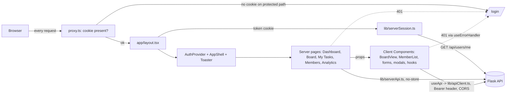
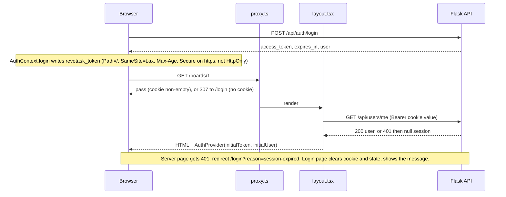

# Design Document: RevoTask Frontend

Version: V2 (see `CHANGELOG.md`)

## Overview

This document designs the Next.js frontend of RevoTask for all 27 requirements in `requirements.md` (V2, which includes auto-login after registration). The frontend consumes the Flask API specified in `.kiro/specs/backend/` and implemented under `backend/app/blueprints/*`. It does not redefine that API. Every field name in `lib/types.ts` was checked against the `schema.py` files of the blueprints. Every path in this document is relative to `frontend/`, which is empty today (`.gitkeep` only).

The API contract used here:

- Success body `{"data": ...}`. Error body `{"error": "..."}`. Error status order 401, 404, 403, 400, 409.
- `POST /api/auth/login` returns `{access_token, token_type, expires_in, user: {id, name, email}}`. `POST /api/auth/register` returns 201 `{id, name, email, created_at}` with no token.
- `GET /api/boards/{id}` returns the board with `role`, and `columns[]` that each hold `cards[]`. The cards inside a column carry no `column_id`.
- `PATCH /api/cards/{id}/position` returns the card fields plus `column_id`, `rebalanced` and, only when `rebalanced` is true, `siblings: [{id, order}]`. `PATCH /api/boards/{id}/columns/reorder` returns `{columns, rebalanced}`.
- `GET /api/cards?assignee=me` returns `[{board_id, board_name, cards}]`. `GET /api/cards?search=` returns a flat card list with no board or column id.
- `GET /api/notifications` returns `{items, page, per_page, total}`. Comments use `content` and `author: {id, name}`.
- `DELETE` routes return `{id}` (board, column, card, comment) or `{user_id}` (member). Swagger UI is served by the API at `/api/docs`.

### Technology decisions

Versions were read from the npm registry on 2026-11-20. Peer ranges were read from each package's metadata.

| Area | Choice | Why |
|------|--------|-----|
| Runtime | Node.js `>=22.12` (`engines` in `package.json`) | Vitest 5 needs `^22.12 \|\| ^24 \|\| >=26`. Next.js 16 needs `>=20.9`. Vercel offers 22.x and 24.x. |
| Framework | `next` 16.4.6, App Router, Turbopack (default bundler of Next 16) | Current stable (`latest` dist-tag). |
| UI | `react` and `react-dom` 19.3.1 | The version range Next 16.4.6 accepts (`^19.0.0`). |
| Language | `typescript` `~5.9.3`, `strict: true` | `latest` is 7.0.2, but `typescript-eslint` accepts only `<6.1.0` and the Next templates target 5.x. Next 16 needs `>=5.1`. Moving to 6.x is a one-line change later. |
| Styling | `tailwindcss` and `@tailwindcss/postcss` 4.3.5, `postcss` `^8.5` | Current stable. Tailwind 4 is CSS-first. `tailwind.config.ts` is kept (Requirement 21.6) and loaded from `app/globals.css` with `@config "../tailwind.config.ts";`. The default `sm` breakpoint is 640px, which equals Requirement 21.2. |
| Toasts | `react-hot-toast` 2.6.1 | Required by the brief. Its bundle starts with `"use client"`, so `Toaster` can be mounted in the Server Component root layout. |
| Lint | `eslint` `^9.39`, `eslint-config-next` 16.4.6, flat config `eslint.config.mjs` | ESLint 10 exists, but `eslint-plugin-react` and `eslint-plugin-jsx-a11y` (dependencies of the Next config) do not list it as a peer. `next lint` was removed in Next 16, and `next build` no longer lints. |
| Unit and component tests | **Vitest** `^5.1.1`, `jsdom` `^31`, `@vitejs/plugin-react` `^6.3`, `vite` `^8.3`, React Testing Library `^16.3.3`, `@testing-library/dom` `^10`, `@testing-library/user-event` `^14.6`, `@testing-library/jest-dom` `^8` | See "Resolved open points". |
| Property tests | `fast-check` `^4.10` | Works in Vitest with no adapter. |
| E2E | `@playwright/test` `^1.65` | Next 16 lists `^1.51.1` as optional peer. |
| Server-only guard | `server-only` | Fails the build when a client module imports `lib/serverApi.ts` or `lib/serverSession.ts`. |

`package.json` dependencies hold only `next`, `react`, `react-dom`, `react-hot-toast` and `server-only`. No chart, drag-and-drop or state-management library is installed (Requirement 23.4). `package-lock.json` is committed.

### Next.js 16 specifics that shape the design

- **Async request APIs.** `cookies()`, `headers()`, `params` and `searchParams` are promises, and synchronous access was removed in Next 16. Every page declares `{ params: Promise<{ id: string }> }` and awaits it. `lib/serverSession.ts` awaits `cookies()`.
- **`proxy.ts`, not `middleware.ts`.** Next 16 deprecates the `middleware` file convention in favor of `proxy` (file `proxy.ts`, exported function `proxy`, same `config.matcher`). The old name still runs but warns at build time. This design uses `proxy.ts` (Requirements Decision 16 allows it). The Route_Guard of the requirements is therefore `proxy.ts`. The Proxy runs on the Node.js runtime, so it can import `lib/session.ts`.
- **Error boundary props.** The installed `next@16.4.6` types (`dist/client/components/error-boundary.d.ts`) pass `{ error: unknown, reset, retry }` to `error.tsx`. `retry()` re-fetches and re-renders the segment. `reset()` only clears the error state. "Try again" (Requirement 10.13) calls `retry()`.
- **Root layout errors.** `app/error.tsx` does not wrap the root layout. Requirement 1.6 (a non-401 failure of `GET /api/users/me` in the root layout) therefore needs `app/global-error.tsx`, which this design adds. It renders its own `<html>` and imports `globals.css`.
- **No lint in build.** The `build` script is `npm run lint && next build`, so `npm run build` fails on any ESLint error (Requirement 24.3), also on Vercel.
- **Cookies cannot be set during Server Component rendering.** The Session_Cookie is therefore written only by browser code (`lib/session.ts`).

### Resolved open points

| Open point in the requirements | Decision |
|--------------------------------|----------|
| Test runner (Decision 13): Jest or Vitest | **Vitest.** Both run React Testing Library. Vitest wins on native TypeScript and ESM (no SWC or Babel config for `server-only`, path aliases or `fast-check`), per-file environments (`// @vitest-environment node` for server-side API client tests) and `vi.useFakeTimers`. Cost: React Testing Library's `waitFor` does not advance Vitest fake timers on its own, so tests advance time explicitly with `await act(async () => { await vi.advanceTimersByTimeAsync(ms) })`. Requirement 25 asks for exact millisecond boundaries, so this is the style needed anyway. |
| Route_Guard file name (Decision 16) | `proxy.ts` with `export function proxy`. See above. |
| Where `Header` is mounted | `components/AppShell.tsx` (Client Component) in the root layout renders `Header` on every path except `/login` and `/register`. This avoids a route group, so the page files keep the paths of the requirements. |
| Page vs form files for `/login`, `/register`, `/profile` | The `page.tsx` files are thin Server Components. The forms are Client Components in `components/auth/LoginForm.tsx`, `components/auth/RegisterForm.tsx` and `components/ProfileForm.tsx`. The traceability tags `(Page: /login)` map to both files. |
| "Open board" Base_Button that links (16.5) | `components/OpenBoardButton.tsx` (Client Component) renders a Base_Button whose `onClick` calls `router.push`. A Server Component cannot pass `onClick`, and a `button` inside an `a` is invalid HTML. |

### Decisions the requirements did not specify

| # | Decision | Reason |
|---|----------|--------|
| F1 | `useApi()` (`hooks/useApi.ts`) binds the Auth_Context token to `apiClient`, so components never pass tokens. | Requirement 5.3 says the token comes from Auth_Context. One place does it. |
| F2 | `lib/serverApi.ts` performs the 401 redirect itself and rethrows every other `ApiError`. Pages that start parallel calls use `Promise.all`. | A redirect is thrown as a special error, so it travels through `Promise.all` untouched. |
| F3 | `getServerSession` is wrapped in React `cache()`. | The layout and the Members page share one `GET /api/users/me` per request. |
| F4 | Auth_Context adds `clearSession()` (clears state and cookie, no navigation). `logout()` calls it and then navigates. The Login_Page calls `clearSession()` when `reason=session-expired`. | Requirement 2.4 asks for cookie deletion. Clearing the state too prevents a loop where `/login` redirects to `/` because a stale token is still in state. |
| F5 | Lengths are counted in Unicode code points (`[...value].length`), not UTF-16 units. | The backend counts Python `str` characters. |
| F6 | The client email check follows Requirement 3.2 literally (one `@`, text before it, a `.` in the domain that is neither its first nor its last character, no whitespace). The API stays the final judge, and its 400 message appears inline. | Requirement 3.2 defines the grammar. |
| F7 | Cards are not draggable while a search filter is active. The "Column" select in Card_Detail_Modal still moves them. | Drop positions are computed from all cards of a column. A filtered view hides neighbours. |
| F8 | Dragging is blocked while a move request is in flight (`isMoving`). | Rollback restores the whole state held before the drop. A second change during the request would be lost. |
| F9 | A column is dropped by comparing the pointer's horizontal coordinate with the horizontal midpoints of the other column elements. | Columns are laid out in a row. Cards use the vertical midpoint (Requirement 13.14). |
| F10 | Notification clicks on already-read items only navigate. Ids with a pending read request stay read when a poll response arrives. | Avoids a flicker from a poll that races the PATCH. |
| F11 | Date display uses `toLocaleString()` and `toLocaleDateString()` inside `<time suppressHydrationWarning>`. | `MemberList` is server-rendered, so server and browser locales can differ. |
| F12 | The success toast after auto-login reads "Welcome to RevoTask!". | Requirement 3.8 requires a toast but no text. |
| F13 | Minimal response headers in `next.config.ts`: `X-Content-Type-Options: nosniff`, `X-Frame-Options: DENY`, `Referrer-Policy: same-origin`. `react/no-danger` is an ESLint error. | Decision 1 of the requirements stores the token in a script-readable cookie, so injection must be hard. No `dangerouslySetInnerHTML`, and every API text is rendered as text. |
| F14 | ESLint also enforces Requirement 8.9 (`no-restricted-syntax` forbids a `button` JSX element outside `components/shared/BaseButton.tsx`) and Requirement 24.5 (`no-restricted-imports` forbids `react-hot-toast` outside `lib/toast.ts` and `app/layout.tsx`; `no-alert` and `no-console` for `error`). | Rules the build can check should not depend on review. |
| F15 | Static hygiene tests in `__tests__/meta/` check the structural rules (Requirements 23.1, 23.2, 23.4, 24.1, 25.8, 26.6, 27.1, 27.3, 27.8). | These requirements are about file contents, not behavior. |
| F16 | A card created while a search filter is active stays hidden until the search term changes. | The filter is a set of ids from the last response. Re-running it is outside the requirements. |
| F17 | The Playwright suite runs the `chromium` project only. | HTML5 drag-and-drop through `dragTo` is the riskiest step. One engine keeps the run short and stable. |

### Research findings

- **Proxy rename.** Next.js documents that the `middleware` file convention is deprecated and renamed to `proxy`, with the same matcher config and an exported function named `proxy` or a default export ([proxy.js reference](https://nextjs.org/docs/app/api-reference/file-conventions/proxy)). Without a `matcher` the Proxy runs on static assets too, so the config below excludes them.
- **Async request APIs.** `cookies()` is an async function. Synchronous access was removed in Next 16, along with sync `params` and `searchParams` ([Version 16 upgrade guide](https://nextjs.org/docs/app/guides/upgrading/version-16), [cookies reference](https://nextjs.org/docs/app/api-reference/functions/cookies)). `.set` and `.delete` work only in Server Functions or Route Handlers.
- **Lint.** `next lint` is removed and `next build` does not lint ([same guide](https://nextjs.org/docs/app/guides/upgrading/version-16)).
- **Error file.** The current `error.js` reference documents `retry()` as the way to recover, and `reset()` for clearing without refetching ([error.js reference](https://nextjs.org/docs/app/api-reference/file-conventions/error)). The installed type declaration was checked at `unpkg.com/next@16.4.6/dist/client/components/error-boundary.d.ts`.
- **Environment variable inlining.** Next inlines `process.env.NEXT_PUBLIC_*` into browser bundles only for literal property access. `process.env[name]` is not replaced. `lib/apiClient.ts` therefore references both variables literally.
- **react-hot-toast.** Version 2.6.1's `dist/index.mjs` begins with `"use client"`.

*Content was rephrased for compliance with licensing restrictions.*

## Architecture



### Rendering strategy

| Route | Component kind | Data source | Client islands |
|-------|----------------|-------------|----------------|
| `/` | Server | `GET /api/boards` | `CreateBoardModal` |
| `/boards/[id]` | Server | `GET /api/boards/{id}` and `GET /api/boards/{id}/members` in parallel | `BoardView` and everything below it |
| `/boards/[id]/members` | Server | `GET /api/boards/{id}/members` (+ cached session) | `MemberList`, `AddMemberModal` |
| `/boards/[id]/analytics` | Server | `GET /api/boards/{id}/analytics` | none (`AnalyticsPanel` has no hooks) |
| `/my-tasks` | Server | `GET /api/cards?assignee=me` | `OpenBoardButton` |
| `/profile`, `/login`, `/register` | Server wrapper | none | `ProfileForm`, `LoginForm`, `RegisterForm` |

### Session and route protection



- **`lib/session.ts`** (browser and Proxy safe): exports `SESSION_COOKIE = 'revotask_token'`, the pure `buildSessionCookie(token, maxAgeSeconds, secure)`, and the browser-only `writeSessionCookie(token, expiresIn)` and `clearSessionCookie()`. `secure` is `location.protocol === 'https:'`. The cookie value is `encodeURIComponent(token)`.
- **`lib/serverSession.ts`** (`import 'server-only'`): the only module that calls `cookies()` for `revotask_token` in a Server Component (Requirement 1.9). `proxy.ts` reads `request.cookies` with the shared constant. It is not a Server Component.
- **Proxy decision table.** Path `/login` or `/register` (and nothing else): pass. A path with a static-asset extension or `_next`: excluded by `matcher`. Any other path: pass when `request.cookies.get(SESSION_COOKIE)?.value` is a non-empty string, else `NextResponse.redirect(new URL('/login', request.url))`. The token is not validated there (Requirement 2.2).
- **Logout.** `logout()` clears state and cookie, calls `router.replace('/login')` and `router.refresh()`. It sends no request.

### Directory layout

`S` = Server Component or server-only module, `C` = Client Component (`"use client"`), `U` = universal module, `T` = test or config. `(new)` marks a file the requirements do not name.

```
frontend/
  app/
    layout.tsx                     S  Toaster, AuthProvider, AppShell, viewport, getServerSession
    globals.css                    T  @import "tailwindcss"; @config "../tailwind.config.ts";
    page.tsx                       S  Dashboard
    login/page.tsx                 S  reads searchParams.reason, renders LoginForm
    register/page.tsx              S  renders RegisterForm
    profile/page.tsx               S  renders ProfileForm
    my-tasks/page.tsx              S
    boards/[id]/page.tsx           S
    boards/[id]/members/page.tsx   S
    boards/[id]/analytics/page.tsx S
    error.tsx                      C  "Try again" -> retry()
    global-error.tsx (new)         C  root layout failures (Requirement 1.6)
    not-found.tsx                  S
  components/
    AppShell.tsx (new)             C  usePathname; Header except on /login and /register
    Header.tsx                     C
    NotificationBell.tsx           C
    BoardView.tsx                  C
    BoardHeader.tsx                C
    KanbanColumn.tsx               C
    CardItem.tsx                   C
    CardSearch.tsx                 C
    CardFormModal.tsx              C
    CardDetailModal.tsx            C
    CommentList.tsx                C
    ColumnFormModal.tsx            C
    CreateBoardModal.tsx           C  trigger button + modal
    AddMemberModal.tsx             C  trigger button + modal
    MemberList.tsx                 C
    AnalyticsPanel.tsx             S
    OpenBoardButton.tsx (new)      C
    NotMemberMessage.tsx (new)     S  "You are not a member of this board" + link to /
    auth/LoginForm.tsx (new)       C
    auth/RegisterForm.tsx (new)    C
    ProfileForm.tsx (new)          C
    shared/BaseButton.tsx          U  no hooks, no directive
    shared/BaseBadge.tsx           U
    shared/BaseModal.tsx           C
    shared/ConfirmModal.tsx (new)  C
    shared/FormField.tsx (new)     U  label + id + aria wiring (render prop)
    shared/FormAlert.tsx (new)     U  role="alert" form-level message
  context/AuthContext.tsx          C
  hooks/
    useApi.ts (new)  useErrorHandler.ts  useDebounce.ts  useNotifications.ts  useDragAndDrop.ts
  lib/
    apiClient.ts  errors.ts  toast.ts  types.ts  order.ts  session.ts
    serverSession.ts S  serverApi.ts S
    validation.ts (new)  boardState.ts (new)  collections.ts (new)  format.ts (new)
  proxy.ts                         S  Route_Guard
  next.config.ts  tailwind.config.ts  postcss.config.mjs  tsconfig.json  eslint.config.mjs
  vitest.config.ts  playwright.config.ts
  __tests__/{shared,auth,hooks,lib,components,meta,helpers}/   setup.ts
  e2e/{auth.spec.ts, kanban.spec.ts, responsive.spec.ts, helpers/auth.ts}
  .env.example  .gitignore  README.md  package.json
```

## Components and Interfaces

### Configuration files

**`package.json` scripts** (Requirement 27.8):

```json
{ "dev": "next dev", "build": "npm run lint && next build", "start": "next start",
  "lint": "eslint .", "typecheck": "tsc --noEmit",
  "test": "vitest run", "test:e2e": "playwright test" }
```

**`tsconfig.json`**: `strict: true` and no individual strict flag set to false; `target: ES2022`, `module: esnext`, `moduleResolution: bundler`, `jsx: react-jsx`, `noEmit`, `paths: {"@/*": ["./*"]}`; `include`: `next-env.d.ts`, `**/*.ts`, `**/*.tsx`, `.next/types/**/*.ts`.

**`eslint.config.mjs`** (flat): `defineConfig([...nextVitals, ...nextTs, project rules, globalIgnores([...])])` with `nextVitals` from `eslint-config-next/core-web-vitals` and `nextTs` from `eslint-config-next/typescript`. Project rules, all at `error`:

- `@typescript-eslint/no-explicit-any`, and `@typescript-eslint/ban-ts-comment` with `ts-ignore` and `ts-nocheck` banned (Requirement 24.2).
- `react/no-danger`, `no-alert`, `no-console` (allow `warn`, `info`) (F13, F14).
- `no-restricted-syntax` with selector `JSXOpeningElement[name.name='button']`, switched off for `components/shared/BaseButton.tsx` (Requirement 8.9).
- `no-restricted-imports` for `react-hot-toast`, switched off for `lib/toast.ts` and `app/layout.tsx` (Requirement 24.5).
- Ignores: `.next/**`, `node_modules/**`, `playwright-report/**`, `test-results/**`, `coverage/**`, `next-env.d.ts`.

**`next.config.ts`**: `poweredByHeader: false` and the three headers of F13. No `eslint` key (removed in Next 16), no webpack config.

**`tailwind.config.ts`**: `content` globs for `app`, `components`; `theme.extend` for the badge and button palette. `postcss.config.mjs`: `{ plugins: { '@tailwindcss/postcss': {} } }`.

**`vitest.config.ts`**:

```ts
export default defineConfig({
  plugins: [react()],
  resolve: { alias: { '@': root, 'server-only': resolve(root, '__tests__/helpers/server-only-stub.ts') } },
  test: { environment: 'jsdom', setupFiles: ['__tests__/setup.ts'],
          include: ['__tests__/**/*.test.{ts,tsx}'], allowOnly: false, restoreMocks: true, css: false },
})
```

`__tests__/setup.ts` registers `@testing-library/jest-dom/vitest` and `cleanup` after each test. Server-side tests start with `// @vitest-environment node`.

**`playwright.config.ts`**:

```ts
const baseURL = process.env.PLAYWRIGHT_BASE_URL?.trim()
if (!baseURL) throw new Error('PLAYWRIGHT_BASE_URL is not set. Point it at the Vercel deployment.')   // Requirement 26.9
export default defineConfig({
  testDir: 'e2e', timeout: 60_000, expect: { timeout: 10_000 }, retries: 0, fullyParallel: true,
  reporter: [['html', { outputFolder: 'playwright-report', open: 'never' }], ['list']],
  use: { baseURL, trace: 'retain-on-failure', screenshot: 'only-on-failure' },
  projects: [{ name: 'chromium', use: { ...devices['Desktop Chrome'] } }],
  // no webServer entry: no local server is started (Requirement 26.1)
})
```

The config tries `process.loadEnvFile('.env.local')` inside a `try` so a developer can keep `PLAYWRIGHT_BASE_URL` there. The throw runs after that attempt.

### `lib/errors.ts` and `lib/toast.ts`

```ts
export class ApiError extends Error {
  readonly statusCode: number
  constructor(statusCode: number, message: string)   // super(message); name = 'ApiError'
}

export const toastApi: {
  success(message: string): string      // toast.success(message)
  error(message: string): string        // toast.error(message)
  loading(message: string): string       // toast.loading(message)
  dismiss(id?: string): void             // toast.dismiss(id), no id dismisses all
}
```

`lib/toast.ts` exports the functions individually as `success`, `error`, `loading`, `dismiss` (module namespace used as `import * as toast from '@/lib/toast'`). It is the only file besides `app/layout.tsx` that imports `react-hot-toast`.

### `lib/apiClient.ts`

```ts
export type HttpMethod = 'GET' | 'POST' | 'PATCH' | 'DELETE'
export interface RequestOptions { token?: string | null; body?: unknown }
export function resolveBaseUrl(): string
export function apiRequest<T>(method: HttpMethod, path: string, options?: RequestOptions): Promise<T>
export const apiClient: {
  get<T>(path: string, token?: string | null): Promise<T>
  post<T>(path: string, body?: unknown, token?: string | null): Promise<T>
  patch<T>(path: string, body: unknown, token?: string | null): Promise<T>
  delete<T>(path: string, token?: string | null): Promise<T>
}
```

`resolveBaseUrl()`:

1. `const server = typeof window === 'undefined'`.
2. Server: `API_BASE_URL` when it is not `undefined`, else `NEXT_PUBLIC_API_BASE_URL`. Client: `NEXT_PUBLIC_API_BASE_URL`. Both are read as literal `process.env.NAME` expressions (inlining).
3. Trim whitespace. When the result is empty, `throw new Error('<NAME> is not set')` with `NAME` = `API_BASE_URL` (server) or `NEXT_PUBLIC_API_BASE_URL` (client). No request is sent.
4. Remove all trailing `/` characters.

`apiRequest()`:

1. `url = resolveBaseUrl() + path` (`path` starts with `/api/`).
2. Headers: `Authorization: Bearer <token>` only when `token` is a non-empty string. `Content-Type: application/json` only when `body !== undefined`, and the body is `JSON.stringify(body)`.
3. Init: `{ method, headers, body, cache: server ? 'no-store' : undefined }`. No `credentials` (the API sends no credentialed CORS).
4. `await fetch(...)`. A rejection becomes `new ApiError(0, 'Network request failed')`.
5. Read `await res.text()`, parse with `JSON.parse` in a `try`.
6. `res.status` in 200 to 299: return `parsed.data` when `parsed` is an object with a `data` key, else `throw new ApiError(res.status, 'Invalid response from server')`.
7. Otherwise `throw new ApiError(res.status, typeof parsed?.error === 'string' && parsed.error !== '' ? parsed.error : \`Request failed with status ${res.status}\`)`.

### `lib/types.ts`

See [Data Models](#data-models).

### `lib/validation.ts`

All functions are pure. Each returns `null` when valid or the message to show.

```ts
export const LIMITS = { name: 255, emailMin: 3, emailMax: 254, passwordMin: 8, passwordMax: 128,
                        title: 255, description: 10_000, comment: 5_000, search: 200 } as const
export const codePointLength = (value: string): number => [...value].length

export function isValidEmail(trimmed: string): boolean        // Requirement 3.2 grammar (F6)
export function validateEmail(raw: string): string | null      // trims, 3..254, isValidEmail
export function validateRegister(v: { name: string; email: string; password: string }): FieldErrors<'name' | 'email' | 'password'>
export function validateLogin(v: { email: string; password: string }): FieldErrors<'email' | 'password'>
export function validateProfile(v: { name: string; email: string }): FieldErrors<'name' | 'email'>
export function validateRequiredText(label: string, raw: string, max: number): string | null   // trims, non-empty, <= max
export function validateOptionalText(label: string, raw: string, max: number): string | null   // empty is valid, <= max
export function validateComment(raw: string): string | null    // non-whitespace, <= 5000
export type FieldErrors<K extends string> = Partial<Record<K, string>>
```

`validateRegister` does not trim `name` or `password` (Requirement 3.2). `validateRequiredText` is used for board name, column title, card title (all 1 to 255 after trimming).

### `lib/order.ts` (Order_Helper)

```ts
/** above: order of the card before the slot (null at the top). below: order of the card after the slot (null at the bottom). */
export function orderBetween(above: number | null, below: number | null): number
//   both     -> (above + below) / 2        (13.2, not rounded)
//   top only -> below / 2                  (13.3)
//   bottom   -> above + 1.0                (13.4)
//   neither  -> 1.0                        (13.5)

/** `sortedOthers` are the orders of the target's items without the dragged one, ascending. index is 0..length. */
export function orderForIndex(sortedOthers: readonly number[], index: number): number

/** Index of the first midpoint that is greater than pointer, or midpoints.length. Midpoints ascending (13.14). */
export function dropIndex(midpoints: readonly number[], pointer: number): number
```

### `lib/boardState.ts`, `lib/collections.ts`, `lib/format.ts`

`lib/boardState.ts` holds `BoardState`, `BoardAction`, `boardReducer`, `initBoardState`, `findCard`. See [Data Models](#data-models).

```ts
// lib/collections.ts (pure)
export function sortByOrder<T extends { order: number }>(items: readonly T[]): T[]               // ascending, stable
export function sortByCreatedAt<T extends { created_at: string }>(items: readonly T[], dir: 'asc' | 'desc'): T[]   // stable
export function sortByActionsDesc<T extends { actions: number }>(items: readonly T[]): T[]       // stable on ties (20.4)
export function barPercentages(counts: readonly number[]): number[]                               // count / max * 100, all 0 when max is 0 (20.2)

// lib/format.ts
export function formatUnreadCount(n: number): string | null     // null for 0, "99+" above 99, else String(n) (18.4)
export function formatDateTime(iso: string): string             // new Date(iso).toLocaleString()
export function formatDate(iso: string): string                 // new Date(iso).toLocaleDateString()
```

### `lib/serverSession.ts` and `lib/serverApi.ts`

```ts
// serverSession.ts  (import 'server-only')
export const getSessionToken: () => Promise<string | null>          // cache(); awaits cookies(); empty value counts as null
export const getServerSession: () => Promise<{ token: string | null; user: User | null }>
//   no token       -> { null, null }, no request (1.4)
//   /me ok         -> { token, user } (1.3)
//   /me 401        -> { null, null }, no throw (1.5)
//   /me other err  -> rethrows the ApiError (1.6) -> app/global-error.tsx

// serverApi.ts  (import 'server-only')
export const serverApi: { get<T>(path: string): Promise<T> }
//   token = await getSessionToken(); no token -> redirect('/login')
//   apiRequest('GET', path, { token }); catch ApiError 401 -> redirect('/login?reason=session-expired') (2.3)
//   every other error is rethrown unchanged
```

`redirect()` is called inside the `catch` block, outside any `try`, so no caller catches the redirect error by accident.

### `context/AuthContext.tsx`

```ts
export interface AuthContextValue {
  token: string | null
  user: User | null
  login(token: string, expiresIn: number, user: User): void   // 1.1
  logout(): void                                              // 1.7
  clearSession(): void                                        // F4: state + cookie, no navigation
  updateUser(user: User): void                                // 1.8: token and cookie unchanged
}
export const AuthContext: React.Context<AuthContextValue | null>
export function AuthProvider(props: { initialToken: string | null; initialUser: User | null; children: React.ReactNode }): JSX.Element
export function useAuth(): AuthContextValue                   // throws when used outside AuthProvider
```

State is `useState` seeded from the props. `login` calls `writeSessionCookie` and then sets state. `logout` = `clearSession()`, `router.replace('/login')`, `router.refresh()`.

### Hooks

| Hook | Signature | Behavior |
|------|-----------|----------|
| `useApi` | `useApi(): { get<T>(path): Promise<T>; post<T>(path, body?): Promise<T>; patch<T>(path, body): Promise<T>; delete<T>(path): Promise<T> }` | `useMemo` over `useAuth().token`. Each method calls `apiClient.*` with that token. The object is stable while the token is stable. |
| `useErrorHandler` | `useErrorHandler(): (error: unknown) => void` and the pure `describeError(error: unknown): { message: string; endsSession: boolean }` | 400 and 409: `error.message`. 401: "Your session has expired. Please log in again." and `endsSession`. 403: "You do not have permission to do this." 404: "The requested item was not found." 0: "Cannot reach the server. Check your connection." Everything else, including non-ApiError values and status 500 and above: "Something went wrong. Please try again." The hook calls `toast.error(message)` from `lib/toast.ts`, then `logout()` once when `endsSession`. |
| `useDebounce` | `useDebounce<T>(value: T, delayMs: number): T` | `useEffect` sets a `setTimeout` for `delayMs` after every `value` change and clears it in the cleanup. The returned value changes only when the timer fires. |
| `useNotifications` | `useNotifications(): { items: Notification[]; unreadCount: number; markAsRead(id: string): Promise<void>; refresh(): Promise<void> }` | See below. |
| `useDragAndDrop` | See below. | |

**`useNotifications`.** Constants `POLL_INTERVAL_MS = 30_000`, `PAGE_SIZE = 100`. State: `items`. `refresh()` calls `GET /api/notifications?per_page=100` and replaces `items` with the response `items`, except that ids in `pendingReadIds` (a ref set) stay `is_read: true` (F10). One `useEffect` keyed on the token:

1. Token null: do nothing.
2. Otherwise call `refresh()` once, then start `setInterval(tick, POLL_INTERVAL_MS)`.
3. Cleanup (token becomes null or unmount) clears the interval and sets `active = false`, so a late response is dropped.
4. `tick` failure: status 401 calls `useErrorHandler`, clears the interval and stops (18.11). Any other failure keeps `items`, shows nothing and waits for the next tick (18.8).

`unreadCount = items.filter((n) => !n.is_read).length`. `markAsRead(id)` adds `id` to `pendingReadIds`, sets `is_read: true` in state, sends `PATCH /api/notifications/{id}/read`, removes the id from the set when the request settles, and on failure sets `is_read: false` again and calls the error handler (18.7).

**`useDragAndDrop`.**

```ts
export interface DragAndDrop {
  isMoving: boolean
  draggingCardId: string | null
  draggingColumnId: string | null
  overColumnId: string | null                       // the single highlighted column (13.11)
  moveCard(cardId: string, targetColumnId: string, position: number | 'end'): Promise<void>
  moveColumn(columnId: string, position: number): Promise<void>
  cardDragProps(cardId: string): { draggable: boolean; onDragStart(e: React.DragEvent): void; onDragEnd(e: React.DragEvent): void }
  columnHandleProps(columnId: string): { draggable: boolean; onDragStart(e: React.DragEvent): void; onDragEnd(e: React.DragEvent): void }
  cardDropProps(columnId: string): { onDragEnter(e): void; onDragOver(e): void; onDragLeave(e): void; onDrop(e): void }
  columnDropProps(): { onDragOver(e): void; onDrop(e): void }   // on the scroll container, for column drags
}
export function useDragAndDrop(args: { boardId: string; state: BoardState; dispatch: Dispatch<BoardAction>; disabled?: boolean }): DragAndDrop
```

Behavior:

- Native HTML5 events only (13.1). `dragstart` sets `dataTransfer.setData('text/plain', id)` and `effectAllowed = 'move'` (Firefox needs the data), and stores `{ kind: 'card' | 'column', id }` in a ref, because `dragover` cannot read `dataTransfer` data.
- `draggable` is `false` while `disabled` (search active, F7) or `isMoving` (F8).
- `dragover` calls `preventDefault()` only when the ref holds a drag of the matching kind, and sets `overColumnId`. `drop` and `dragend` set it to `null` (13.11). `dragend` after Escape or an outside drop changes nothing else (13.15).
- **Card drop.** On `drop` in column `C`: read the `[data-card-id]` elements of `C`'s card list, skip the dragged one, collect `(rect.top + rect.bottom) / 2` for each, call `dropIndex(midpoints, e.clientY)` (13.14, 13.6), then `moveCard(id, C, index)`.
- **Column drop.** On `drop` in the scroll container: collect `(rect.left + rect.right) / 2` of the `[data-column-id]` elements except the dragged one, call `dropIndex(midpoints, e.clientX)` (F9), then `moveColumn(id, index)`.
- **`moveCard(cardId, targetColumnId, position)`.**
  1. `snapshot = stateRef.current` (a ref refreshed on every render).
  2. `others` = the target column's cards without `cardId`, sorted by `order`. `index = position === 'end' ? others.length : clamp(position, 0, others.length)`.
  3. When the target equals the source column and `index` equals the card's current index in that list: return, no state change, no request (13.8).
  4. `order = orderForIndex(others.map((c) => c.order), index)`.
  5. `dispatch({ type: 'card/moved', cardId, toColumnId, order })`, then `PATCH /api/cards/{id}/position` with `{ column_id, order }` (13.7). `isMoving` is true until the request settles.
  6. Success: when `response.rebalanced`, `dispatch({ type: 'cards/orders-applied', columnId: toColumnId, orders: response.siblings })` (13.10).
  7. Failure: `dispatch({ type: 'state/restored', snapshot })` and `handleError(error)` (13.9).
- **`moveColumn`.** Same shape. `others` are the other columns by `order`. Equal index returns without a request (11.9). The PATCH is `PATCH /api/boards/{boardId}/columns/reorder` with `{ column_id, order }`. `rebalanced` dispatches `columns/orders-applied` with `response.columns` (11.8). Failure restores the snapshot and calls the error handler (11.10).

### Shared components

| Component | Props | Behavior |
|-----------|-------|----------|
| `BaseButton` | `variant?: 'primary' \| 'secondary' \| 'destructive'` (default `primary`), `loading?: boolean`, plus all `ButtonHTMLAttributes` | Renders `<button type={type ?? 'button'} disabled={disabled \|\| loading} aria-busy={loading}>`. Distinct Tailwind class set per variant. `loading` adds a spinner. Forwards every other prop, including `className` (merged last). |
| `BaseBadge` | `color?: 'gray' \| 'blue' \| 'green' \| 'yellow' \| 'red'` (default `gray'`), `className?`, `children` | Renders a `span` with a distinct class set per color. |
| `BaseModal` | `open: boolean`, `title: string`, `onClose(): void`, `children`, `size?: 'md' \| 'lg'` | Described below. |
| `ConfirmModal` | `open`, `title`, `message`, `confirmLabel`, `pending?`, `onConfirm()`, `onCancel()` | A `BaseModal` with a destructive confirm `BaseButton` and a cancel `BaseButton`. Used for delete board, column, card, comment and member removal. |
| `FormField` | `label: string`, `error?: string \| null`, `hint?`, `children: (a: { id: string; 'aria-invalid': boolean; 'aria-describedby'?: string }) => ReactNode` | Calls `useId()`, renders `<label htmlFor={id}>`, the control from `children`, and `<p id="{id}-error">` only while `error` is set. One place implements Requirements 22.5 and 22.8. |
| `FormAlert` | `message?: string \| null` | `<div role="alert">` while `message` is set, nothing otherwise. Used for the inline API messages of Requirements 3.6, 4.5 and the 409 of 17.6 (the latter goes through `FormField`). |

**`BaseModal`.**

- While `open` is false it returns `null`, so the dialog, backdrop and children are absent from the DOM (8.6). While open it renders through `createPortal(..., document.body)` (guarded by `typeof document !== 'undefined'`): a backdrop `div` and a `div role="dialog" aria-modal="true" aria-labelledby={headingId}` that holds `<h2 id={headingId}>{title}</h2>` and the children (8.5, 22.1).
- A module-level stack `modalStack: symbol[]` holds one entry per open modal. Only the topmost modal handles keys (22.3).
- One `document` `keydown` listener per open modal: `Escape` calls `onClose` once (8.7); `Tab` and `Shift+Tab` wrap focus inside the dialog by comparing `document.activeElement` with the first and last focusable element (22.3). Focusable = visible, non-disabled `button`, `a[href]`, `input`, `select`, `textarea`, or `[tabindex]` with a value of 0 or more.
- The backdrop `onClick` calls `onClose`. The dialog `onClick` stops propagation (8.7).
- `useEffect([open])`: remember `document.activeElement`, move focus to the first focusable element or to the dialog container (`tabIndex={-1}`) (22.2). Cleanup restores focus to the remembered element when it is still connected, else blurs the active element so focus rests on `body` (22.4).
- Mobile: `max-h-[100dvh] max-w-full overflow-y-auto` on the dialog (21.4).

### Feature components

**`Header`** (C). No props. Reads `useAuth()`. Renders the brand link, the Notification_Bell, and a `<nav id="main-nav">` with links to `/`, `/my-tasks`, `/profile`, the user name and a "Log out" `BaseButton` whose click calls `logout()` (2.5). State `menuOpen`. Below `sm` the nav has class `hidden` unless `menuOpen`, and the menu `BaseButton` (`aria-label="Toggle navigation"`, `aria-expanded`, `aria-controls="main-nav"`, class `sm:hidden`) toggles `menuOpen` (21.2, 21.7). From `sm` up, the nav has `sm:flex` and the menu button is hidden by CSS (21.8). Responsive switching uses CSS only, so there is no hydration mismatch.

**`NotificationBell`** (C). Uses `useNotifications()`. A secondary `BaseButton` with `aria-label="Notifications"`, `aria-expanded` and an inline SVG bell (`aria-hidden`). `formatUnreadCount(unreadCount)` non-null renders a red `BaseBadge` (18.4). Open state shows a panel: "No notifications" when `items` is empty (18.9), else the items from `sortByCreatedAt(items, 'desc')`. Each item is a secondary `BaseButton` with the `message`, `formatDateTime(created_at)` and an unread marker (`<span aria-label="Unread">`) only when `is_read` is false (18.5). Click: `if (!n.is_read) void markAsRead(n.id)`, then `router.push('/boards/' + n.board_id)`, then close the panel (18.6). `Escape` and a click outside close the panel.

**`BoardView`** (C). Props `{ initialBoard: BoardDetail; members: Member[] }`.

- State: `const [state, dispatch] = useReducer(boardReducer, initialBoard, initBoardState)`; `searchIds: ReadonlySet<string> | null` (`useState`); `modal: ModalState` (`useState`); `selectedCardId: string | null`.
- `type ModalState = null | { kind: 'addColumn' } | { kind: 'renameColumn'; columnId: string } | { kind: 'deleteColumn'; columnId: string } | { kind: 'addCard'; columnId: string }`.
- `const dnd = useDragAndDrop({ boardId, state, dispatch, disabled: searchIds !== null })`.
- Derived: `memberById` (`useMemo`), `visibleCards(column)` = `column.cards` filtered by `searchIds` when set. Card count of a column = `visibleCards(column).length` (15.4). When `searchIds !== null` and every column shows 0 cards, the text "No cards match your search" renders (15.6).
- Layout: `BoardHeader`, a toolbar with `CardSearch` and an "Add column" `BaseButton`, then one scroll container `<div class="flex gap-4 overflow-x-auto" {...dnd.columnDropProps()}>` with the columns in `order` ascending (10.2, 21.3).
- Column delete: `ConfirmModal`. On confirm `DELETE /api/columns/{id}`, then `dispatch({ type: 'column/removed', columnId })` and close (11.6). Failure: `handleError`, state unchanged (11.10).
- Renders `ColumnFormModal`, `CardFormModal` (from `modal`), `CardDetailModal` (from `selectedCardId`; it closes when `findCard` returns null).

**`BoardHeader`** (C). Props `{ board: { id: string; name: string; role: Role }; onRenamed(name: string): void }`. Shows the name, a `BaseBadge` for the role, and a link to `/boards/{id}/members` always (10.7, 10.8). Only `role === 'admin'`: rename and delete `BaseButton`s and a link to `/boards/{id}/analytics`. Rename uses a `BaseModal` with `FormField` + input, validation `validateRequiredText('Name', v, 255)`, `PATCH /api/boards/{id}` `{ name }`, on 200 `onRenamed(response.name)`, success toast, close (10.9, 10.10). Delete uses `ConfirmModal`, `DELETE /api/boards/{id}`, success toast, `router.push('/')` (10.11). Failures: `handleError`, modal stays open, nothing else changes (10.12).

**`KanbanColumn`** (C). Props `{ column: ColumnWithCards; cards: Card[]; memberById: ReadonlyMap<string, Member>; dnd: DragAndDrop; onAddCard(): void; onRename(): void; onDelete(): void; onOpenCard(cardId: string): void }`. Renders `<section aria-labelledby={headingId} data-column-id={id} class={overColumnId === id ? 'ring-2 ring-blue-500' : ''}>`. The header (`{...dnd.columnHandleProps(id)}`) holds `<h2 id=...>` with the title, a count `BaseBadge`, rename and delete `BaseButton`s. The body is `<ul data-testid="column-cards" {...dnd.cardDropProps(id)}>` with one `CardItem` per card. With 0 cards it renders a drop area labelled "No cards" inside the same drop target (10.4). An "Add card" `BaseButton` sits at the bottom.

**`CardItem`** (C). Props `{ card: Card; assigneeName: string | null; dnd: DragAndDrop; onOpen(): void }`. Renders `<li><div role="button" tabIndex={0} data-testid="card" data-card-id={id} {...dnd.cardDragProps(id)}>`. It shows the title, a green "Completed" `BaseBadge` when `completed_at` is set, and the assignee name when `assignee_id` is set (10.3). `onClick` and `onKeyDown` (Enter, only when `e.target === e.currentTarget`) call `onOpen` (22.7, 22.9). The element is a `div` with `role="button"`, not a native `button`, because it is draggable and Requirement 8.9 reserves `button` elements for Base_Button.

**`CardSearch`** (C). Props `{ onResults(ids: ReadonlySet<string> | null): void }`. State `term`, ref `latestRequest` (a counter). `const debounced = useDebounce(term, 300)`; `const trimmed = debounced.trim()`. The input truncates typed or pasted text to 200 code points in `onChange` and also sets `maxLength={200}` (15.1). `useEffect([trimmed])`:

1. `trimmed === ''`: `latestRequest.current += 1` (any in-flight response is now stale), `onResults(null)`, no request (15.5).
2. Otherwise `const id = ++latestRequest.current`, `GET /api/cards?search=${encodeURIComponent(trimmed)}`. On success, when `id === latestRequest.current`, `onResults(new Set(cards.map((c) => c.id)))`. A stale response is dropped (15.7).
3. On failure, when `id === latestRequest.current`: `handleError(error)`; nothing else changes (15.8).

**`ColumnFormModal`** (C). Props `{ mode: 'create' | 'rename'; open: boolean; boardId: string; column?: Column; onClose(): void; onSaved(column: Column): void }`. A `title` input (pre-filled in rename mode), `validateRequiredText('Title', v, 255)`. Create: `POST /api/boards/{boardId}/columns`; the parent dispatches `column/added` with `{ ...column, cards: [] }`. Rename: `PATCH /api/columns/{id}`; the parent dispatches `column/renamed`. Submit is disabled while pending. A failure calls `handleError`, keeps the modal open and re-enables submit (11.1 to 11.5, 11.11).

**`CardFormModal`** (C). Props `{ open: boolean; columnId: string; members: Member[]; onClose(): void; onCreated(card: Card): void }`. Fields `title`, `description`, `assignee` select (empty option first, then `members` in API order). Validation: title required and at most 255, description at most 10,000. Submit sends `POST /api/columns/{columnId}/cards` with `{ title, description, assignee_id: selected || null }`. On 201 the parent dispatches `card/added` (appended last), the modal closes and a success toast shows (12.1 to 12.3, 12.8, 12.9).

**`CardDetailModal`** (C). Props `{ card: Card; columnId: string; columns: { id: string; title: string }[]; members: Member[]; boardRole: Role; dnd: DragAndDrop; onClose(): void; onSaved(card: Card): void; onDeleted(cardId: string): void }`. Contents:

- Edit form: `title`, `description`, `assignee` select, `completed` checkbox. `changed = pick of the fields that differ from the card` (`description` compares with `card.description ?? ''`, `completed` with `card.completed_at !== null`). Submit is disabled while `changed` is empty or pending (12.11). Submit sends `PATCH /api/cards/{id}` with only the changed fields, then `onSaved(response)` (12.5). Validation as in `CardFormModal` (12.10).
- "Column" select listing `columns`, set to `columnId`. A change calls `dnd.moveCard(card.id, selectedColumnId, 'end')` (13.13).
- Delete: visible when `card.created_by === user.id || boardRole === 'admin'` (12.6, 12.7). It opens a `ConfirmModal`. Confirm sends `DELETE /api/cards/{id}` and then `onDeleted(id)`, closing both modals. Cancel closes the confirmation only.
- `CommentList` below the form (14.1). Failures call `handleError` and keep the entered values (12.8).

**`CommentList`** (C). Props `{ cardId: string }`. State: `comments: Comment[] | null` (null before the first response), `draft`, `draftError`, `editingId`, `editDraft`, `editError`, `deletingId`, pending flags. `useEffect([cardId])` sends `GET /api/cards/{cardId}/comments` once and stores `sortByCreatedAt(response, 'asc')`. A failed GET calls `handleError` and leaves `comments` null, so "No comments yet" never shows for a failed load (14.11). An empty array shows "No comments yet" (14.3). Each comment shows `content`, `author.name` and `formatDateTime(created_at)` (14.2). Edit and delete `BaseButton`s render only when `comment.author.id === user.id` (14.7, 14.10). Create appends the 201 response and clears the textarea (14.6). Edit swaps in a textarea with save and cancel `BaseButton`s (14.12); save sends `PATCH /api/comments/{id}` and replaces the item in place (14.8). Delete opens a `ConfirmModal`; confirm sends `DELETE /api/comments/{id}` and removes the item (14.9, 14.13). Validation uses `validateComment` for both forms (14.5).

**`CreateBoardModal`** (C). No props. Renders a "Create board" `BaseButton` (always, 9.3) and a `BaseModal` with a `name` input. `validateRequiredText('Name', v, 255)`; `POST /api/boards` `{ name: trimmed }`; on 201 close, success toast, `router.push('/boards/' + id)` (9.4 to 9.6). Failure: `handleError`, modal open, submit re-enabled.

**`AddMemberModal`** (C). Props `{ boardId: string; onAdded(member: Member): void }`. Trigger `BaseButton` plus `BaseModal` with `email` (`validateEmail`), `role` select (`member` default, `admin`). `POST /api/boards/{boardId}/members` with `{ email: trimmed, role }`; on 201 `onAdded(member)`, close, success toast (19.2 to 19.4). Failure: `handleError`, modal stays open with the values (19.8).

**`MemberList`** (C). Props `{ boardId: string; initialMembers: Member[]; currentUserId: string; isAdmin: boolean }`. State `members`, `removing: Member | null`. Rows show `name`, `email`, role `BaseBadge`, `<time>` with `formatDate(created_at)` (19.1, F11). `isAdmin`: an `AddMemberModal`, a role `<select>` per row (`PATCH /api/boards/{boardId}/members/{user_id}` `{ role }`, replace the role from the response; a failure resets the select to the previous role, 19.9, 19.8) and a "Remove" `BaseButton` per row (19.5). Non-admin: a "Leave board" `BaseButton` only on the own row, no select, no remove, no add (19.6). Removal and leaving go through `ConfirmModal`, `DELETE /api/boards/{boardId}/members/{user_id}`; removing someone else deletes the row (19.10), removing oneself calls `router.push('/')` (19.7). Failures call `handleError`; the list stays unchanged.

**`AnalyticsPanel`** (S, no directive). Props `{ cardsPerColumn: {column_id; title; card_count}[]; completedThisWeek: number; memberActivity: {user_id; name; actions}[] }`. Bars use `barPercentages(counts)` as inline `style={{ width: p + '%' }}` on a `div role="img" aria-label="<title>: <count>"`. Empty `cardsPerColumn` shows "This board has no columns" (20.6). "Completed this week" with the integer (20.3). `sortByActionsDesc(memberActivity)` as a list of name and `actions` (20.4).

**`AppShell`** (C): `const pathname = usePathname(); const bare = pathname === '/login' || pathname === '/register'`; renders `<>{!bare && <Header />}<main class="mx-auto w-full max-w-screen-2xl px-4 py-6">{children}</main></>`.

**`OpenBoardButton`** (C): `{ boardId: string }`, secondary `BaseButton` "Open board", `onClick={() => router.push('/boards/' + boardId)}` (16.5).

**`NotMemberMessage`** (S): `<p>You are not a member of this board</p>` and `<Link href="/">`.

**`LoginForm`** (C). Props `{ sessionExpired: boolean }`. Uses `useAuth()`, `useApi()`, `useErrorHandler()`, `useRouter()`.

- Guard: when `token && !sessionExpired`, render `null` and `router.replace('/')` in an effect (4.7).
- When `sessionExpired`, an effect calls `clearSession()` (F4, 2.4) and the form shows "Your session has expired. Please log in again."
- Submit: `email.trim() === ''` or `password === ''` gives field errors and no request (4.2). Otherwise `POST /api/auth/login` `{ email, password }` (email as typed, trimmed by the API). Success: `login(access_token, expires_in, user)` then `router.replace('/')` (4.4). 401: `FormAlert` with `error.message`, email kept, no error handler call (4.5). Other errors: `handleError` (4.6). The button is disabled while pending (4.3).

**`RegisterForm`** (C). Same guard as `LoginForm` (without `sessionExpired`). The sequence (3.4 to 3.10):

```ts
async function submit() {
  const errors = validateRegister(values)
  if (hasErrors(errors)) { setErrors(errors); return }          // no request, values kept (3.3)
  setPending(true); setFormError(null)
  const email = values.email.trim()
  try {
    await api.post<RegisteredUser>('/api/auth/register', { name: values.name, email, password: values.password })
  } catch (error) {
    setPending(false)
    if (error instanceof ApiError && (error.statusCode === 409 || error.statusCode === 400)) setFormError(error.message)   // 3.6, no toast
    else handleError(error)                                                                                                  // 3.7
    return
  }
  let session: LoginResponse
  try {
    session = await api.post<LoginResponse>('/api/auth/login', { email, password: values.password })    // 3.5
  } catch {
    setValues(EMPTY); toast.success('Account created. Please log in.'); router.replace('/login')        // 3.9, Error_Handler not called
    return                                                                                                // pending stays true until navigation
  }
  login(session.access_token, session.expires_in, session.user)      // 3.8
  toast.success('Welcome to RevoTask!')
  router.replace('/')
}
```

The password lives only in component state (3.10). After `login` the guard effect may call `router.replace('/')` again with the same target, which is harmless.

**`ProfileForm`** (C). Fields `name` and `email` seeded from `useAuth().user`. `validateProfile`. Submit disabled while the trimmed values equal the Current_User or while pending (17.3). It sends `PATCH /api/users/me` with only the changed fields (`email` trimmed). On 200: `updateUser(response)` and a success toast. 409: `FormField` error on `email` with the message (17.6). Other errors: `handleError` (17.7).

### Pages

All pages use `{ params: Promise<{ id: string }> }` where they take a route parameter. Path segments are passed through `encodeURIComponent`.

| Page | Logic |
|------|-------|
| `app/page.tsx` | `const boards = await serverApi.get<Board[]>('/api/boards')`. Heading, `<CreateBoardModal />`. Empty list: "You have no boards yet". Otherwise a list with one `<Link href={'/boards/' + b.id}>` per board in API order, name plus `<BaseBadge color={b.role === 'admin' ? 'blue' : 'gray'}>{b.role}</BaseBadge>` (9.1, 9.2). A non-401 failure propagates to `app/error.tsx` (9.7). |
| `app/boards/[id]/page.tsx` | Starts both calls before awaiting, then `Promise.all` (10.1, 23.3). `catch`: 404 calls `notFound()` (10.5), 403 returns `<NotMemberMessage />` (10.6), anything else is rethrown (10.13). Success renders `<BoardView initialBoard members />`. |
| `app/boards/[id]/members/page.tsx` | `Promise.all([serverApi.get<Member[]>(.../members), getServerSession()])`. 404 gives `notFound()`, 403 gives `<NotMemberMessage />` (19.11). `isAdmin = members.find((m) => m.user_id === session.user?.id)?.role === 'admin'`. Renders `<MemberList />`. |
| `app/boards/[id]/analytics/page.tsx` | `serverApi.get<Analytics>(.../analytics)`. 403 renders "Analytics are available to board administrators" and a link to `/boards/{id}` (20.5). 404 gives `notFound()` (20.7). Otherwise `<AnalyticsPanel />`. |
| `app/my-tasks/page.tsx` | `serverApi.get<MyTasksGroup[]>('/api/cards?assignee=me')`. Empty: "No cards are assigned to you" (16.6). Else one `<section>` per group in API order, keyed by `board_id`, with `<h2>{board_name}</h2>` and one `<li>` per card: title, `BaseBadge` (green "Completed" or gray "Open"), `<OpenBoardButton boardId={group.board_id} />` (16.2 to 16.5). Failures other than 401 reach `app/error.tsx` (16.7). |
| `app/login/page.tsx` | `const { reason } = await searchParams; return <LoginForm sessionExpired={reason === 'session-expired'} />`. |
| `app/register/page.tsx`, `app/profile/page.tsx` | Render the form. |
| `app/error.tsx` (C) | `({ retry }) => <div><h2>Something went wrong.</h2><BaseButton onClick={() => retry()}>Try again</BaseButton></div>`. It does not log to the console and does not show `error.message`. |
| `app/global-error.tsx` (C) | The same content inside `<html><body>`, importing `./globals.css`. |
| `app/not-found.tsx` (S) | "Page not found" and a link to `/`. |
| `proxy.ts` | See "Session and route protection". `export const config = { matcher: ['/((?!_next/static\|_next/image\|favicon\\.ico\|.*\\.(?:svg\|png\|jpg\|jpeg\|gif\|webp\|ico\|css\|js\|map\|txt\|xml)$).*)'] }`. |

### Responsive approach and accessibility

- Mobile-first Tailwind utilities, breakpoint `sm` (640px) for the header, `md` and up for wider paddings. Page content is `max-w-screen-2xl` with horizontal padding. The board row is the only horizontal scroller (`overflow-x-auto`, columns `w-72 shrink-0`), and the document never scrolls sideways (21.1, 21.3).
- Touch targets use `min-h-10` buttons. Long titles use `break-words`.
- Every input goes through `FormField` (label, `aria-invalid`, `aria-describedby`). Icon-only buttons have `aria-label`. Modals follow the focus rules above. Cards are `tabIndex=0` and open with Enter. Keyboard and touch users move cards with the "Column" select.
- Colors keep contrast of at least 4.5:1 for text (Tailwind `-700` or `-800` text on `-100` badges). Focus rings are never removed (`focus-visible:ring-2`).

### Environment variables, deployment and CORS

`.env.example` (each value a URL on `localhost`, no trailing slash, no secret):

```
NEXT_PUBLIC_API_BASE_URL=http://localhost:5000
API_BASE_URL=http://localhost:5000
PLAYWRIGHT_BASE_URL=http://localhost:3000
```

`frontend/.gitignore`: `.next/`, `node_modules/`, `.env`, `.env.local`, `.env.*.local`, `coverage/`, `test-results/`, `next-env.d.ts`, `*.tsbuildinfo`. It does not list `playwright-report/` or `.env.example`. The root `.gitignore` already negates `.env.example`.

`README.md` covers: setup (`npm install`, copy `.env.example` to `.env.local`); the four commands with one sentence each (`npm run dev`, `npm run build`, `npm test`, `npm run test:e2e`); Vercel (project root directory `frontend`; set `NEXT_PUBLIC_API_BASE_URL` and `API_BASE_URL` to the API origin, for example the Railway URL with no trailing slash and no `/api`; `PLAYWRIGHT_BASE_URL` is not needed there; `NEXT_PUBLIC_*` values are compiled in at build time, so a change needs a redeploy); and CORS. On the backend, `CORS_ORIGINS` must list the exact Vercel origin (`https://<host>`, no trailing slash, no path) and `http://localhost:3000`. Server Component requests are server-to-server and need no CORS entry. A Vercel preview deployment has its own origin and also needs an entry before its browser requests work.

## Data Models

### API types (`lib/types.ts`)

The only module that declares response types (Requirement 5.9). Field names come from the `schema.py` files of the blueprints.

```ts
export type Role = 'admin' | 'member'
export type NotificationType = 'card_assigned' | 'card_moved' | 'comment_added' | 'member_added'

export interface User { id: string; name: string; email: string }                    // login "user", /users/me
export interface RegisteredUser extends User { created_at: string }
export interface LoginResponse { access_token: string; token_type: string; expires_in: number; user: User }

export interface Board { id: string; name: string; owner_id: string; role: Role; created_at: string; updated_at: string }
export interface Column { id: string; board_id: string; title: string; order: number; created_at: string; updated_at: string }
export interface Card {
  id: string; title: string; description: string | null; assignee_id: string | null; created_by: string
  order: number; completed_at: string | null; created_at: string; updated_at: string
}
export interface ColumnWithCards extends Column { cards: Card[] }
export interface BoardDetail extends Board { columns: ColumnWithCards[] }

export interface Member { user_id: string; name: string; email: string; role: Role; created_at: string }
export interface Comment { id: string; card_id: string; content: string; author: { id: string; name: string }; created_at: string; updated_at: string }
export interface Notification {
  id: string; type: NotificationType; message: string; board_id: string; card_id: string | null; is_read: boolean; created_at: string
}
export interface NotificationPage { items: Notification[]; page: number; per_page: number; total: number }
export interface MyTasksGroup { board_id: string; board_name: string; cards: Card[] }
export interface Analytics {
  cards_per_column: { column_id: string; title: string; card_count: number }[]
  completed_this_week: number
  member_activity: { user_id: string; name: string; actions: number }[]
}
export interface CardMoveResult extends Card { column_id: string; rebalanced: boolean; siblings?: { id: string; order: number }[] }
export interface ColumnReorderResult { columns: Column[]; rebalanced: boolean }
export interface DeletedId { id: string }
export interface MemberRemoved { user_id: string }
```

Request bodies are built inline at the call sites and match the API schemas: board `{ name }`; column `{ title }`; reorder and move `{ column_id, order }`; card create `{ title, description, assignee_id }`; card update any of `title`, `description`, `assignee_id`, `completed`; comment `{ content }`; member add `{ email, role }`; member role `{ role }`; profile `{ name?, email? }`.

### Board state (`lib/boardState.ts`)

```ts
export interface BoardState {
  board: { id: string; name: string; role: Role; owner_id: string }
  columns: ColumnWithCards[]            // sorted by order ascending; each column's cards sorted by order ascending
}
export type BoardAction =
  | { type: 'board/renamed'; name: string }
  | { type: 'column/added'; column: ColumnWithCards }
  | { type: 'column/renamed'; column: Column }                                  // title and updated_at only
  | { type: 'column/removed'; columnId: string }
  | { type: 'column/moved'; columnId: string; order: number }                   // optimistic
  | { type: 'columns/orders-applied'; columns: Column[] }                       // rebalanced response
  | { type: 'card/added'; columnId: string; card: Card }                        // appended last
  | { type: 'card/replaced'; card: Card }                                       // by id, position kept
  | { type: 'card/removed'; cardId: string }
  | { type: 'card/moved'; cardId: string; toColumnId: string; order: number }   // optimistic
  | { type: 'cards/orders-applied'; columnId: string; orders: { id: string; order: number }[] }
  | { type: 'state/restored'; snapshot: BoardState }
export function initBoardState(detail: BoardDetail): BoardState
export function boardReducer(state: BoardState, action: BoardAction): BoardState
export function findCard(state: BoardState, cardId: string): { card: Card; columnId: string } | null
```

Reducer rules: every action returns a new object and never mutates its input. `card/moved` removes the card from its column, inserts `{ ...card, order }` into the target column and re-sorts that column (stable, so an equal order places the moved card after the existing one). `column/moved` re-sorts `columns`. `*/orders-applied` overwrites `order` by id, ignores unknown ids, and re-sorts. `card/replaced` replaces the card where it stands and does not move it. A move to the same column and index is filtered out by `useDragAndDrop` before it reaches the reducer, but the reducer is also idempotent for a repeated `card/moved` with the same arguments. `state/restored` returns `snapshot` itself.

### Component state summary

| Component | Local state |
|-----------|-------------|
| `AuthProvider` | `token`, `user` |
| `BoardView` | `BoardState` (reducer), `searchIds`, `modal`, `selectedCardId` |
| `useDragAndDrop` | `draggingCardId`, `draggingColumnId`, `overColumnId`, `isMoving`, `dragRef` (kind and id), `stateRef` |
| `CardSearch` | `term`, `latestRequest` ref |
| `useNotifications` | `items`, `pendingReadIds` ref |
| `CommentList` | `comments`, draft, edit and delete state |
| Forms | `values`, `errors`, `formError`, `pending` |

## Correctness Properties

*A property is a characteristic or behavior that should hold true across all valid executions of a system-essentially, a formal statement about what the system should do. Properties serve as the bridge between human-readable specifications and machine-verifiable correctness guarantees.*

Testing with generated inputs applies to the pure logic of this frontend: order computation, the board reducer, validators, the API client, formatting and sorting helpers, the Proxy decision and the debounce and stale-response logic. It does not apply to layout, focus movement, Tailwind classes, Next.js file conventions, deployment or the end-to-end flows. Those use example tests, static checks and Playwright (see Testing Strategy).

Numeric properties that involve midpoints use order values whose neighbouring gap is at least 1e-6, which is the `MIN_GAP` below which the backend rebalances anyway (`backend/app/common/ordering.py`). Floating point cannot guarantee a value strictly between two adjacent doubles.

### Property 1: Order placement

*For any* list of strictly increasing positive finite orders with consecutive gaps of at least 1e-6, and *for any* index from 0 to the list length, `orderForIndex(list, index)` returns a positive finite number such that inserting it into the list and sorting ascending puts it at that index. The value equals `(list[index-1] + list[index]) / 2` between two items, `list[0] / 2` at index 0, `list[last] + 1.0` at the end, and exactly `1.0` for an empty list.

**Validates: Requirements 11.7, 13.2, 13.3, 13.4, 13.5, 13.13**

### Property 2: Drop index from midpoints

*For any* ascending list of midpoints and *for any* pointer coordinate, `dropIndex` returns an index `i` such that every midpoint before `i` is at most the pointer coordinate and every midpoint from `i` on is greater than it. An empty list gives 0.

**Validates: Requirements 13.14**

### Property 3: Moves preserve board invariants

*For any* board state and *for any* card move to a valid column and index, the reducer result contains exactly the same card ids as before, every column's cards are sorted by `order` ascending, the moved card sits in the target column with the computed `order`, and every other card is deeply equal to its previous value. The same holds for column moves over the column list.

**Validates: Requirements 11.7, 13.6, 13.7**

### Property 4: Drops at the current position are no-ops

*For any* board state, *for any* card dropped in its own column at its own index (or any column dropped at its own index), `moveCard` and `moveColumn` leave the state reference-equal to the input and send no request.

**Validates: Requirements 11.9, 13.8**

### Property 5: A failed move restores the prior state

*For any* board state and *for any* valid move whose request rejects, the state after the rejection is deeply equal to the state before the drop, the state before the request settles already showed the moved item at its target, and the error handler is called exactly once.

**Validates: Requirements 11.10, 13.7, 13.9**

### Property 6: Rebalanced orders are applied exactly

*For any* column and *for any* permutation of its items returned as `siblings` (or `columns`) with orders 1.0 to N, after applying the response each item's `order` equals the value with the same `id` in the response, and the list is sorted by `order` ascending.

**Validates: Requirements 11.8, 13.10**

### Property 7: Debounce sends one request with the last value

*For any* sequence of input values separated by gaps shorter than 300 ms and followed by 300 ms of silence, Card_Search sends exactly one request whose term is the percent-encoded trimmed last value, or no request when that trimmed value is empty. No request is sent at 299 ms of silence.

**Validates: Requirements 15.2, 15.3, 15.5**

### Property 8: Stale search responses are ignored

*For any* set of overlapping search requests and *for any* order in which their responses resolve, the card ids reported to Board_View after all responses have resolved are those of the most recently sent request. When the most recent change was an empty term, the filter stays cleared.

**Validates: Requirements 15.5, 15.7**

### Property 9: Search filter and counts

*For any* board and *for any* set of card ids, the cards shown in each column are exactly the column's cards whose id is in the set (order preserved), each column's displayed count equals the number of cards shown in it, and a set containing no card of the board gives a count of 0 in every column and shows "No cards match your search".

**Validates: Requirements 15.4, 15.6**

### Property 10: Search input truncation

*For any* string typed or pasted into the search input, the stored value equals the first 200 code points of the string, and shorter strings are stored unchanged.

**Validates: Requirements 15.1**

### Property 11: Response handling

*For any* JSON-serializable value `d` and any status from 200 to 299, a response with body `{"data": d}` makes `apiRequest` resolve to a value deeply equal to `d`. *For any* status outside that range, a response whose body is `{"error": e}` with a non-empty string `e` makes it throw an `ApiError` with `statusCode` equal to the status and `message` equal to `e`. A body that is not JSON or has no non-empty string `error` gives the message `Request failed with status <status>`. The thrown value satisfies `instanceof ApiError` and `instanceof Error`. A rejected `fetch` gives status 0.

**Validates: Requirements 5.5, 5.6, 5.7, 6.1, 6.2**

### Property 12: Request construction

*For any* base URL string with any number of trailing slashes and *for any* path that starts with `/api/`, the requested URL equals the base with all trailing slashes removed followed by the path. *For any* token, the `Authorization` header equals `Bearer <token>` when the token is a non-empty string and is absent otherwise. `Content-Type: application/json` is present exactly when a body is given. Server-side calls use `cache: 'no-store'`.

**Validates: Requirements 5.1, 5.3, 5.4, 5.8, 5.10**

### Property 13: Error handler message mapping

*For any* thrown value, `describeError` returns the message of the mapping table in Requirement 7: the API message for status 400 and 409, the fixed texts for 401, 403, 404 and 0, and "Something went wrong. Please try again." for every other status (including every status of 500 or higher) and for values that are not an `ApiError`. `endsSession` is true exactly when the status is 401.

**Validates: Requirements 7.1, 7.2, 7.3, 7.4, 7.5, 7.6, 7.8**

### Property 14: Validators accept exactly the specified inputs

*For any* string, each validator returns `null` if and only if the string satisfies the reference predicate of its requirement: register `name` 1 to 255 code points untrimmed, `email` 3 to 254 after trimming and matching the grammar of Requirement 3.2, `password` 8 to 128 untrimmed; required titles and names 1 to 255 after trimming with at least one non-whitespace character; card `description` at most 10,000; comment `content` 1 to 5,000 with a non-whitespace character; login rejects an `email` with no non-whitespace character and an empty `password`.

**Validates: Requirements 3.2, 3.3, 4.2, 9.4, 10.10, 11.2, 12.2, 12.10, 14.5, 17.2, 19.3**

### Property 15: Edits send only changed fields

*For any* card and *for any* edited form values, the PATCH body built by the edit form contains exactly the keys among `title`, `description`, `assignee_id` and `completed` whose form value differs from the card value, and the submit button is disabled exactly when that set is empty. The same holds for the profile form with `name` and trimmed `email`.

**Validates: Requirements 12.4, 12.5, 12.11, 17.3, 17.4**

### Property 16: Session cookie string

*For any* token made of base64url characters and dots, *for any* positive integer `expiresIn` and *for any* secure flag, `buildSessionCookie` returns a string that starts with `revotask_token=` followed by the encoded token (decoding it returns the token), contains `Path=/`, `SameSite=Lax` and `Max-Age=<expiresIn>`, contains `Secure` if and only if the flag is true, and never contains `HttpOnly`.

**Validates: Requirements 1.1, 1.2**

### Property 17: Route guard

*For any* request path and *for any* cookie value (missing, empty or non-empty), `proxy` redirects to `/login` if and only if the path is a Protected_Path and the cookie is missing or empty. It never redirects `/login` or `/register`.

**Validates: Requirements 2.1, 2.2, 2.6**

### Property 18: Unread count and badge text

*For any* list of notifications, `unreadCount` equals the number of items whose `is_read` is false. *For any* non-negative integer `n`, `formatUnreadCount(n)` is null for 0, the decimal text of `n` for 1 to 99 and `"99+"` above 99.

**Validates: Requirements 18.3, 18.4**

### Property 19: Sorting helpers

*For any* list, `sortByCreatedAt` (ascending for comments, descending for notifications) and `sortByActionsDesc` (member activity) return a permutation of the input sorted by the key, and items with equal keys keep their input order.

**Validates: Requirements 14.2, 18.5, 20.4**

### Property 20: Bar percentages

*For any* list of non-negative integers, `barPercentages` returns values between 0 and 100 inclusive, the largest count maps to 100 when the maximum is above 0, all values are 0 when the maximum is 0, and a larger count never maps to a smaller percentage.

**Validates: Requirements 20.2**

### Property 21: Form field accessibility wiring

*For any* label text and error text, `FormField` renders a `label` whose `htmlFor` equals the control's `id`. While an error is set, the control has `aria-invalid="true"` and an `aria-describedby` that points to an element holding the error text. With no error, the error element is absent and `aria-invalid` is `"false"` or absent.

**Validates: Requirements 22.5, 22.8**

### Property 22: Lists render in API order

*For any* list of boards, the Dashboard renders one link per board in the same order. *For any* list of My Tasks groups, including groups that share a `board_name`, the page renders one section per group in the same order, and every card item shows "Completed" when `completed_at` is set and "Open" otherwise.

**Validates: Requirements 9.1, 16.2, 16.3, 16.4**

### Property 23: Comment controls follow authorship

*For any* list of comments and *for any* Current_User id, the edit and delete buttons are present on a comment if and only if its `author.id` equals the Current_User id, regardless of the board role.

**Validates: Requirements 14.7, 14.10**

## Error Handling

| Situation | Where it is detected | User-visible outcome |
|-----------|---------------------|----------------------|
| No cookie on a protected path | `proxy.ts` | Redirect to `/login`, no page content rendered (2.1). |
| 401 from a Server Component call | `lib/serverApi.ts` | `redirect('/login?reason=session-expired')`. The login page clears the cookie and state and shows "Your session has expired. Please log in again." (2.3, 2.4). |
| 401 from `GET /api/users/me` in the root layout | `lib/serverSession.ts` | The page renders with a null session. The Proxy and `serverApi` handle the redirect (1.5). |
| Non-401 failure of `GET /api/users/me` | `lib/serverSession.ts` | The error propagates to `app/global-error.tsx`. It shows "Something went wrong." and a "Try again" button that calls `retry()` (1.6). |
| 404 or 403 on board, members or analytics pages | the page's `catch` | `notFound()`, or "You are not a member of this board" with a link to `/`, or the analytics message (10.5, 10.6, 19.11, 20.5, 20.7). |
| Any other failure in a Server Component | rethrown by `serverApi` | `app/error.tsx` with "Try again" calling `retry()` (9.7, 10.13, 16.7). Production builds hide server error text, so only a generic message shows. |
| 401 in a Client Component call | `useErrorHandler` | Toast "Your session has expired. Please log in again." then `logout()` once (7.2). |
| 400, 409 from a mutation | `useErrorHandler` | Toast with the API message (7.1). Registration and profile forms show the message inline instead (3.6, 17.6). Login shows the 401 message above the form (4.5). |
| 403, 404, status 0, 5xx, thrown non-`ApiError` | `useErrorHandler` | Toast with the fixed text of the mapping (7.3 to 7.6). |
| Failed optimistic request (card move, column move, notification read) | `useDragAndDrop`, `useNotifications` | Snapshot restored (`state/restored`, `is_read` back to false), then the error handler runs once (13.9, 11.10, 18.7). |
| Failed pessimistic request (create, rename, delete, comment, member) | the owning component | The modal stays open with the entered values, submit is re-enabled, state unchanged, error handler runs (11.11, 12.8, 14.11, 19.8). |
| Polling failure | `useNotifications` | Non-401: silent, previous items kept, next tick retries (18.8). 401: error handler once, polling stops (18.11). |
| Search failure | `CardSearch` | Error handler (unless the response is stale), displayed cards unchanged (15.8). |
| Auto-login failure after a successful registration | `RegisterForm` | Success toast "Account created. Please log in." and redirect to `/login`. The error handler is not called (3.9). |
| Missing `NEXT_PUBLIC_API_BASE_URL` or `API_BASE_URL` | `resolveBaseUrl()` | An `Error` naming the variable, thrown before any request. In the browser it reaches the error handler as an unknown error, on the server it reaches `app/error.tsx` (5.2). |
| Unexpected render error in a client subtree | `app/error.tsx` | "Something went wrong." and "Try again". |

Double submits are prevented by disabling the submit button while a request is pending. No code path calls `alert` or `console.error` for an `ApiError`, and `toast.error` is called only inside `lib/toast.ts` (24.4, 24.5).

## Testing Strategy

PBT applies to the pure logic listed in Correctness Properties. The strategy combines four layers.

| Layer | Tooling | Scope |
|-------|---------|-------|
| Property tests | Vitest + `fast-check` | The 23 properties above. |
| Component and hook tests | Vitest + jsdom + React Testing Library + `user-event` | Requirement 25 and the example criteria from the prework. |
| Static hygiene tests | Vitest (`__tests__/meta/`) | File-content rules. |
| End-to-end tests | Playwright against the Vercel deployment | Requirement 26 and the criteria that need a real browser, API and database. |

### Generated-input tests (fast-check)

- Library: `fast-check` `^4.10`. No property-testing code is written by hand.
- Each property is one `fc.assert(fc.property(...), { numRuns: 100 })` test, or `fc.asyncProperty` for hook tests, with at least 100 runs.
- Each test carries the tag comment `// Feature: frontend, Property <n>: <title>`.
- Files: `__tests__/lib/order.property.test.ts` (1, 2), `__tests__/lib/boardState.property.test.ts` (3, 4, 6, 9), `__tests__/hooks/useDragAndDrop.property.test.tsx` (4, 5), `__tests__/components/CardSearch.property.test.tsx` (7, 8, 10), `__tests__/lib/apiClient.property.test.ts` (11, 12; the base-URL part runs in the `node` environment), `__tests__/hooks/useErrorHandler.property.test.ts` (13), `__tests__/lib/validation.property.test.ts` (14, 15), `__tests__/lib/session.property.test.ts` (16), `__tests__/lib/proxy.property.test.ts` (17), `__tests__/lib/format.property.test.ts` (18), `__tests__/lib/collections.property.test.ts` (19, 20), `__tests__/shared/FormField.property.test.tsx` (21), `__tests__/components/lists.property.test.tsx` (22), `__tests__/components/CommentList.property.test.tsx` (23).
- Generators: board states use `fc.array` of columns with unique ids, strictly increasing orders with a gap of at least 1e-6 (built from cumulative positive increments), and 0 to 6 cards per column. Strings for validators mix boundary lengths (0, 1, 255, 256, and so on) with `fc.string({ unit: 'binary' })` to include non-BMP code points and whitespace-only values.
- Async hook properties mock `apiClient` with controllable promises and wrap actions in `act`.

### Component and hook tests (Requirement 25)

- Mocks: `vi.mock('@/lib/apiClient')` (all component tests mock this one module, so `useApi` is real), `vi.mock('next/navigation')` (`useRouter` returns `{ push, replace, refresh }` spies, `usePathname`), `vi.mock('@/lib/toast')`. `__tests__/helpers/renderWithAuth.tsx` wraps a tree in `AuthContext.Provider` with a token, a user and `login`, `logout`, `clearSession`, `updateUser` spies.
- Time: `vi.useFakeTimers()` in `beforeEach` of every time-dependent file and `vi.useRealTimers()` in `afterEach`. Time advances only through `await act(async () => { await vi.advanceTimersByTimeAsync(ms) })`. `userEvent.setup({ advanceTimers: vi.advanceTimersByTime })` is used with fake timers. Tests never sleep (25.8).
- jsdom has no `DataTransfer`, no layout and no `dragover` coordinates. Drag tests pass a stub `dataTransfer` object to `fireEvent.dragStart`, `fireEvent.drop` and stub `getBoundingClientRect` on the card elements to place midpoints.

| Requirement 25 item | Test file(s) |
|---------------------|--------------|
| 25.2 Base_Button, Base_Badge, Base_Modal | `__tests__/shared/BaseButton.test.tsx`, `BaseBadge.test.tsx`, `BaseModal.test.tsx` (including Tab wrap on the last and first element, Shift+Tab, focus return, nested modal) |
| 25.3 Login and Register pages | `__tests__/auth/LoginForm.test.tsx`, `RegisterForm.test.tsx` (field errors with an uncalled API mock; register then login once each with the trimmed email; `login` once; redirect to `/`; button disabled until both mocks resolve; login rejection gives the toast, redirect to `/login`, `login` and error handler uncalled) |
| 25.4 Order_Helper and Drag_Hook | `__tests__/lib/order.test.ts` (1.5, 1.0, 4.0, 1.0 examples), `__tests__/hooks/useDragAndDrop.test.tsx` (optimistic state before the PATCH resolves, rollback deep-equals and handler called once, `rebalanced` replaces orders) |
| 25.5 Notification_Hook and Error_Handler | `__tests__/hooks/useNotifications.test.tsx` (1 request on mount, none at 29,999 ms, 1 at 30,000 ms, none after token null or unmount), `useErrorHandler.test.tsx` (400, 401, 403, 404, 409, 0, 500, non-ApiError) |
| 25.6 API_Client | `__tests__/lib/apiClient.test.ts` and `apiClient.server.test.ts` (`// @vitest-environment node`) |
| 25.7 Comment_List and Card_Search | `__tests__/components/CommentList.test.tsx`, `CardSearch.test.tsx` (no request at 299 ms, one at 300 ms, one for a burst) |
| 25.1, 25.8 zero failures, zero skips, no sleeps | `vitest run` (`allowOnly: false`) plus `__tests__/meta/hygiene.test.ts`, which fails on `.skip`, `.todo`, `.only`, `xit`, `xdescribe` and on real-time waits in `__tests__/` and `e2e/` |

Additional example tests cover the rest of the prework: `getServerSession` branches (node environment), `serverApi` 401 redirect, the five server pages called as async functions with a mocked `serverApi` and the returned element rendered (404, 403 and error states), `AuthProvider` (`login`, `logout`, `updateUser`, `clearSession`), `BoardView` flows (add, rename and delete column, add, edit and delete card, column select move), `BoardHeader`, `NotificationBell`, `MemberList`, `AddMemberModal`, `ProfileForm`, `AnalyticsPanel`, `Header` menu toggle, `app/error.tsx` and `app/global-error.tsx`.

### Static hygiene tests (`__tests__/meta/hygiene.test.ts`)

Read files with `node:fs` and assert: the five server pages contain no `"use client"` and none of `useState`, `useReducer`, `useEffect`, `useLayoutEffect` (23.1); every file under `components/` and `hooks/` that starts with `"use client"` uses at least one hook, handler prop, context hook or browser global (23.2); `package.json` has no chart, drag-and-drop or state-management package and defines the six scripts (23.4, 27.8); `tsconfig.json` has `strict: true` and no strict-family flag set to false (24.1); `.env.example` has the three variables with `localhost` URLs and no trailing slash (27.1); `.gitignore` lists the seven required entries and neither matches `.env.example` nor lists `playwright-report/` (26.8, 27.3); no source file declares a type named like an API response outside `lib/types.ts` (5.9); `lib/serverSession.ts` is the only file under `app/`, `components/`, `hooks/` and `context/` that mentions `revotask_token` or `SESSION_COOKIE` together with `cookies(` (1.9).

### End-to-end tests (Requirement 26)

All tests run in the `chromium` project against `PLAYWRIGHT_BASE_URL`. They use `getByRole`, `getByLabel`, `getByText` and the `data-testid` values `card` and `column-cards`. Columns are found with `page.getByRole('region', { name: 'To Do' })` because each `KanbanColumn` is a `section` labelled by its heading. No test calls `waitForTimeout` or sleeps. Waiting uses auto-waiting, web-first assertions (`toHaveURL`, `toBeVisible`, `toHaveText`) and `waitForResponse`.

`e2e/helpers/auth.ts`:

```ts
export interface TestUser { name: string; email: string; password: string }
export function newUser(): TestUser            // email: `e2e-${Date.now()}-${randomBytes(6).toString('hex')}@example.com` (12-char suffix),
                                               // name: `E2E ${suffix}`, password: `Pw-${randomBytes(9).toString('base64url')}`
export async function registerThroughUi(page: Page, options?: { user?: TestUser; expectLogoutButton?: boolean }): Promise<TestUser>
   // goto /register, fill labels, submit, await expect(page).toHaveURL((u) => u.pathname === '/'),
   // then expect the "Log out" button visible unless expectLogoutButton is false (the 375 px spec: the nav is collapsed)
export async function logoutThroughUi(page: Page): Promise<void>
   // opens the menu first when the menu button is visible (narrow viewport), then clicks "Log out"
```

| File | Content |
|------|---------|
| `e2e/auth.spec.ts` | (a) register, expect path `/` and the logout button visible. (b) register, log out, log in at `/login` with a wrong password, expect path `/login` and the API message visible above the form. (c) a fresh context with no cookie requests `/`, expect path `/login`. (d) register, click logout, expect `/login`, then `page.goto('/')` and expect `/login` again. |
| `e2e/kanban.spec.ts` | One test with eight `test.step` calls named "Step 1 ..." to "Step 8 ...". A failing step throws, so no later step runs and the report names the step (26.4). Steps: 1 register and see `/` and the logout button. 2 create a board, expect path `/boards/<id>` and the name visible. 3 add column "To Do", heading visible. 4 add column "Done", heading visible. 5 create a card, expect it inside the "To Do" region. 6 open the card, add a comment, expect the `content` and the user's name in the dialog. 7 start `const moved = page.waitForResponse((r) => r.request().method() === 'PATCH' && r.url().endsWith('/position'))`, run `card.dragTo(doneRegion.getByTestId('column-cards'))`, `await moved`, expect the card inside "Done". 8 read the card's index among `doneRegion.getByTestId('card')`, `page.reload()`, expect the card at the same index in "Done". |
| `e2e/responsive.spec.ts` | `test.use({ viewport: { width: 375, height: 667 } })`. Register, then on `/` and on a board created in the test assert `document.documentElement.scrollWidth <= clientWidth` through `expect.poll(() => page.evaluate(...))`. The same spec also asserts the menu button is visible at 375 px and hidden at 1280 px (21.2, 21.8). |

Drag-and-drop through `dragTo` is the one step that depends on browser behavior. The handlers use only native events and a `text/plain` payload, which Chromium accepts from Playwright's synthesized drag.

The HTML report is written to `playwright-report/` after every run, passing or failing, and is committed (26.8).

### Manual and CI checks that need no custom test

- `npm run lint`, `npm run typecheck`, `npm run build`, `npm test` run in CI before deployment. `npm run build` includes lint.
- Requirement 21.1 across 320 to 1920 px and 21.4 (modal height) are checked by the Playwright mobile check and by a manual pass at 320, 768 and 1920 px.

## Requirements Traceability

Every acceptance criterion maps to the files that implement it and the layer that tests it. `P<n>` is a correctness property, `U` a unit or component test, `H` the hygiene test, `E` Playwright, `M` manual or tool run.

| Requirement | Criteria | Implemented in | Verified by |
|-------------|----------|----------------|-------------|
| 1 Session | 1.1, 1.2 | `lib/session.ts`, `context/AuthContext.tsx` | P16, U |
| | 1.3 to 1.6 | `app/layout.tsx`, `lib/serverSession.ts`, `app/global-error.tsx` | U |
| | 1.7, 1.8 | `context/AuthContext.tsx` | U |
| | 1.9 | `lib/serverSession.ts` | H |
| 2 Route protection | 2.1, 2.2, 2.6 | `proxy.ts` | P17, E |
| | 2.3 | `lib/serverApi.ts` | U |
| | 2.4 | `components/auth/LoginForm.tsx`, `app/login/page.tsx` | U |
| | 2.5 | `components/Header.tsx` | U, E |
| 3 Register | 3.1 | `components/auth/RegisterForm.tsx`, `app/register/page.tsx` | U |
| | 3.2, 3.3 | `lib/validation.ts`, `RegisterForm.tsx` | P14, U |
| | 3.4 to 3.9 | `RegisterForm.tsx` | U, E |
| | 3.10 | `RegisterForm.tsx` | U |
| 4 Login | 4.1 to 4.6 | `components/auth/LoginForm.tsx` | P14, U, E |
| | 4.7 | `LoginForm.tsx`, `RegisterForm.tsx` | U |
| 5 API client | 5.1, 5.3, 5.4, 5.8, 5.10 | `lib/apiClient.ts` | P12, U |
| | 5.2 | `lib/apiClient.ts` | U |
| | 5.5 to 5.7 | `lib/apiClient.ts`, `lib/errors.ts` | P11, U |
| | 5.9 | `lib/types.ts` | `tsc`, H |
| 6 ApiError and toasts | 6.1, 6.2 | `lib/errors.ts` | P11 |
| | 6.3, 6.5 | `lib/toast.ts` | U |
| | 6.4 | `app/layout.tsx` | U |
| 7 Error handler | 7.1 to 7.6, 7.8 | `hooks/useErrorHandler.ts` | P13, U |
| | 7.7 | `hooks/useErrorHandler.ts`, `lib/toast.ts`, ESLint rule | U, M |
| 8 Shared components | 8.1 to 8.4 | `components/shared/BaseButton.tsx`, `BaseBadge.tsx` | U |
| | 8.5 to 8.7 | `components/shared/BaseModal.tsx` | U |
| | 8.8, 8.9 | `BaseModal.tsx`, every modal, ESLint rule | H, M |
| 9 Dashboard | 9.1, 9.2 | `app/page.tsx` | P22, U |
| | 9.3 to 9.6 | `components/CreateBoardModal.tsx` | P14, U |
| | 9.7 | `app/error.tsx` | U |
| 10 Board detail | 10.1 | `app/boards/[id]/page.tsx` | U |
| | 10.2 to 10.4 | `components/BoardView.tsx`, `KanbanColumn.tsx`, `CardItem.tsx`, `lib/boardState.ts` | P3, U |
| | 10.5, 10.6 | `app/boards/[id]/page.tsx`, `app/not-found.tsx`, `components/NotMemberMessage.tsx` | U |
| | 10.7 to 10.12 | `components/BoardHeader.tsx` | P14, U |
| | 10.13 | `app/error.tsx` | U |
| 11 Columns | 11.1 to 11.6, 11.11 | `components/ColumnFormModal.tsx`, `BoardView.tsx`, `KanbanColumn.tsx` | P14, U |
| | 11.7 to 11.10 | `hooks/useDragAndDrop.ts`, `lib/order.ts`, `lib/boardState.ts` | P1, P3 to P6 |
| 12 Cards | 12.1 to 12.3, 12.9 | `components/CardFormModal.tsx` | P14, U |
| | 12.4, 12.5, 12.10, 12.11 | `components/CardDetailModal.tsx` | P14, P15, U |
| | 12.6, 12.7 | `CardDetailModal.tsx` | U |
| | 12.8 | `CardFormModal.tsx`, `CardDetailModal.tsx` | U |
| 13 Drag and drop | 13.1 | `hooks/useDragAndDrop.ts` | H |
| | 13.2 to 13.5 | `lib/order.ts` | P1, U |
| | 13.6 to 13.10 | `hooks/useDragAndDrop.ts`, `lib/boardState.ts` | P3 to P6, U |
| | 13.11 | `hooks/useDragAndDrop.ts`, `components/KanbanColumn.tsx` | U |
| | 13.12 | `app/boards/[id]/page.tsx` (server order) | E (step 8) |
| | 13.13 | `CardDetailModal.tsx`, `useDragAndDrop.ts` | P1, U |
| | 13.14 | `lib/order.ts` (`dropIndex`), `useDragAndDrop.ts` | P2, U |
| | 13.15 | `useDragAndDrop.ts` | U |
| 14 Comments | 14.1 to 14.4, 14.6, 14.8, 14.9, 14.11 to 14.13 | `components/CardDetailModal.tsx`, `components/CommentList.tsx` | U |
| | 14.2 | `CommentList.tsx`, `lib/collections.ts` | P19, U |
| | 14.5 | `lib/validation.ts` | P14 |
| | 14.7, 14.10 | `CommentList.tsx` | P23 |
| 15 Search | 15.1 | `components/CardSearch.tsx` | P10, U |
| | 15.2, 15.3 | `CardSearch.tsx`, `hooks/useDebounce.ts` | P7, U |
| | 15.4, 15.6 | `components/BoardView.tsx` | P9, U |
| | 15.5, 15.7 | `CardSearch.tsx` | P7, P8 |
| | 15.8 | `CardSearch.tsx` | U |
| 16 My Tasks | 16.1, 16.6, 16.7 | `app/my-tasks/page.tsx` | U |
| | 16.2 to 16.4 | `app/my-tasks/page.tsx` | P22 |
| | 16.5 | `components/OpenBoardButton.tsx` | U |
| 17 Profile | 17.1 to 17.7 | `components/ProfileForm.tsx`, `app/profile/page.tsx` | P14, P15, U |
| 18 Notifications | 18.1, 18.2, 18.6 to 18.8, 18.11 | `hooks/useNotifications.ts` | U |
| | 18.3, 18.4 | `hooks/useNotifications.ts`, `lib/format.ts`, `NotificationBell.tsx` | P18 |
| | 18.5 | `NotificationBell.tsx`, `lib/collections.ts` | P19, U |
| | 18.9, 18.10 | `NotificationBell.tsx`, `Header.tsx` | U |
| 19 Members | 19.1, 19.11 | `app/boards/[id]/members/page.tsx` | U |
| | 19.2 to 19.4 | `components/AddMemberModal.tsx` | P14, U |
| | 19.5 to 19.10 | `components/MemberList.tsx` | U |
| 20 Analytics | 20.1, 20.5, 20.7 | `app/boards/[id]/analytics/page.tsx` | U |
| | 20.2 | `components/AnalyticsPanel.tsx`, `lib/collections.ts` | P20 |
| | 20.3, 20.6 | `AnalyticsPanel.tsx` | U |
| | 20.4 | `AnalyticsPanel.tsx`, `lib/collections.ts` | P19 |
| 21 Responsive | 21.1 | all pages, Tailwind classes | E, M |
| | 21.2, 21.7, 21.8 | `components/Header.tsx` | U, E |
| | 21.3 | `components/BoardView.tsx` | U |
| | 21.4 | `components/shared/BaseModal.tsx` | E, M |
| | 21.5 | `app/layout.tsx` (`viewport` export) | U |
| | 21.6 | `tailwind.config.ts`, `app/globals.css`, `postcss.config.mjs` | H |
| 22 Accessibility | 22.1 to 22.4 | `components/shared/BaseModal.tsx` | U |
| | 22.5, 22.8 | `components/shared/FormField.tsx` and every form | P21, U |
| | 22.6 | `NotificationBell.tsx`, `Header.tsx` | U |
| | 22.7, 22.9 | `components/CardItem.tsx` | U |
| 23 Rendering | 23.1, 23.2, 23.4 | page files, `components/*`, `package.json` | H |
| | 23.3 | `app/boards/[id]/page.tsx` | U |
| 24 Type safety | 24.1 | `tsconfig.json` | H, M |
| | 24.2, 24.3 | `eslint.config.mjs`, `package.json` (`build` runs `lint`) | M |
| | 24.4, 24.5 | `hooks/useErrorHandler.ts`, `lib/toast.ts`, ESLint rules | U, M |
| 25 Component tests | 25.1 to 25.8 | `vitest.config.ts`, `__tests__/` | M, H |
| 26 E2E | 26.1, 26.8, 26.9 | `playwright.config.ts`, `.gitignore` | H, E |
| | 26.2 to 26.5, 26.7 | `e2e/*.spec.ts`, `e2e/helpers/auth.ts` | E |
| | 26.6 | `playwright.config.ts`, `e2e/` | H |
| 27 Configuration | 27.1 to 27.3, 27.8 | `.env.example`, `.gitignore`, `package.json` | H |
| | 27.4 to 27.7 | `README.md` | review |

### Requirement coverage summary

All 27 requirements and their criteria appear above. The deviations from the requirement text are limited to file names and added files: the Route_Guard file is `proxy.ts` (Decision 16), the root layout failure goes to `app/global-error.tsx` in addition to `app/error.tsx`, and the files marked `(new)` in the directory layout hold shared logic that the requirements do not name.
